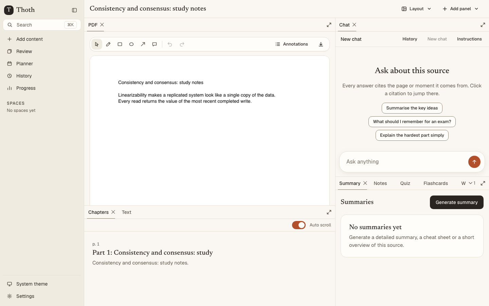
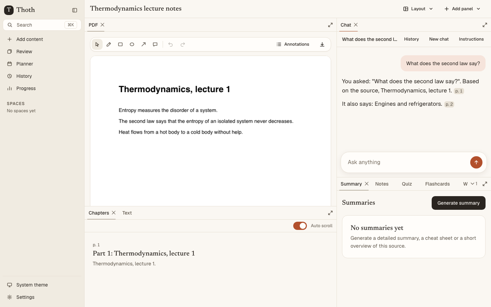
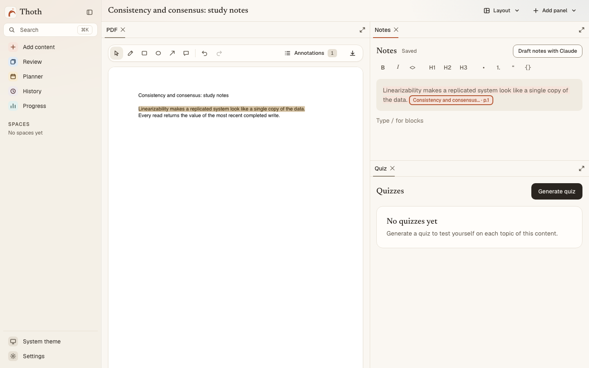
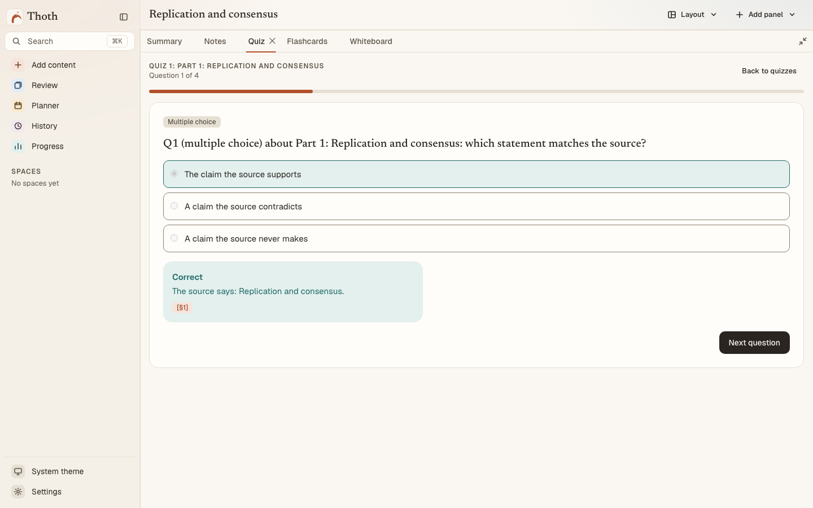
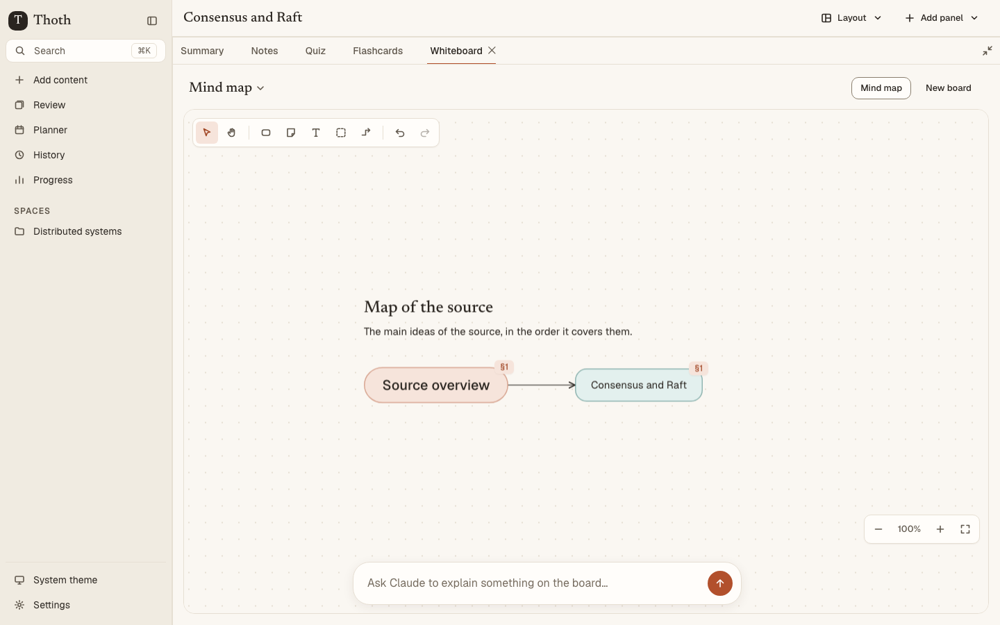
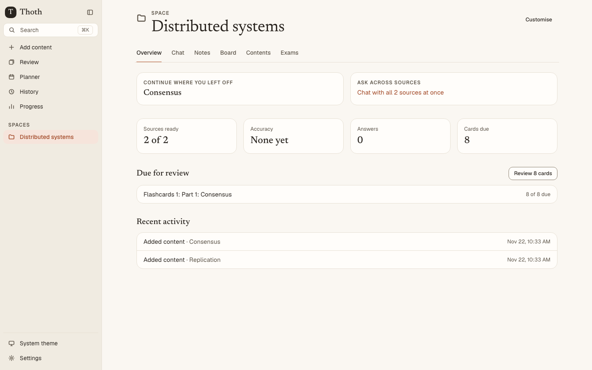
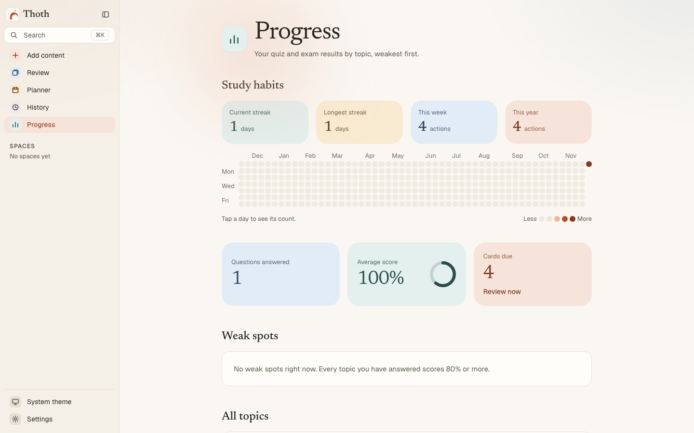

<div align="center">


# Thoth

**Learn anything from your own sources.**

Turn PDFs, lectures, YouTube videos and web pages into chat with citations, notes, quizzes, flashcards and exams.<br>
On your computer, with the AI model you choose.

[](https://github.com/huannguyen2114/thoth/releases/latest)
[](https://github.com/huannguyen2114/thoth/actions/workflows/ci.yml)
[](https://github.com/huannguyen2114/thoth/releases)
[](LICENSE)
[](https://github.com/huannguyen2114/thoth/stargazers)
<br>


[**Website**](https://thoth-5j7.pages.dev) · [**Download**](https://github.com/huannguyen2114/thoth/releases/latest) · [**Docs**](docs/README.md) · [**Changelog**](https://thoth-5j7.pages.dev/changelog/)

</div>

<picture>
  <source srcset="apps/site/public/shots/workspace-dark.png" media="(prefers-color-scheme: dark)">
  
</picture>

## Why Thoth

Hosted study apps keep your material on their servers, cap your uploads and pick the model for you. Thoth is the same idea as a desktop app you own:

- **Your files stay yours.** No account and no telemetry. Everything lives in one folder on your computer.
- **Your model.** Use your Claude subscription, an Anthropic API key, or any OpenAI-compatible provider. That includes a free local model through Ollama or LM Studio. Pick a different one per task.
- **Every answer shows its source.** Citations point at the page, the second or the paragraph, and a click takes you there.

## Features

<table>
  <tr>
    <td width="50%" valign="top">
      
      <h3>Chat with citations</h3>
      Ask about a lecture or a book. Answers cite the timestamp or page, and the source jumps there when you click.
    </td>
    <td width="50%" valign="top">
      
      <h3>Notes that link back</h3>
      Select a passage and send it to your notes as a quote that opens the source at that spot. Or let the model draft notes for you.
    </td>
  </tr>
  <tr>
    <td width="50%" valign="top">
      
      <h3>Quizzes, flashcards and exams</h3>
      Five question types with graded feedback, flashcards scheduled with FSRS, and timed exams across a whole course.
    </td>
    <td width="50%" valign="top">
      
      <h3>Whiteboard and mind maps</h3>
      A mind map of any source on a canvas you can edit. Every node keeps a link back to where it came from.
    </td>
  </tr>
  <tr>
    <td width="50%" valign="top">
      
      <h3>Spaces</h3>
      Group a course's sources. Chat across all of them, see what is due, and keep notes and boards for the course.
    </td>
    <td width="50%" valign="top">
      
      <h3>Progress, habits and a planner</h3>
      Scores by topic with your weak spots first, a study heatmap, and a plan that adapts to how you do.
    </td>
  </tr>
</table>

Also included:

- PDF annotation (highlight, comment, draw), with export of an annotated copy.
- Hybrid search (keywords and local embeddings) from <kbd>⌘</kbd> <kbd>K</kbd>.
- Anki export.
- Your phone as a second screen over Wi-Fi, behind a passcode.

## Install

| System                | Download                                                                                                                                                                                                                          |
| --------------------- | --------------------------------------------------------------------------------------------------------------------------------------------------------------------------------------------------------------------------------- |
| macOS (Apple Silicon) | [`Thoth-macOS-arm64.dmg`](https://github.com/huannguyen2114/thoth/releases/latest/download/Thoth-macOS-arm64.dmg)                                                                                                                 |
| macOS (Intel)         | [`Thoth-macOS-x64.dmg`](https://github.com/huannguyen2114/thoth/releases/latest/download/Thoth-macOS-x64.dmg)                                                                                                                     |
| Windows               | [`Thoth-Windows-x64-setup.exe`](https://github.com/huannguyen2114/thoth/releases/latest/download/Thoth-Windows-x64-setup.exe) or [`.msi`](https://github.com/huannguyen2114/thoth/releases/latest/download/Thoth-Windows-x64.msi) |
| Linux                 | [`Thoth-Linux-x86_64.AppImage`](https://github.com/huannguyen2114/thoth/releases/latest/download/Thoth-Linux-x86_64.AppImage) or [`.deb`](https://github.com/huannguyen2114/thoth/releases/latest/download/Thoth-Linux-amd64.deb) |

### Homebrew (macOS)

```bash
brew tap huannguyen2114/thoth https://github.com/huannguyen2114/thoth
brew install --cask thoth
```

### Updates

The app checks for a new version when it starts, and from **Check for Updates…** in the menu. Each update is signed and installs with one click. With Homebrew, `brew upgrade --greedy` works too.

> [!NOTE]
> The installers are not code-signed yet. On macOS, right-click the app and choose **Open** the first time (Homebrew does this for you). On Windows, choose **More info**, then **Run anyway**.

### Choose a model

| Model                                | How                                                                    |
| ------------------------------------ | ---------------------------------------------------------------------- |
| Your Claude subscription             | Install [Claude Code](https://claude.com/claude-code) and sign in once |
| Anthropic API                        | Paste a key in Settings; it is kept in your system keychain            |
| OpenAI, OpenRouter or any compatible | Add a provider in Settings with its base URL and key                   |
| Ollama or LM Studio (local, free)    | Start it, then add it in Settings; nothing leaves your computer        |

## Build from source

You need Node 22 or newer and pnpm 12. The desktop app also needs the Rust toolchain.

```bash
pnpm install
pnpm dev             # the web app at http://127.0.0.1:3000
pnpm check           # lint, typecheck and unit tests
pnpm test:e2e        # browser tests against a scripted model
pnpm desktop:build   # the desktop app for this machine
pnpm site:dev        # the landing page
```

<details>
<summary><b>Under the hood</b></summary>

| Part      | Built with                                                                     |
| --------- | ------------------------------------------------------------------------------ |
| App       | Next.js 16, React 19, TypeScript, Tailwind CSS 4 with the Hearth design system |
| Core      | Pure TypeScript use cases, Zod, ts-fsrs (`@thoth/core`)                        |
| Data      | libSQL (SQLite) with vector search, Drizzle                                    |
| Retrieval | FTS5 plus local embeddings (Transformers.js, multilingual-e5-small)            |
| Desktop   | Tauri 2 with a bundled Node server                                             |
| Tests     | Vitest, Playwright against a scripted model                                    |

Start with the [architecture](docs/technical_design/01-architecture.md) and the [decision records](docs/decision/README.md).

</details>

## Docs

- [Where everything is](docs/README.md)
- [Architecture](docs/technical_design/01-architecture.md)
- [Decisions (ADRs)](docs/decision/README.md)
- [Roadmap](docs/plan/roadmap.md)
- [Hearth design system](design/hearth/README.md)
- [Guide for coding agents](CLAUDE.md)

## Contributing

Issues and pull requests are welcome. Before a pull request, run `pnpm check` and `pnpm test:e2e`, and read the [decision records](docs/decision/README.md): they are binding. A user-visible change also updates the landing page (`pnpm site:check` tells you what is stale).

If Thoth helps you study, a star helps others find it.

## Star history

<a href="https://star-history.com/#huannguyen2114/thoth&Date">
  <picture>
    <source media="(prefers-color-scheme: dark)" srcset="https://api.star-history.com/svg?repos=huannguyen2114/thoth&type=Date&theme=dark">
    
  </picture>
</a>

## License

Thoth is free software under the [GNU Affero General Public License v3.0](LICENSE). You may use, study, change and share it. If you offer a modified version to others over a network, you must share your changes under the same license.

Thoth is an independent project. The example lecture on the website is Martin Kleppmann's, played from YouTube; Thoth is not affiliated with him.
