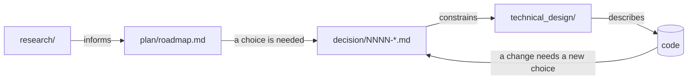

# Thoth documentation

These docs are written for both people and AI agents.

**If you are new to the repo, read the docs in this order:**

1. The technical design.
2. The decisions.
3. The code.

## Map

| Folder                                            | What it holds                                                      | Who edits it                     | Rule                                                                         |
| ------------------------------------------------- | ------------------------------------------------------------------ | -------------------------------- | ---------------------------------------------------------------------------- |
| [`decision/`](decision/README.md)                 | Architecture Decision Records (ADRs): **why** we chose something   | Anyone, through a new file       | **Append-only.** Never rewrite an accepted ADR. Supersede it with a new one. |
| [`technical_design/`](technical_design/README.md) | **How** the system works today: architecture, modules, data, flows | Anyone                           | Keep it current. Update it in the same PR as the code change.                |
| [`plan/`](plan/roadmap.md)                        | **What** we build next, phase by phase                             | Anyone                           | Tick off phases. Re-plan freely.                                             |
| [`research/`](research/youlearn.md)               | Background: the YouLearn teardown, with screenshots                | Rarely                           | Reference only                                                               |
| [`../design/hearth/`](../design/hearth/README.md) | The Hearth design system (tokens, component guidelines)            | Re-sync from the Hearth artifact | Treat it as vendored. Do not hand-edit it.                                   |

## How the documents relate

## Writing style

- **Standard engineering English.** Use short sentences and active voice. Use the present tense for how things work and the future tense only in the plan.
- **One topic per file.** Name files with a number prefix so they sort, for example `02-llm-providers.md`.
- **Diagrams in Mermaid,** inside fenced `mermaid` blocks. GitHub renders them, and agents can read them as text.
- **Link to code by repo path,** for example `packages/core/src/ports/llm.ts`. Do not paste large code blocks. They drift out of date.
- **Name the token,** not the value. Write `surface-200`, not `#fffdfa`.
- **Every design doc starts with a status line:** `Status: Current | Draft | Planned (Phase N)`.
