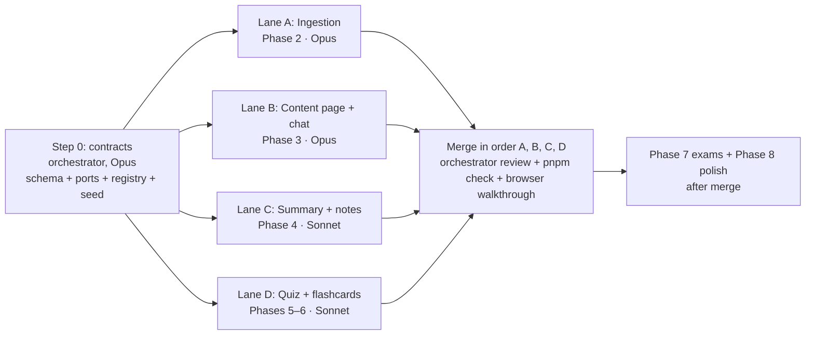

# Parallel development plan (Phases 2–6)

Status: **Done** (2026-11-15). Step 0 and lanes A–D merged; ADRs 0014–0017 record the lane decisions. Reuse this pattern for later phases.

## Why a "contracts first" step

Phases 2–6 all touch three shared places:

- **the database schema and migrations**, where two parallel migrations would get the same number and clash;
- **`apps/web/src/server/container.ts`**;
- **the content page's Learn panel**, which every learning tool plugs into.

If parallel sessions edit these at the same time, the merges are painful and quality drops.

The sweet spot has two parts:

1. **Step 0 (one session, here):** freeze the shared **contracts**.
   - The domain types and ports for every MVP feature.
   - **One migration** with every MVP table.
   - A Learn-panel tool registry.
   - Seed content, so no lane waits for real ingestion.
   - Each lane's entry point is stubbed.
2. **Lanes 1–4 (in parallel, one worktree session each):** each lane owns **its own folders** and only _fills in_ the contracts. Overlap is limited to one-line registrations.

## Lanes

Step 0 already built **every repository** in `packages/db`, every port in `packages/core/src/ports`, the container slots and the Learn-panel registry. Lanes add **use cases, prompts, adapters (ingest) and UI**. They do not change schema, ports or repositories.

| Lane                       | Phase | Model      | Owns (create and edit freely)                                                                                                                                                                     | Shared files: do not edit                                                                 |
| -------------------------- | ----- | ---------- | ------------------------------------------------------------------------------------------------------------------------------------------------------------------------------------------------- | ----------------------------------------------------------------------------------------- |
| **A: Ingestion**           | 2     | Opus 5.5   | `packages/ingest/**` (new package), `packages/core/src/usecases/ingest/**`, `apps/web/src/features/library/**`, `apps/web/src/server/jobs/**`, `apps/web/src/app/page.tsx` (home)                 | ports, schema, migrations, repositories, `container.ts` (ask the orchestrator for a slot) |
| **B: Content page + chat** | 3     | Opus 5.5   | `apps/web/src/app/content/**`, `apps/web/src/features/{content-viewer,learn-panel,chat}/**` (except `learn-panel/types.ts`), `packages/core/src/usecases/chat/**`, `apps/web/src/app/api/chat/**` | `learn-panel/types.ts`, ports, schema, repositories, `container.ts`                       |
| **C: Summary + notes**     | 4     | Sonnet 5.5 | `apps/web/src/features/{summary,notes}/**`, `packages/core/src/usecases/{summary,notes}/**`                                                                                                       | everything else                                                                           |
| **D: Quiz + flashcards**   | 5–6   | Sonnet 5.5 | `apps/web/src/features/{quiz,flashcards}/**`, `packages/core/src/usecases/{quiz,flashcards}/**`, `ts-fsrs` in `packages/core/package.json`                                                        | everything else                                                                           |

**Shared helpers.** A lane that needs a helper another lane might also want (for example, reading segments in a time or page range) writes it inside its **own** use-case folder. The orchestrator promotes it to a shared module at merge.

**Seed data.** `pnpm --filter @thoth/db seed` creates `sample-lecture` (YouTube, time locators) and `sample-pdf` (6 pages). The dev harness `/dev/tools/sample-pdf` renders every Learn tool on its own.

**Allowed shared edits (resolved by the orchestrator at merge):**

- one `export * from "...";` line per new module in `packages/core/src/index.ts`;
- dependency lines in a `package.json` you own, plus the resulting `pnpm-lock.yaml` change. The orchestrator re-runs `pnpm install` at merge instead of hand-merging the lockfile.

**Design docs, one file per lane, so lanes never edit the same doc:**

| Lane | Doc                                                     |
| ---- | ------------------------------------------------------- |
| A    | `docs/technical_design/03-ingestion.md`                 |
| B    | new `docs/technical_design/07-content-page-and-chat.md` |
| C    | new `docs/technical_design/08-summary-and-notes.md`     |
| D    | new `docs/technical_design/09-quiz-and-flashcards.md`   |

The orchestrator updates `technical_design/README.md` and the roadmap.

## Rules for every lane session (quality gates)

1. **Read before coding.** Read `CLAUDE.md`, then `docs/technical_design/01`, `02`, `04` and `05`, then this file.
2. **Stay in your folders.** Do not edit another lane's folders, the schema, migrations, or ports. If a contract is wrong, **stop and message the orchestrator**. Do not patch it locally.
3. **Follow the existing patterns:**
   - core use case + test;
   - repository + `:memory:` test;
   - a thin Server Action or SSE route;
   - Hearth tokens only.
4. **Prompts live next to the use case.** Every `generateObject` schema has a good-reply test and a bad-reply test.
5. **Before you report done:**
   - `pnpm check` and `pnpm build` are green;
   - one live smoke run on `claude-sonnet-5-5` through the subscription (cheap);
   - a browser walkthrough of the lane's "done when";
   - the matching `docs/technical_design/*.md` is updated.
6. **Commit to the lane branch** with Conventional Commits. Do not push to `main`. The orchestrator reviews, merges and pushes.
7. **Decisions.** A new hard-to-reverse choice gets an ADR draft named `docs/decision/NNNN-draft-<lane>.md`. The orchestrator assigns the final number at merge, so numbers never clash.

## Step 0 deliverables (contracts)

- **Core domain + ports:**
  - `Segment`, `Chapter`, `Chat`, `Message` (with `Citation[]`), `StudySet`, `QuizQuestion`, `QuizAttempt`, `Flashcard` (with FSRS fields), `Review`, `Note`, `Job`;
  - repository ports for each;
  - `Citation` parsing helpers (`[p.12]`, `[03:21]`).
- **DB:** all MVP tables in **one migration** (`0001_mvp_contracts.sql`), plus FTS5 `chunks_fts`.
- **Seed:** `pnpm --filter @thoth/db seed` inserts two ready-made contents:
  - a YouTube lecture with a timestamped transcript and chapters;
  - a 6-page "PDF" with page segments.
    Lanes B, C and D develop against these before Lane A lands.
- **Learn panel contract:**
  - `features/learn-panel/registry.ts` defines `LearnTool { id, label, icon, Panel, GenerateDialog? }`, with stub entries for summary, notes, quiz and flashcards;
  - a dev harness route `/dev/tools/[contentId]` renders any tool panel on its own, so C and D can test before B ships the real panel.
- **Container:** a typed slot for each repository, so each lane adds one line.

## Merge order and review

The order is **A, then B, then C, then D**. The orchestrator handles each branch:

1. Rebase it on `main`.
2. Run `pnpm check && pnpm build`.
3. Review the diff against these rules and the ADRs.
4. Do a browser walkthrough.
5. Merge with `--no-ff`, then push.

A lane whose branch conflicts outside its owned folders is sent back to its session to fix.

---

# Phase 8 lanes (2026-11-16)

Status: **Done** (2026-11-16): merged with ADRs 0024–0027. Step 0 was: the app frame, sidebar, palette and shortcut registry, theme, the activity log (ADR-0023) with `NoteRepository.list` and `ActivityRepository.listRecent`, ADRs 0020–0023 and doc 11. The same rules as above apply (quality gates, ADR drafts named `NNNN-draft-<lane>.md`, commit to your branch only, no push or merge).

**Everyone reads `docs/technical_design/11-app-shell-and-feel.md` first.** The native feel is part of every lane's "done".

| Lane                                          | Model  | Owns (create and edit freely)                                                                                                                                                                                     | Shared files: one-line edits only                                                                                                                                                   |
| --------------------------------------------- | ------ | ----------------------------------------------------------------------------------------------------------------------------------------------------------------------------------------------------------------- | ----------------------------------------------------------------------------------------------------------------------------------------------------------------------------------- |
| **1: Dockable workspace** (ADR-0021)          | Opus   | `apps/web/src/app/content/**`, `apps/web/src/features/{workspace,content-viewer,chat}/**`, `features/learn-panel/**` except `types.ts`; doc `07`                                                                  | `apps/web/package.json` (dockview)                                                                                                                                                  |
| **2: Notes editor** (ADR-0022)                | Opus   | `apps/web/src/features/notes/**`, `packages/core/src/usecases/notes/**`; new doc `12-notes-editor.md`                                                                                                             | `apps/web/package.json` (Tiptap)                                                                                                                                                    |
| **3: Habit tracker, History, Search, Export** | Sonnet | `packages/core/src/usecases/{insights,search,export}/**`; `apps/web/src/features/{habits,history,search,export}/**`; `app/history/**`; `app/api/{search,export}/**`; new doc `13-habits-history-search-export.md` | one section each in `app/page.tsx` (home heatmap) and `app/progress/page.tsx`; one `<SearchProvider>` mount in `app/_components/app-shell.tsx`; one History `Item` in `sidebar.tsx` |
| **4: Phone, LAN and passcode**                | Sonnet | `apps/web/src/proxy.ts`, `app/unlock/**`, `features/access/**`, `public/sw.js`, `app/manifest.ts`; new doc `14-phone-and-lan.md`                                                                                  | root `package.json` (one `start:lan` script), `.env.example`, phone-only rules at the end of `app/shell.css` (in a block marked `/* Lane 4 */`)                                     |

The merge order is 1, 2, 3, 4. The Notes panel in the workspace is the existing `notesTool` from the Learn registry, so Lanes 1 and 2 meet only through `LearnToolProps` (`contentId`, `onCite`).

---

# Phase 9 lanes (2026-11-18)

Status: **Done** (2026-11-19): merged in the order 2, 4, 3, 1, with ADRs 0032–0035. Step 0 was:

- ADRs 0028–0031.
- Core contracts: `EmbeddingProvider` and `VectorRepository` (`ports/embeddings.ts`); plan domain and `PlanRepository`; the whiteboard element and operation model and `WhiteboardRepository`; the `embed` job kind; activity kinds `plan_item_done` and `whiteboard_edit`.
- DB: migrations `0006` (plans, plan items, whiteboards) and `0007` (`segment_vectors` with a libSQL vector index), with the repositories tested.
- Web: container slots `plans`, `whiteboards` and `vectors`, plus an optional `embeddings`; `THOTH_LLM=scripted` uses `ScriptedLlmProvider` (a stub); a Whiteboard Learn tool stub that is already a dock panel.

Same rules as before. Read `docs/technical_design/11-app-shell-and-feel.md` first.

| Lane                                            | Model  | Owns                                                                                                                                                                      | Shared files: one-line edits only                                                                                                                                                                                                                               |
| ----------------------------------------------- | ------ | ------------------------------------------------------------------------------------------------------------------------------------------------------------------------- | --------------------------------------------------------------------------------------------------------------------------------------------------------------------------------------------------------------------------------------------------------------- |
| **1: Browser tests + CI** (ADR-0028)            | Sonnet | `apps/web/e2e/**`, `apps/web/playwright.config.ts`, `packages/llm/src/scripted-provider.ts` (+ tests), `.github/workflows/ci.yml` (new `e2e` job); doc `15-e2e-tests.md`  | `apps/web/package.json` (Playwright dev dependency, `test:e2e` script); root `package.json` (one script)                                                                                                                                                        |
| **2: Embeddings + hybrid retrieval** (ADR-0029) | Opus   | new `packages/embeddings/**`; `packages/core/src/usecases/retrieval/**`; `apps/web/src/server/jobs/**` (the embed job and backfill); doc `16-embeddings-and-retrieval.md` | `container.ts` (the `embeddings` slot); `next.config.ts` (`serverExternalPackages`); one call into retrieval from `usecases/chat/context.ts`, `usecases/exams/sampling.ts` and `usecases/search/**` each; `usecases/ingest/run-ingest-job.ts` (enqueue `embed`) |
| **3: Study planner** (ADR-0030)                 | Sonnet | `packages/core/src/usecases/planner/**`; `apps/web/src/features/planner/**`; `apps/web/src/app/planner/**`; doc `17-study-planner.md`                                     | one section in `app/page.tsx` (Today); one `Item` in `sidebar.tsx`                                                                                                                                                                                              |
| **4: Whiteboard + mind maps** (ADR-0031)        | Opus   | `packages/core/src/usecases/whiteboard/**`; `apps/web/src/features/whiteboard/**`; doc `18-whiteboard.md`                                                                 | none                                                                                                                                                                                                                                                            |

Lane 1 tests the other lanes' features after merge. Until then it covers everything already on `main`, and adds skipped (`test.fixme`) journeys for the planner and the whiteboard, which the orchestrator enables at merge.

The merge order is 2, 4, 3, 1: tests last, so they run against everything.

---

# Phase 10 lanes (2026-11-21)

Status: **Done** (2026-11-21): merged in the order 2, 3, 4, 1, with ADRs 0040–0043. Space chat chips use Lane 3's link opener. Step 0 was:

- **ADRs 0036–0039.**
- **Core:**
  - links and anchors (`domain/link.ts`), annotations, tags, LLM settings v2 (`domain/llm-profiles.ts`);
  - the `SecretStore` port;
  - `AnnotationRepository`, `LinkRepository` and `TagRepository`;
  - owner-aware `NoteRepository` and `ChatRepository`, and `SpaceRepository.update`;
  - `saveNote` writes the backlink index.
- **DB:**
  - migration `0008` (annotations, links, tags, content_tags, notes and chats owned by a content or a space, space colour and icon), with every repository tested and a test that migrates a 0007 database;
  - `migrateDb` runs with foreign keys off.
- **Web:**
  - container slots `annotations`, `links` and `tags`;
  - `NotesEditor` with `ownerKey`;
  - `THOTH_MIGRATIONS_DIR` and the `THOTH_STANDALONE` build switch.
- **Doc stubs** 19–22.

Same rules as before. Read `docs/technical_design/11-app-shell-and-feel.md` and your lane's ADR first. Run `pnpm test:e2e` as well as `pnpm check` before you report done.

| Lane                                            | Model | Owns                                                                                                                                                                                                                                                                                                                                                                                                                                       | Shared files: one-line edits only                                                                                                                                                   |
| ----------------------------------------------- | ----- | ------------------------------------------------------------------------------------------------------------------------------------------------------------------------------------------------------------------------------------------------------------------------------------------------------------------------------------------------------------------------------------------------------------------------------------------ | ----------------------------------------------------------------------------------------------------------------------------------------------------------------------------------- |
| **1: Desktop app** (ADR-0036)                   | Opus  | new `apps/desktop/**`; new `.github/workflows/desktop.yml`; a `GET /api/health` route (`apps/web/src/app/api/health/**`); doc `19-desktop-app.md`                                                                                                                                                                                                                                                                                          | root `package.json` (desktop scripts); `pnpm-workspace.yaml`; `apps/web/next.config.ts` (standalone tracing options only)                                                           |
| **2: OpenAI-compatible providers** (ADR-0037)   | Opus  | `packages/llm/**` (except `scripted-provider.ts`); `packages/core/src/domain/llm-{settings,profiles}.ts`; `packages/core/src/usecases/llm-settings*`; `packages/db/src/repositories/settings-repository*`; `apps/web/src/features/settings/**`; new `apps/web/src/server/secrets.ts`; doc `20-…` and doc `02`                                                                                                                              | `container.ts` (the `llm` and `secrets` wiring only); `apps/web/package.json` (`@napi-rs/keyring`); `apps/web/src/server/env.ts` (key env vars)                                     |
| **3: Annotations, links, backlinks** (ADR-0038) | Opus  | `apps/web/src/features/content-viewer/**`; `apps/web/src/features/notes/editor/**`; new `apps/web/src/features/annotations/**`; new `packages/core/src/usecases/annotations/**`; `apps/web/src/app/api/content/[id]/annotated.pdf/**`; the "From highlights" path in `packages/core/src/usecases/flashcards/**`; doc `21-…`, docs `07` and `12`                                                                                            | `features/notes/tool.tsx` (the "Add to notes" hook and backlink scroll); `features/summary/**` (a selection toolbar mount); `apps/web/package.json` (`pdf-lib`, `perfect-freehand`) |
| **4: Spaces v2** (ADR-0039)                     | Opus  | `apps/web/src/features/spaces/**`; `apps/web/src/app/spaces/**`; new `packages/core/src/usecases/spaces/**` (move the existing `spaces.ts` in); space chat in `packages/core/src/usecases/chat/space-chat*` and `apps/web/src/features/chat/space-*`; `features/library/**` (bulk add, tag filters); `packages/ingest` (YouTube playlist listing); the space-chat case in `packages/llm/src/scripted-provider.ts`; doc `22-…` and doc `10` | `sidebar.tsx` (space colour and icon); `features/whiteboard/tool.tsx` (an owner prop); `usecases/search/**` (space notes); `commands.tsx` ("Move to…")                              |

**How the lanes meet:**

- **The link format.** Both L3 and L4 produce and render `thoth:` links. L3 builds the `ThothLink` chip node and the `[[` / `@` picker in `features/notes/editor/**` and exports them. Until L3 lands, L4 renders links in space chat with its own small chip that calls `parseLink`. The orchestrator swaps that chip for L3's at merge.
- **`saveNote`** already writes the backlink index, so space notes (L4) and content notes (L3) both show up in backlinks with no extra work.
- **Space chat answers** are stored with `[label](thoth:c/<id>?at=…)` links (ADR-0039), and their links go into the index as `chat_message` rows.

The merge order is 2, 3, 4, then 1: L2 changes `container.llm`, which everyone calls; L4 builds on L3's link chip; L1 packages everything.
