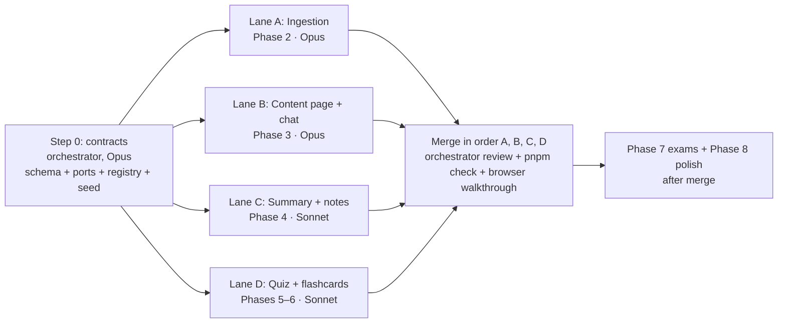

# Parallel development plan (Phases 2–6)

Status: **Active** (2026-11-15). Step 0 done; lanes A–D running in worktree sessions.

## Why a "contracts first" step

Phases 2–6 all touch three shared places:

- **the database schema and migrations**, where two parallel migrations would get the same number and clash;
- **`apps/web/src/server/container.ts`**;
- **the content page's Learn panel**, which every learning tool plugs into.

If parallel sessions edit these at the same time, the merges are painful and quality drops.

The sweet spot has two parts:

1. **Step 0 (one session, here):** freeze the shared **contracts**.
   - The domain types and ports for every MVP feature.
   - **One migration** with every MVP table.
   - A Learn-panel tool registry.
   - Seed content, so no lane waits for real ingestion.
   - Each lane's entry point is stubbed.
2. **Lanes 1–4 (in parallel, one worktree session each):** each lane owns **its own folders** and only _fills in_ the contracts. Overlap is limited to one-line registrations.

## Lanes

Step 0 already built **every repository** in `packages/db`, every port in `packages/core/src/ports`, the container slots and the Learn-panel registry. Lanes add **use cases, prompts, adapters (ingest) and UI**. They do not change schema, ports or repositories.

| Lane                       | Phase | Model      | Owns (create and edit freely)                                                                                                                                                                     | Shared files: do not edit                                                                 |
| -------------------------- | ----- | ---------- | ------------------------------------------------------------------------------------------------------------------------------------------------------------------------------------------------- | ----------------------------------------------------------------------------------------- |
| **A: Ingestion**           | 2     | Opus 5.5   | `packages/ingest/**` (new package), `packages/core/src/usecases/ingest/**`, `apps/web/src/features/library/**`, `apps/web/src/server/jobs/**`, `apps/web/src/app/page.tsx` (home)                 | ports, schema, migrations, repositories, `container.ts` (ask the orchestrator for a slot) |
| **B: Content page + chat** | 3     | Opus 5.5   | `apps/web/src/app/content/**`, `apps/web/src/features/{content-viewer,learn-panel,chat}/**` (except `learn-panel/types.ts`), `packages/core/src/usecases/chat/**`, `apps/web/src/app/api/chat/**` | `learn-panel/types.ts`, ports, schema, repositories, `container.ts`                       |
| **C: Summary + notes**     | 4     | Sonnet 5.5 | `apps/web/src/features/{summary,notes}/**`, `packages/core/src/usecases/{summary,notes}/**`                                                                                                       | everything else                                                                           |
| **D: Quiz + flashcards**   | 5–6   | Sonnet 5.5 | `apps/web/src/features/{quiz,flashcards}/**`, `packages/core/src/usecases/{quiz,flashcards}/**`, `ts-fsrs` in `packages/core/package.json`                                                        | everything else                                                                           |

**Shared helpers.** A lane that needs a helper another lane might also want (for example, reading segments in a time or page range) writes it inside its **own** use-case folder. The orchestrator promotes it to a shared module at merge.

**Seed data.** `pnpm --filter @thoth/db seed` creates `sample-lecture` (YouTube, time locators) and `sample-pdf` (6 pages). The dev harness `/dev/tools/sample-pdf` renders every Learn tool on its own.

**Allowed shared edits (resolved by the orchestrator at merge):**

- one `export * from "...";` line per new module in `packages/core/src/index.ts`;
- dependency lines in a `package.json` you own, plus the resulting `pnpm-lock.yaml` change. The orchestrator re-runs `pnpm install` at merge instead of hand-merging the lockfile.

**Design docs, one file per lane, so lanes never edit the same doc:**

| Lane | Doc                                                     |
| ---- | ------------------------------------------------------- |
| A    | `docs/technical_design/03-ingestion.md`                 |
| B    | new `docs/technical_design/07-content-page-and-chat.md` |
| C    | new `docs/technical_design/08-summary-and-notes.md`     |
| D    | new `docs/technical_design/09-quiz-and-flashcards.md`   |

The orchestrator updates `technical_design/README.md` and the roadmap.

## Rules for every lane session (quality gates)

1. **Read before coding.** Read `CLAUDE.md`, then `docs/technical_design/01`, `02`, `04` and `05`, then this file.
2. **Stay in your folders.** Do not edit another lane's folders, the schema, migrations, or ports. If a contract is wrong, **stop and message the orchestrator**. Do not patch it locally.
3. **Follow the existing patterns:**
   - core use case + test;
   - repository + `:memory:` test;
   - a thin Server Action or SSE route;
   - Hearth tokens only.
4. **Prompts live next to the use case.** Every `generateObject` schema has a good-reply test and a bad-reply test.
5. **Before you report done:**
   - `pnpm check` and `pnpm build` are green;
   - one live smoke run on `claude-sonnet-5-5` through the subscription (cheap);
   - a browser walkthrough of the lane's "done when";
   - the matching `docs/technical_design/*.md` is updated.
6. **Commit to the lane branch** with Conventional Commits. Do not push to `main`. The orchestrator reviews, merges and pushes.
7. **Decisions.** A new hard-to-reverse choice gets an ADR draft named `docs/decision/NNNN-draft-<lane>.md`. The orchestrator assigns the final number at merge, so numbers never clash.

## Step 0 deliverables (contracts)

- **Core domain + ports:**
  - `Segment`, `Chapter`, `Chat`, `Message` (with `Citation[]`), `StudySet`, `QuizQuestion`, `QuizAttempt`, `Flashcard` (with FSRS fields), `Review`, `Note`, `Job`;
  - repository ports for each;
  - `Citation` parsing helpers (`[p.12]`, `[03:21]`).
- **DB:** all MVP tables in **one migration** (`0001_mvp_contracts.sql`), plus FTS5 `chunks_fts`.
- **Seed:** `pnpm --filter @thoth/db seed` inserts two ready-made contents:
  - a YouTube lecture with a timestamped transcript and chapters;
  - a 6-page "PDF" with page segments.
    Lanes B, C and D develop against these before Lane A lands.
- **Learn panel contract:**
  - `features/learn-panel/registry.ts` defines `LearnTool { id, label, icon, Panel, GenerateDialog? }`, with stub entries for summary, notes, quiz and flashcards;
  - a dev harness route `/dev/tools/[contentId]` renders any tool panel on its own, so C and D can test before B ships the real panel.
- **Container:** a typed slot for each repository, so each lane adds one line.

## Merge order and review

The order is **A, then B, then C, then D**. The orchestrator handles each branch:

1. Rebase it on `main`.
2. Run `pnpm check && pnpm build`.
3. Review the diff against these rules and the ADRs.
4. Do a browser walkthrough.
5. Merge with `--no-ff`, then push.

A lane whose branch conflicts outside its owned folders is sent back to its session to fix.
