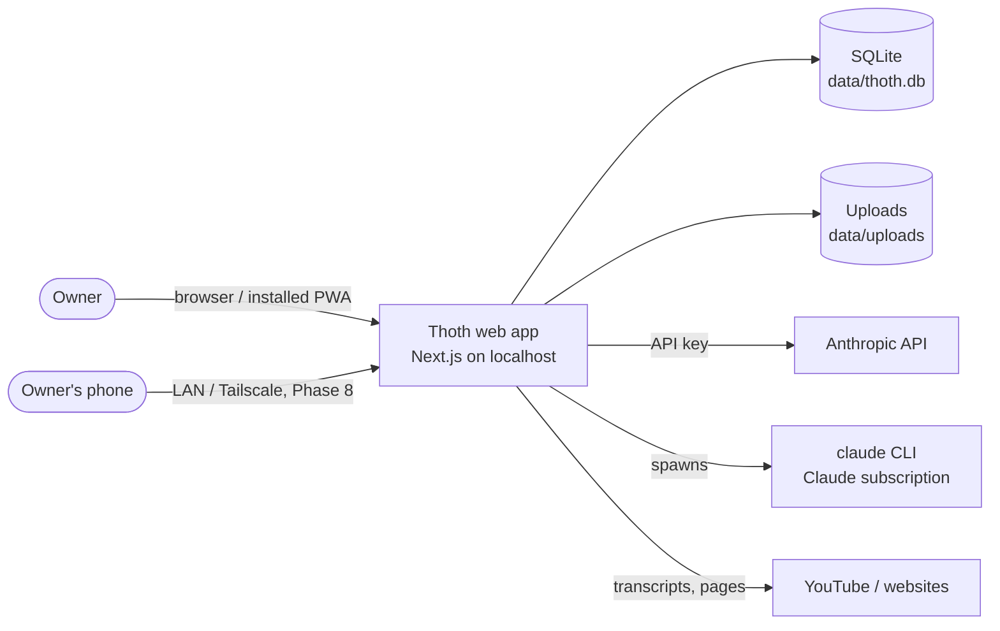
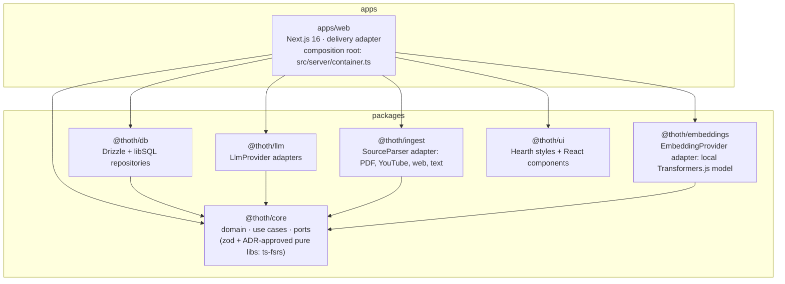
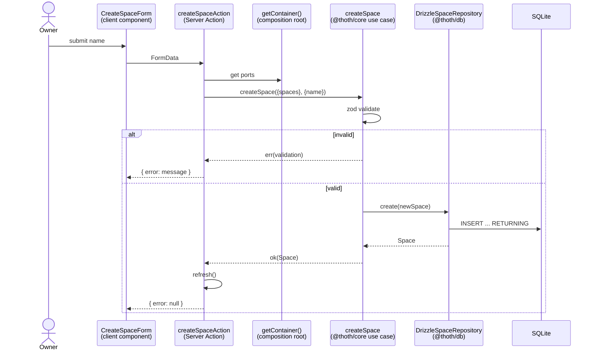

# 01. Architecture

Status: Current (Phases 0–6)

## System context

Thoth is a single-user, local-first study app (ADR-0002). It runs on the owner's Mac. The owner reaches it from a desktop browser, or from a phone over LAN or Tailscale.



## Packages and dependency rules

We use hexagonal architecture (ADR-0004) in a pnpm + Turborepo monorepo (ADR-0003). **Arrows are the only allowed imports.**



| Package                                     | Owns                                                                                          | Must not                                                      |
| ------------------------------------------- | --------------------------------------------------------------------------------------------- | ------------------------------------------------------------- |
| `@thoth/core` (`packages/core`)             | Entities (`domain/`), use cases (`usecases/`), ports (`ports/`), `Result` and IDs (`shared/`) | Import React, Next, Drizzle, SDKs, or `node:` modules         |
| `@thoth/db` (`packages/db`)                 | Schema, migrations (`drizzle/`), repository adapters                                          | Contain business rules. It maps rows to domain types and back |
| `@thoth/llm` (`packages/llm`)               | Provider adapters, prompt plumbing, JSON repair and retry                                     | Know about UI or the DB                                       |
| `@thoth/ingest` (`packages/ingest`)         | Source parsers behind the `SourceParser` port (ADR-0014)                                      | Write to the DB or call the LLM. Use cases do that            |
| `@thoth/embeddings` (`packages/embeddings`) | The local embedding model behind the `EmbeddingProvider` port (ADR-0029)                      | Touch the DB. The indexer use case in core does that          |
| `@thoth/ui` (`packages/ui`)                 | Generated Hearth CSS, typed components such as `Button`                                       | Fetch data or call server code                                |
| `apps/web`                                  | Routes, feature UIs, Server Actions, route handlers, wiring                                   | Put business rules in actions or components                   |

## Request flow (write path)

The "create space" flow is the reference for every feature:



**Read path.** `SpacesList` is an async Server Component inside `<Suspense>`. It calls `await connection()`, then `listSpaces(await getContainer())` (ADR-0011).

## Composition root

`apps/web/src/server/container.ts` is the **only** place that constructs adapters:

- It builds the libSQL client from `THOTH_DATA_DIR`.
- It runs migrations once per process.
- It returns ports.

Tests build their own containers with fakes or `:memory:` databases.

## Repository layout

```text
thoth/
├─ apps/web/                 Next.js app (routing in src/app, features in src/features, wiring in src/server)
├─ packages/
│  ├─ core/                  Domain, use cases, ports. Pure TypeScript.
│  ├─ db/                    Drizzle schema, migrations, repositories
│  ├─ llm/                   LLM provider adapters
│  ├─ ingest/                Source parsers (PDF, YouTube, web, text)
│  ├─ ui/                    Hearth CSS (generated) and React components
│  └─ tsconfig/              Shared tsconfig presets
├─ design/hearth/            Vendored Hearth design system (read-only)
├─ docs/                     decision/ (ADRs), technical_design/, plan/, research/ (local only, git-ignored)
├─ tools/                    Repo scripts (ADR append-only check)
├─ data/                     Runtime data, git-ignored (SQLite, uploads)
└─ CLAUDE.md                 Entry point for AI agents
```

## Where each phase lives

Phases 2–6 were built in parallel lanes on frozen contracts (`docs/plan/parallel-development.md`) and landed without restructuring.

| Phase                                   | Where it lives                                                                                                                                                                                                                                                                          |
| --------------------------------------- | --------------------------------------------------------------------------------------------------------------------------------------------------------------------------------------------------------------------------------------------------------------------------------------- |
| 1 LLM providers                         | `packages/llm`, `core/usecases/llm-settings.ts`, `features/settings`, `app/api/llm/stream`                                                                                                                                                                                              |
| 2 Ingestion                             | `packages/ingest`, `core/usecases/ingest`, `server/jobs`, `features/library`, `app/api/upload`, `instrumentation.ts` (doc 03)                                                                                                                                                           |
| 3 Content page + chat                   | `app/content/[id]`, `features/{content-viewer,learn-panel,chat}`, `core/usecases/chat`, `app/api/{chat,content}` (doc 07)                                                                                                                                                               |
| 4 Summary + notes                       | `features/{summary,notes}`, `core/usecases/{summary,notes}` (doc 08)                                                                                                                                                                                                                    |
| 5–6 Quiz + flashcards                   | `features/{quiz,flashcards}`, `app/review`, `core/usecases/{quiz,flashcards}` (doc 09)                                                                                                                                                                                                  |
| 7 Exams + progress                      | `core/usecases/exams`, `core/usecases/spaces/`, `features/quiz/exam`, `features/progress`, `app/{spaces,exams,progress}` (doc 10)                                                                                                                                                       |
| 9 Tests, retrieval, planner, whiteboard | `apps/web/e2e` + `packages/llm/src/scripted-provider.ts` (doc 15); `packages/embeddings`, `core/usecases/retrieval`, `server/jobs/indexer.ts` (doc 16); `core/usecases/planner`, `features/planner`, `app/planner` (doc 17); `core/usecases/whiteboard`, `features/whiteboard` (doc 18) |
| 12 Chrome extension                     | A new `apps/extension` that reuses `core`, `ingest` and `ui`                                                                                                                                                                                                                            |
