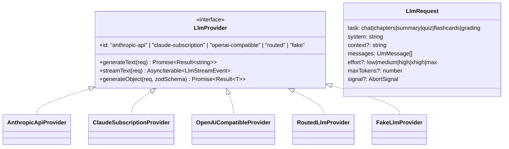
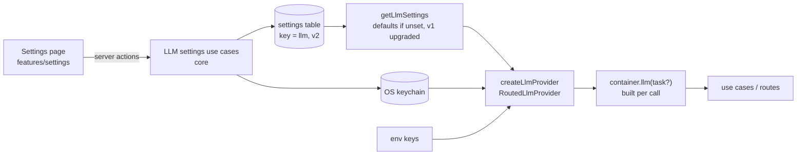

# 02. LLM providers

Status: Current (Phase 10). Decisions: ADR-0008, ADR-0013, ADR-0037. OpenAI-compatible providers, profiles, keys and per-task routing: doc 20.

## Port

`packages/core/src/ports/llm.ts`

- **`task`** picks the provider profile and model from the owner's settings (`LlmSettingsV2.tasks[task]`, doc 20).
- **`effort`** defaults to `defaultEffortByTask[task]` (`packages/core/src/domain/llm-settings.ts`):

  | Task       | Default effort |
  | ---------- | -------------- |
  | chat       | medium         |
  | chapters   | low            |
  | summary    | medium         |
  | quiz       | high           |
  | flashcards | medium         |
  | grading    | medium         |

- **`context`** carries the large, stable source text, kept apart from `messages` so that it can be cached.
- **Errors are returned, never thrown** (ADR-0005):

  | Code              | Meaning                                                |
  | ----------------- | ------------------------------------------------------ |
  | `llm_unavailable` | Network, auth, rate limit, or the CLI is not signed in |
  | `llm_bad_output`  | The output failed schema validation                    |
  | `llm_refused`     | A final `stop_reason: "refusal"`                       |

## Adapters (`packages/llm/src`)

The OpenAI-compatible adapter (Ollama, LM Studio, OpenRouter, OpenAI, custom) is described in doc 20.

|                       | `AnthropicApiProvider` (`anthropic-api.ts`)                                                                     | `ClaudeSubscriptionProvider` (`claude-subscription.ts`)                                                                | `FakeLlmProvider`  |
| --------------------- | --------------------------------------------------------------------------------------------------------------- | ---------------------------------------------------------------------------------------------------------------------- | ------------------ |
| **Library**           | `@anthropic-ai/sdk` 1.8, `client.beta.messages`                                                                 | `@anthropic-ai/claude-agent-sdk` 0.3, `query()`                                                                        | none               |
| **Auth**              | `ANTHROPIC_API_KEY`, else the key saved in the OS keychain, else an `ant auth` profile                          | The `claude` CLI login on this Mac. `ANTHROPIC_API_KEY` is **removed** from its env                                    | none               |
| **Text**              | `stream(...).finalMessage()`                                                                                    | The `result` message                                                                                                   | canned             |
| **Streaming**         | `content_block_delta` / `text_delta` events                                                                     | `includePartialMessages: true` → `stream_event` deltas                                                                 | word by word       |
| **Structured output** | `beta.messages.parse` + `betaZodOutputFormat(schema)`                                                           | `outputFormat: {type: "json_schema", schema: z.toJSONSchema(schema)}`, then zod validates `structured_output`          | `JSON.parse` + zod |
| **Source context**    | A second system block with `cache_control: ephemeral`                                                           | Appended to `systemPrompt`                                                                                             | n/a                |
| **Refusals**          | Opus/Sonnet 5.5: `fallbacks: "default"` + beta `server-side-fallback-2026-07-01`; final refusal → `llm_refused` | `stop_reason: "refusal"` → `llm_refused`                                                                               | n/a                |
| **Isolation**         | n/a                                                                                                             | `tools: []`, `settingSources: []`, `strictMcpConfig`, `persistSession: false`, `maxTurns: 1` (3 for structured output) | n/a                |

## Selection and wiring

- **The default settings** route every task to the Claude subscription with `claude-opus-5-5`. A stored v1 value (one provider for every task) upgrades on read.
- **`container.llm()`** returns a router that dispatches each request by `request.task`; `container.llm(task)` returns that task's adapter. It is rebuilt on every call, so a settings change applies on the next request without a restart.
- **`@anthropic-ai/claude-agent-sdk` and `@napi-rs/keyring` are in `serverExternalPackages`.**

## Streaming over HTTP

`POST /api/llm/stream` (`apps/web/src/app/api/llm/stream/route.ts`) writes each `LlmStreamEvent` as an SSE frame (`data: {json}\n\n`). The client reads it with `fetch` plus `TextDecoderStream` (see `features/settings/connection-check.tsx`). Phase 3 chat reuses this pattern.

## Troubleshooting

| Message                                                         | Fix                                                                         |
| --------------------------------------------------------------- | --------------------------------------------------------------------------- |
| `Claude Code: Failed to authenticate ... Run claude ... /login` | In a terminal, run `claude`, then `/login`. The Agent SDK shares this login |
| `No API key found. Set ANTHROPIC_API_KEY ...`                   | Add the key in Settings (keychain), or to `apps/web/.env.local` and restart |
| `The API key was rejected`                                      | The key is wrong or revoked                                                 |

## Rules

- **Prompts live next to their use case** (`packages/core/src/usecases/<feature>/prompts.ts`), not in adapters.
- **Never send an API key to the client.** Settings only show "Key saved" or "From environment".
- **Every `generateObject` schema gets a unit test** with a good reply and a bad one.
- **Adapter tests stub the SDK** (`anthropic-api.test.ts`, `claude-subscription.test.ts`) and assert the request shape, the isolation options and the error mapping. **There is no live call in CI.**
