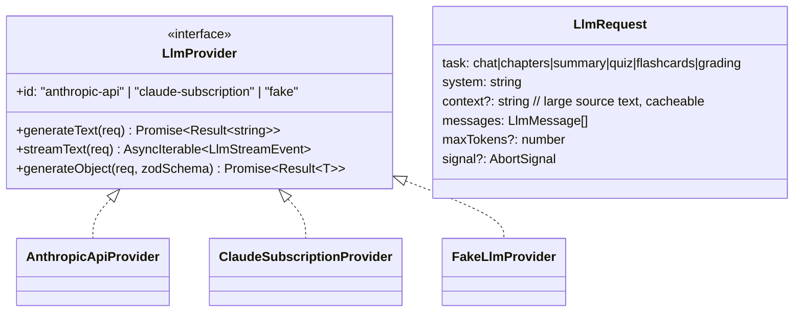
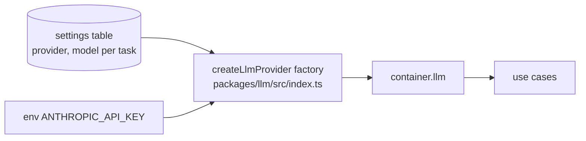

# 02. LLM providers

Status: Port **Current**. Real adapters **Planned (Phase 1)**. Decision: ADR-0008.

## Port

`packages/core/src/ports/llm.ts`

- **`task`** lets settings choose the model per task. For example, Haiku for chapters and Sonnet for chat and quiz grading.
- **`context`** is kept apart from `messages`, so the API adapter can mark it with `cache_control`.
- **Errors** are returned, not thrown:
  - `llm_unavailable` for network or auth problems, or the CLI not being logged in;
  - `llm_bad_output` for schema failures.

## Adapters

| Adapter                                | Library                                    | Structured output                                                        | Streaming                  | Notes                                                                                                 |
| -------------------------------------- | ------------------------------------------ | ------------------------------------------------------------------------ | -------------------------- | ----------------------------------------------------------------------------------------------------- |
| `FakeLlmProvider` (current)            | none                                       | `JSON.parse` + zod                                                       | word by word               | Tests and offline UI                                                                                  |
| `AnthropicApiProvider` (Phase 1)       | `@anthropic-ai/sdk`                        | Tool-use with a JSON schema from zod. Validate, retry once               | SDK stream events          | Prompt caching on `context`. Key from `ANTHROPIC_API_KEY`                                             |
| `ClaudeSubscriptionProvider` (Phase 1) | `@anthropic-ai/claude-agent-sdk` `query()` | Ask for JSON only. Extract, validate with zod, retry once with the error | Partial assistant messages | `allowedTools: []`, `maxTurns: 1`, custom system prompt. Needs the `claude` CLI logged in on this Mac |

## Selection

## Rules

- Prompts live next to their use case (`packages/core/src/usecases/<feature>/prompts.ts`), not in adapters.
- Never send the API key to the client. Settings show only whether a key is present.
- **Every `generateObject` schema has a unit test with a recorded good reply and a bad one.**
- **Parity test** (Phase 1): one quiz request runs through both real adapters, and both outputs must parse. It is skipped in CI when credentials are absent.
