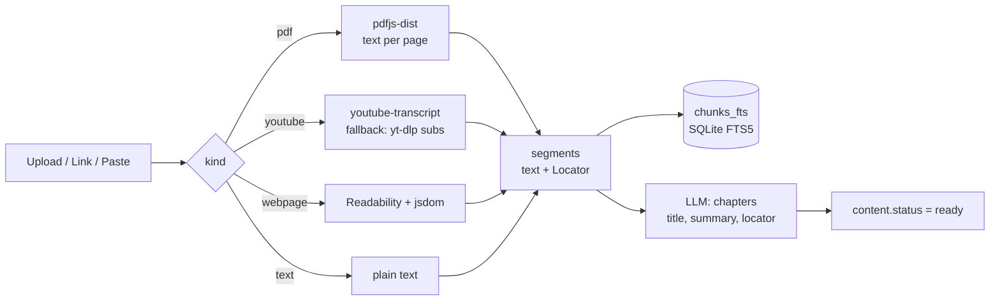

# 03. Ingestion

Status: Planned (Phase 2). The `Locator` type is current in `packages/core/src/domain/content.ts`.

## Goal

Every source becomes **segments** with a **locator**, so citations, chapters and summary ranges all point back into the source.

## Locator

| Source      | Locator                              | Citation rendered as                   |
| ----------- | ------------------------------------ | -------------------------------------- |
| PDF         | `{ type: "page", page }`             | `[p.12]`, which jumps the PDF viewer   |
| YouTube     | `{ type: "time", startSec, endSec }` | `[03:21]`, which seeks the player      |
| Web or text | `{ type: "offset", start, end }`     | `[§4]`, which scrolls to the paragraph |

## Jobs

Ingestion is slow, so it runs as a job:

- **Storage:** a `jobs` table holds `kind`, `payload`, `status`, `attempts` and `error`.
- **Runner:** an in-process runner, started by the container, picks up jobs.
- **Progress:** the UI watches status through SSE.
- **No Redis** (ADR-0002, single user).

## Retrieval

- **Small sources (under about 150k tokens):** pass the full text as `context`, which the API adapter caches.
- **Large sources, or a whole Space for exams:** run an FTS5 BM25 search for the top-k chunks.
- **Embeddings** are optional later, through `sqlite-vec`. Adding them needs a new ADR.
