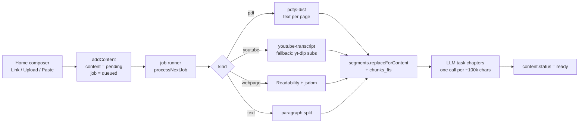
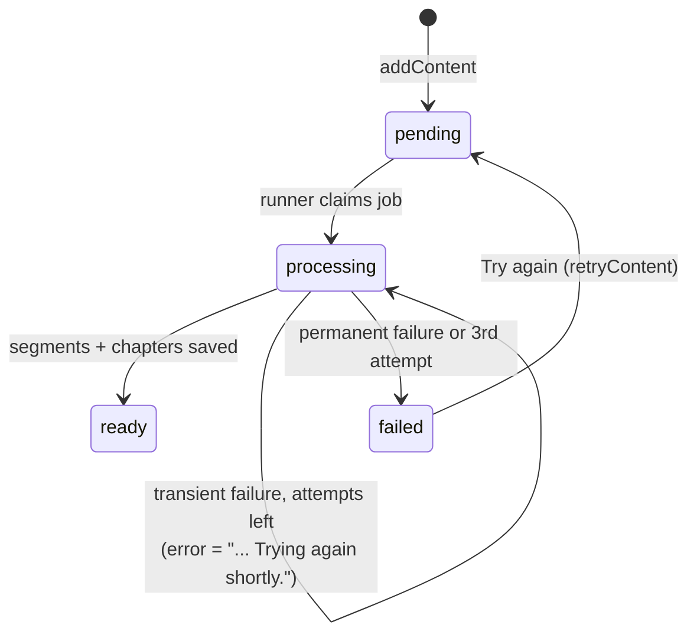

# 03. Ingestion

Status: Current (Phase 2). Decision draft: ADR-0014.

## Goal

Every source becomes **segments** with a **locator**, so citations, chapters and summary ranges all point back into the source.

## Where the code lives

| Piece                                | Path                                                                      |
| ------------------------------------ | ------------------------------------------------------------------------- |
| Port `SourceParser`, `IngestFailure` | `packages/core/src/ports/ingest.ts`                                       |
| Use cases                            | `packages/core/src/usecases/ingest/` (`add-content`, `run-ingest-job`)    |
| Chapter prompt and schema            | `packages/core/src/usecases/ingest/prompts.ts`, `chapters.ts`             |
| Parsers (adapter `SourceIngestor`)   | `packages/ingest/src/` (`pdf`, `youtube`, `webpage`, `text`)              |
| Container slot                       | `ingest` in `apps/web/src/server/container.ts`                            |
| Job runner                           | `apps/web/src/server/jobs/runner.ts`, started by `src/instrumentation.ts` |
| Upload route                         | `apps/web/src/app/api/upload/route.ts`                                    |
| Home composer and Recents            | `apps/web/src/features/library/`                                          |

`@thoth/ingest` depends on `@thoth/core` only, like `db` and `llm`. Its Node-only libraries (`pdfjs-dist`, `jsdom`) are in `serverExternalPackages`.

## Adding content

`addContent` validates input with zod, creates a `pending` content with a placeholder title, and enqueues an `ingest` job with payload `{ contentId, text? }`.

| Input                   | Kind      | Stored on the content     | Placeholder title        |
| ----------------------- | --------- | ------------------------- | ------------------------ |
| Link (YouTube video)    | `youtube` | `sourceUrl`               | host + path              |
| Link (any other http/s) | `webpage` | `sourceUrl`               | host + path              |
| Upload                  | `pdf`     | `filePath`                | file name without `.pdf` |
| Paste                   | `text`    | nothing (text in payload) | "Pasted text"            |

- **Link detection** is `detectLinkKind` in `usecases/ingest/source-url.ts`. The composer uses the same function to show "YouTube video" or "Web page" while you type.
- **Uploads** go through `POST /api/upload` (multipart, field `file`), not a Server Action, because actions cap bodies at 1 MB. The route checks the size (50 MB) and the `%PDF-` header, saves the file to `<THOTH_DATA_DIR>/uploads/<uploadId>.pdf`, then calls `addContent`. The file is named by a random upload ID because `filePath` is fixed when the content is created.
- **Pasted text** is capped at 1,000,000 characters.

## Parsers and locators

| Source  | Parser                                                                                                                                            | Segment                         | Locator                              | Citation  |
| ------- | ------------------------------------------------------------------------------------------------------------------------------------------------- | ------------------------------- | ------------------------------------ | --------- |
| PDF     | `pdfjs-dist` legacy build, text items joined per page. Empty pages are skipped but keep their page numbers. Title: PDF metadata, then file name.  | One page                        | `{ type: "page", page }`             | `[p.12]`  |
| YouTube | `youtube-transcript` (English track first, then any `en-*`, then the default track), then `yt-dlp` subtitles if installed. Title: YouTube oEmbed. | Caption cues grouped to 30–90 s | `{ type: "time", startSec, endSec }` | `[03:21]` |
| Web     | Fetch (HTML only, 5 MB max), Readability, then leaf block elements (`p`, `li`, headings, ...) joined by blank lines.                              | Paragraph                       | `{ type: "offset", start, end }`     | `[§4]`    |
| Text    | Split on blank lines (LF or CRLF).                                                                                                                | Paragraph                       | `{ type: "offset", start, end }`     | `[§4]`    |

- **Offsets.** For pasted text, `text.slice(start, end) === segment.text` on the text exactly as submitted (browsers submit CRLF). For web pages, offsets point into the extracted article text.
- **Paragraph sizing** (`packages/ingest/src/text.ts`): a paragraph under 200 characters (a heading) merges into the next one; a paragraph over 2,000 characters splits at sentence ends.
- **Caption grouping** (`groupCues`): a group closes at a sentence end once it is 30 s long, at 60 s regardless, and never passes 90 s. Auto-captions have no punctuation, so they close at 60 s. A tail under 30 s joins the previous group if that stays within 90 s.
- **Units.** `youtube-transcript` returns milliseconds for srv3 captions and seconds for classic ones. `normaliseLibraryCues` tells them apart by the median cue duration.

## Chapters

`generateChapters` (`usecases/ingest/chapters.ts`) calls `llm.generateObject` with task `chapters` (effort `low` by default):

- **Context:** numbered segments, `[12] (03:21) text...`, in the cacheable `context` field.
- **Output:** `{ chapters: [{ startSegment, title, summary }] }` (`chaptersOutputSchema`). The model picks only **where** each chapter starts. `toChapters` computes the locator from the real segments (time range, first page, or character range), drops out-of-range and duplicate starts, and moves the first chapter to the first segment.
- **Long sources** are split into windows of about 100,000 characters. Each window is one call that says "part i of n". The target is about one chapter per 4,000 characters, 1 to 12 per window.

## Jobs

- **Runner.** `startJobRunner()` runs one loop per server process, started from `instrumentation.ts` in the Node.js runtime only (not during `next build`). It runs one job at a time. When the queue is empty it sleeps 2 s, or until `wakeJobRunner()` is called after a new job is queued.
- **Retries** (`processNextJob` in core): at most 3 attempts, waiting 15 s and then 60 s. Retryable failures are network errors, HTTP 429 and 5xx, YouTube rate limits, `llm_unavailable` and `llm_bad_output`. Permanent failures are: no captions, private video, a 4xx page, a PDF with no text, and `llm_refused`. A thrown bug is recorded on the job and treated as retryable, so a content never stays stuck.
- **Try again** on a failed content calls `retryContent`, which re-queues it. Pasted text is re-used from its saved segments, because the original job payload is gone.
- **Dev note.** The runner keeps the code it loaded at startup. After editing parser or use-case code, restart `pnpm dev`; hot reload does not reach the running loop.

## UI

- **Composer** (`add-content-composer.tsx`): Hearth `tabs` for Link, Upload and Paste. Link uses the `composer` pattern with the accent send button. Upload is a drop zone with a primary "Choose PDF" button. Paste is a `field` textarea.
- **Recents** (`recents-list.tsx`): the 20 newest contents with a status badge (Queued, Processing, Ready, Failed, each with an icon). Ready titles link to `/content/{id}`. Failed rows show the fix-it message and a "Try again" button. While any row is queued or processing, `RefreshWhileBusy` calls `router.refresh()` every 2 s. We use polling instead of SSE: it is enough for one user and needs no extra route.

## Error messages

Messages follow Hearth's voice: say what happened and what to do. Examples:

| Situation          | Message                                                                                                    |
| ------------------ | ---------------------------------------------------------------------------------------------------------- |
| No captions        | This video has no captions. Pick a video with captions, or install yt-dlp and try again.                   |
| Scanned PDF        | This PDF has no selectable text, so it is probably a scan. Run OCR on it, then upload it again.            |
| 404 page           | The site refused the request (404). Open the page in your browser, copy the text and use Paste instead.    |
| Model unreachable  | We could not reach the model to write chapters. _(adapter message, for example "run claude, then /login")_ |
| Malformed chapters | The model returned chapters we could not read. Try again, or pick another model for Chapters in Settings.  |

## Known gaps

- **Interrupted jobs.** If the server stops while a job is `running`, the job and its content stay `running` / `processing`. `JobRepository` has no method to re-queue stale jobs yet.
- **Upload file names** use a random upload ID, not the content ID, because `ContentRepository` cannot set `filePath` after `create`.

## Retrieval

- **Small sources (under about 150k tokens):** pass the full text as `context`, which the API adapter caches.
- **Large sources, or a whole Space for exams:** run an FTS5 BM25 search for the top-k chunks.
- **Embeddings** are optional later, through `sqlite-vec`. Adding them needs a new ADR.
