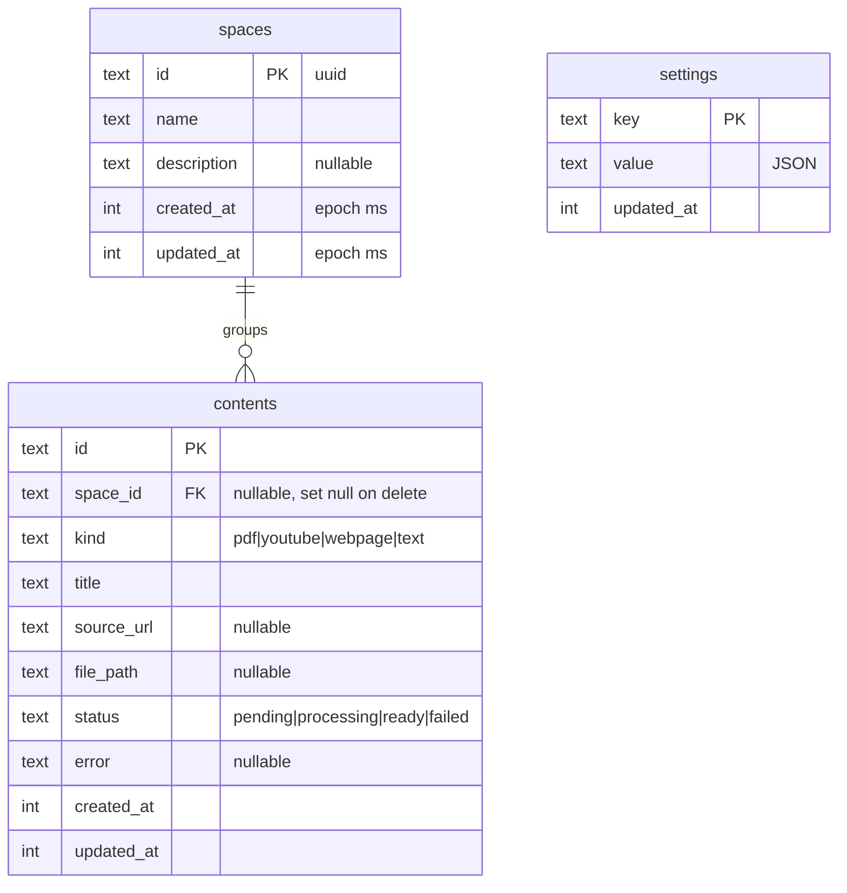
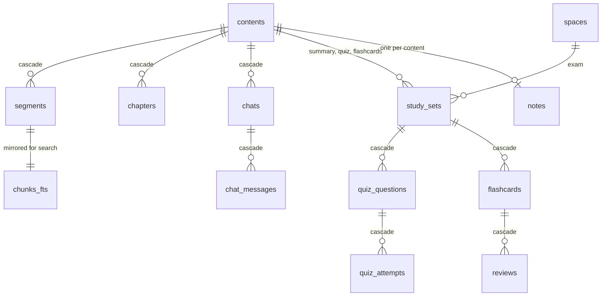

# 04. Data model

Status: Current (all MVP tables, Step 0 contracts). Decision: ADR-0006.

## Current (Phase 0)

Schema: `packages/db/src/schema/index.ts`. Migrations: `packages/db/drizzle/`.

## MVP tables (Step 0, migration `0001_mvp_contracts` + `0002_chunks_fts`)

Every repository below exists in `packages/db/src/repositories/` and is tested in `contracts.test.ts`.

| Table                             | Holds                                                                                                  | Port                                                  |
| --------------------------------- | ------------------------------------------------------------------------------------------------------ | ----------------------------------------------------- |
| `segments`                        | Source text pieces with a JSON `locator` (page, time or offset)                                        | `SegmentRepository` (`search` = FTS5 BM25)            |
| `chunks_fts`                      | FTS5 virtual table (`text`, `segment_id`, `content_id`), porter tokenizer                              | written only by `SegmentRepository.replaceForContent` |
| `chapters`                        | AI sections: title, summary, locator                                                                   | `ChapterRepository`                                   |
| `chats`, `chat_messages`          | Conversations per content, messages with parsed `citations`                                            | `ChatRepository`                                      |
| `study_sets`                      | "My Sets": summary (markdown `body`), quiz, flashcards, exam. Exactly one of `content_id` / `space_id` | `StudySetRepository`                                  |
| `notes`                           | One markdown document per content                                                                      | `NoteRepository`                                      |
| `quiz_questions`, `quiz_attempts` | Typed questions (`answer` JSON per type), attempts with score 0..1                                     | `QuizRepository`                                      |
| `flashcards`, `reviews`           | Cards with FSRS fields (`due`, `stability`, ...) and the review log                                    | `FlashcardRepository`                                 |
| `jobs`                            | Background work queue: `queued` → `running` → `done` / `failed`, retry via `run_after`                 | `JobRepository`                                       |

**Foreign keys** are enforced: `migrateDb` runs `PRAGMA foreign_keys = ON`, so deleting a content removes its children.

**Seed:** `pnpm --filter @thoth/db seed` adds `sample-lecture` and `sample-pdf` (`packages/db/src/seed.ts`).

## Conventions

- **IDs** are random UUID text, typed as branded IDs in core (`SpaceId`, `ContentId`). Never mix them.
- **Time** is stored as integer epoch milliseconds (`timestamp_ms`) and is a `Date` in the domain.
- **JSON columns** are used only for opaque option bags and citations. Anything we query lives in real columns.
- **Schema changes:** edit `schema/`, run `pnpm --filter @thoth/db db:generate`, and commit the SQL. Never edit an applied migration.
- **Secrets never go in the database** (ADR-0008).
