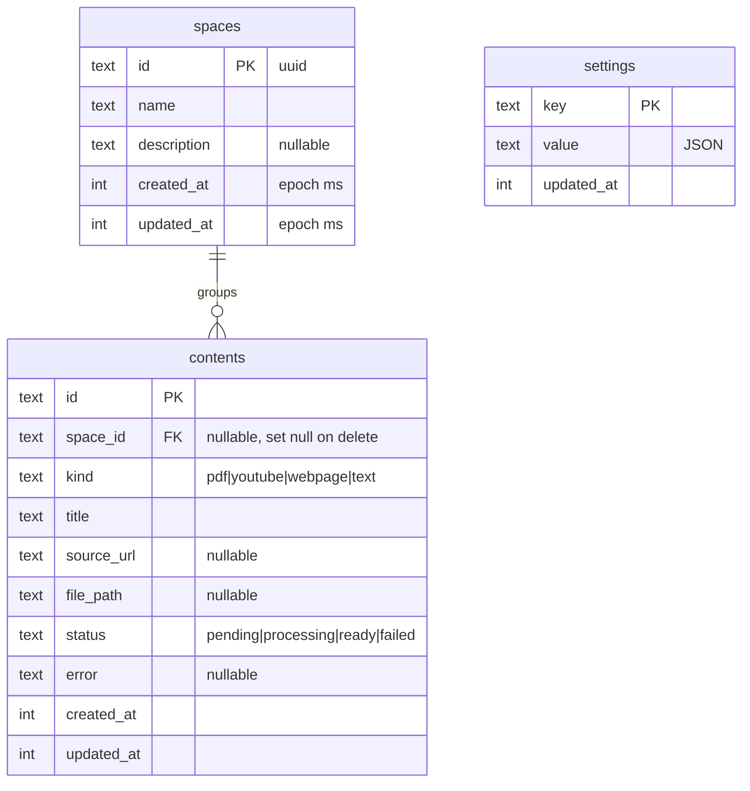
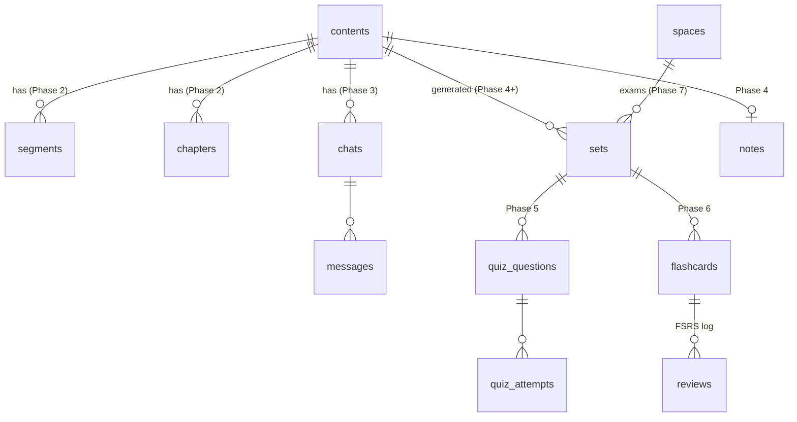

# 04. Data model

Status: Current for Phase 0 tables. Planned tables are marked. Decision: ADR-0006.

## Current (Phase 0)

Schema: `packages/db/src/schema/index.ts`. Migrations: `packages/db/drizzle/`.

## Planned

## Conventions

- **IDs** are random UUID text, typed as branded IDs in core (`SpaceId`, `ContentId`). Never mix them.
- **Time** is stored as integer epoch milliseconds (`timestamp_ms`) and is a `Date` in the domain.
- **JSON columns** are used only for opaque option bags and citations. Anything we query lives in real columns.
- **Schema changes:** edit `schema/`, run `pnpm --filter @thoth/db db:generate`, and commit the SQL. Never edit an applied migration.
- **Secrets never go in the database** (ADR-0008).
