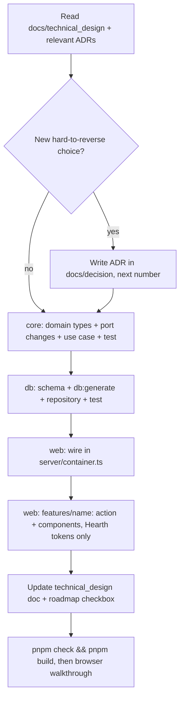

# 06. Quality and workflow

Status: Current. Decision: ADR-0010.

## Commands (run from the repo root)

| Command                               | Does                                                         |
| ------------------------------------- | ------------------------------------------------------------ |
| `pnpm dev`                            | Start the web app (http://localhost:3000)                    |
| `pnpm check`                          | Lint, then typecheck, then test. **Run before every commit** |
| `pnpm format`                         | Biome format and safe fixes                                  |
| `pnpm build`                          | Production build of every package and app                    |
| `pnpm --filter @thoth/db db:generate` | Create a migration after a schema change                     |
| `pnpm --filter @thoth/ui tokens`      | Regenerate the Hearth CSS from `design/hearth/tokens.json`   |

## Tests

| Layer        | How                                                                                  | Example                                                 |
| ------------ | ------------------------------------------------------------------------------------ | ------------------------------------------------------- |
| Use cases    | Vitest, with in-memory fakes of the ports                                            | `packages/core/src/usecases/spaces.test.ts`             |
| Repositories | Vitest, with a libSQL `:memory:` database and real migrations                        | `packages/db/src/repositories/space-repository.test.ts` |
| LLM adapters | Vitest, with recorded replies. Live parity tests are skipped without credentials     | `packages/llm/src/fake-provider.test.ts`                |
| UI flows     | Manual walkthrough in the browser for each phase. Playwright e2e planned for Phase 8 |                                                         |

## CI (`.github/workflows/ci.yml`)

1. On every push and pull request: install, `pnpm check`, `pnpm build`.
2. On pull requests: `tools/check-adr-append-only.sh` (ADR-0001).

## Recipe: add a feature (humans and agents)



## Commits and branches

- Use Conventional Commits: `feat(quiz): ...`, `fix(db): ...`, `docs(adr): ...`, `chore: ...`.
- Do one phase or one feature per branch, and merge to `main` through a pull request.
- Never commit `.env*.local` or `data/`.

## Live LLM smoke tests (manual, uses real quota)

`packages/llm/src/live.test.ts` is skipped unless `THOTH_LIVE` is set. It checks structured output and streaming against real providers.

```bash
THOTH_LIVE=subscription pnpm --filter @thoth/llm test live
THOTH_LIVE=api,subscription THOTH_LIVE_MODEL=claude-haiku-5-5 pnpm --filter @thoth/llm test live
```

The default model is `claude-sonnet-5-5`. Run these after changing an adapter. CI never runs them.

## Rule: record study activity (ADR-0023)

Every new study action calls `recordActivity(deps.activity, kind, ref)` after it succeeds, so the habit tracker counts it. `activity` is an optional dependency, so tests that do not pass it record nothing. Add a new `ActivityKind` (and a migration that updates the enum) for a new kind of action.
