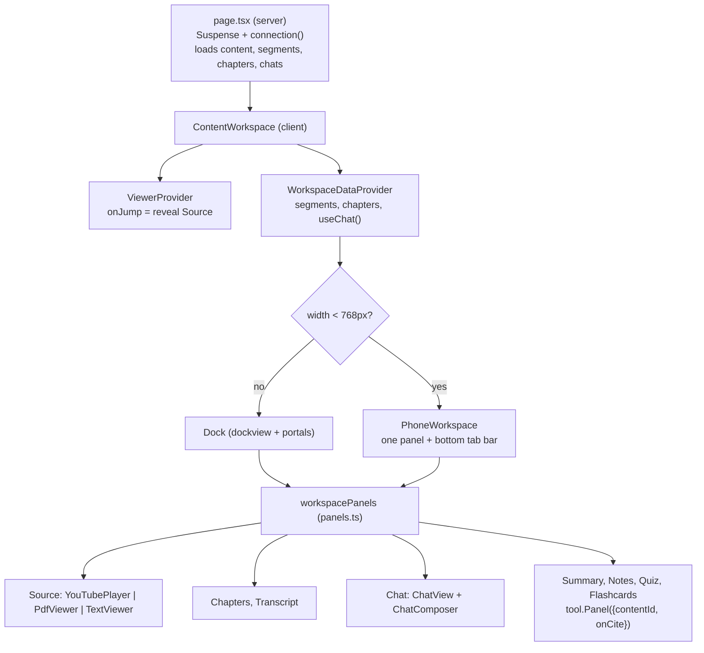
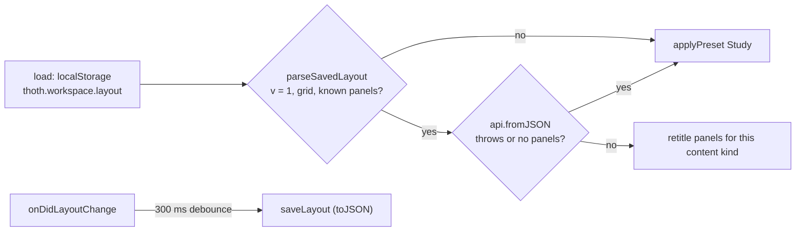
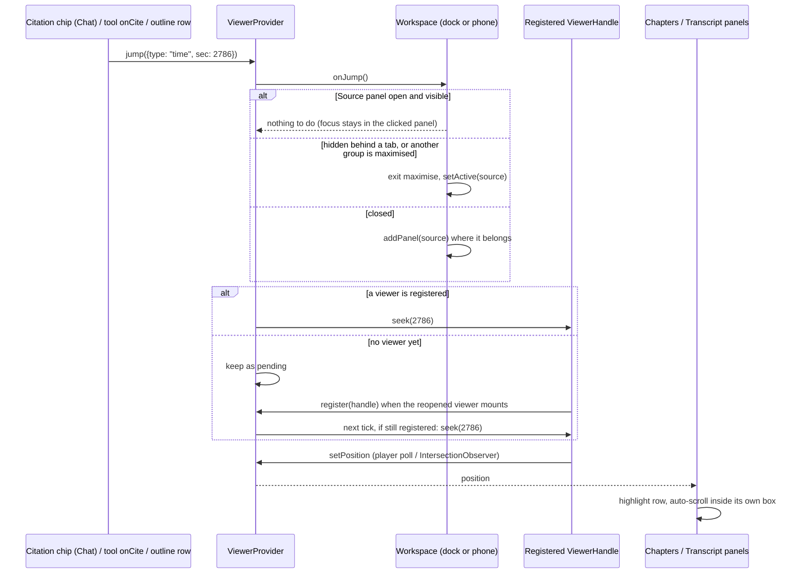
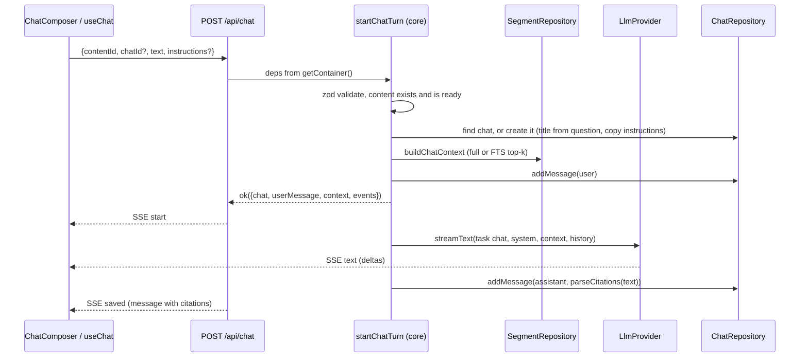
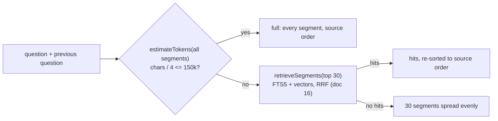

# 07. Content page and chat

Status: Current (Phase 8, Lane 1). Decisions: ADR-0004, ADR-0005, ADR-0011, ADR-0013, ADR-0015 (chat context), ADR-0021 (dockable workspace), draft ADR-0024 (how it is built).

The content page is a **dockable workspace**, like VS Code or Claude Code. The source, its chapters and transcript, the chat and every Learn tool are panels. Each panel can be dragged, split in four directions, stacked as tabs, resized, maximised and closed. On phones it shows one panel at a time.

## Files

| Area                    | Where                                                                                  |
| ----------------------- | -------------------------------------------------------------------------------------- |
| Route                   | `apps/web/src/app/content/[id]/page.tsx`                                               |
| Workspace               | `apps/web/src/features/workspace/`                                                     |
| Panel registry          | `features/workspace/panels.ts` (ids and titles in `panel-ids.ts`)                      |
| Layout presets, storage | `features/workspace/layout.ts`; operations on the dock in `layout-actions.ts`          |
| dockview bridge, theme  | `features/workspace/dock.tsx`, `workspace.css`                                         |
| Viewers and outline     | `apps/web/src/features/content-viewer/` (`source-viewer`, `outline`, `viewer-context`) |
| Learn tools registry    | `apps/web/src/features/learn-panel/{registry,types}.ts`                                |
| Chat UI                 | `apps/web/src/features/chat/`                                                          |
| Chat use cases          | `packages/core/src/usecases/chat/{chat,context,prompts}.ts`                            |
| Chat stream             | `apps/web/src/app/api/chat/route.ts` (`POST`, SSE)                                     |
| Stored file             | `apps/web/src/app/api/content/[id]/file/route.ts` (`GET`)                              |

## Page structure

- **Server read.** The page wraps everything, `AppShell` included, in one `<Suspense>`, because `AppShell`'s `NavLink` reads the pathname. It uses `<AppShell bleed>`, so the workspace fills the main area and each panel scrolls on its own.
- **Header.** The title, a processing or failed callout, and on desktop two Hearth menus: **Layout** (the presets and Reset layout) and **Add panel** (every panel; open ones are marked "Open" and get focus, closed ones come back).
- **Before hydration** the dock area shows a skeleton. The mode (dock or phone) is read from `matchMedia` with `useSyncExternalStore`, so the server and the first client render agree.

### Panels

Every panel receives `WorkspacePanelProps`: `contentId`, `content` and `onCite(token)`. Data they share (segments, chapters, the chat controller) comes from `useWorkspaceData()`.

| Panel                             | Component                         | Notes                                                                                            |
| --------------------------------- | --------------------------------- | ------------------------------------------------------------------------------------------------ |
| Source ("Video", "PDF", "Source") | `SourcePanel`                     | `renderer: "always"`: it stays in the page while hidden or dragged, so the video never reloads.  |
| Chapters                          | `ChaptersView` in `outline.tsx`   | Auto scroll follows the reader's position.                                                       |
| Transcript ("Text" for non-video) | `TranscriptView` in `outline.tsx` | Same.                                                                                            |
| Chat                              | `ChatPanel`                       | The chat lives in the workspace, so closing the panel keeps the thread and any streaming answer. |
| Summary, Notes, Quiz, Flashcards  | `learnToolPanel(tool)`            | The Learn tools' `Panel`, through the frozen `LearnToolProps` contract.                          |

- The video keeps 16:9 and fits the shorter side of its panel (`.ws-video-stage`, a size container).
- Panels have a minimum size of 240 × 140 px, so a split never squeezes a tool into an unusable sliver.

### Dock bridge

`dockview` 8.8.3 is framework-free (the React binding is a separate package; see draft ADR-0024). `Dock` creates it with `createDockview` and gives it three factories. Each returns a plain element, and React renders into it with `createPortal`:

- `createComponent`: a panel body, rendered from the registry by its id.
- `createRightHeaderActionComponent`: each group's **Maximise panel / Restore panel size** button.
- `createWatermarkComponent`: the empty state when every panel is closed, with **Reset layout**.

Floating groups and popout windows are turned off.

### Layout presets and persistence

| Preset        | Arrangement                                                                        |
| ------------- | ---------------------------------------------------------------------------------- |
| Study         | Source over Chapters/Transcript tabs; Chat over Summary/Notes/Quiz/Flashcards tabs |
| Watch + notes | Source over Transcript/Chapters tabs; Notes beside it at full height               |
| Quiz          | Source; Notes stacked above Quiz beside it                                         |

- One layout is shared by every content, per viewer. Storage that is blocked or full is ignored; the layout still works for the session.
- **Reset layout** clears the saved layout and builds Study.
- **Palette commands** (registered with `useCommands`, group "Workspace"): `Workspace: Study layout`, `Workspace: Watch + notes layout`, `Workspace: Quiz layout`, `Workspace: Reset layout`, and `Workspace: Show <panel>` for each panel. On phones only the Show commands are registered.
- A closed panel comes back where it belongs: the Source above an open Chapters or Transcript (else as a left column), the outline panels with each other or under the Source, a Learn tool as a tab with the other Learn tools, anything else as a right column.

### Phones

Under 768 px there is no dock. `PhoneWorkspace` shows one panel and a bottom tab bar with every panel (52 px tall, scrolls sideways). A panel stays mounted once opened, so it keeps its state. The Source is mounted from the start. The chosen tab is remembered in `thoth.workspace.phoneTab`.

### Styling

`workspace.css` defines the `dockview-theme-hearth` class. It sets every `--dv-*` colour to a Hearth token, so no dockview default colour shows, and light and dark come from the tokens.

- Tabs look like Hearth Tabs: `label` type, `ink-muted` when inactive, a hairline under the bar, and an `accent` underline on the tab of the active group (`border-control` in other groups).
- Separators are `border-subtle` hairlines; a divider turns `accent` only while dragged.
- Drop overlays are `accent-tint` with a 1px `accent` border.
- Tabs and header actions use `cursor: default` and no text selection. Motion is 150 ms and turns off with `prefers-reduced-motion`.

## Viewer and jumps

`ViewerProvider` (`viewer-context.tsx`) keeps two contexts:

- **actions** (stable): `register(handle)`, `jump(ref)`, `jumpToToken("[p.5]")`, `setPosition`.
- **position** (changes often): where the reader is now, as a `CitationRef`. Only the Chapters and Transcript lists read it, so chat does not re-render while a video plays.

Citations jump across panels. Any panel calls `onCite(token)` (= `jumpToToken`); chapter and transcript rows call `jump(ref)`.

- On phones `onJump` switches the bottom tab bar to the Source.
- The pending jump is applied a tick after `register`, and only if that viewer is still registered. A viewer can mount and unmount at once (React Strict Mode), and a jump handed to the one that left would be lost.
- Viewers scroll with `revealInScroller`, which moves only the nearest scrolling box. `scrollIntoView` would also scroll the clipped dock containers around it.
- **Deep links** `/content/{id}?at=[p.3]` still work (`InitialJump`, used by exam results and the progress page). If the saved layout has no Source panel, the jump reopens it.

| Kind                | Viewer                                                                                     | Handle                    | Position source                 | Token     |
| ------------------- | ------------------------------------------------------------------------------------------ | ------------------------- | ------------------------------- | --------- |
| youtube             | `YouTubePlayer`: IFrame Player API, loaded once from `youtube.com/iframe_api`              | `seek(sec)` + `playVideo` | `getCurrentTime()` every 500 ms | `[mm:ss]` |
| pdf with `filePath` | `PdfViewer`: `pdfjs-dist` 6.5, one canvas per page, drawn when within a screen of the view | `showPage(n)`             | page ≥ 50% visible              | `[p.N]`   |
| pdf without file    | `TextViewer` in `pages` mode (the seed)                                                    | `showPage(n)`             | top-most visible page           | `[p.N]`   |
| webpage, text       | `TextViewer` in `paragraphs` mode; anchor `§n` = segment `idx + 1`                         | `showParagraph(n)`        | top-most visible paragraph      | `[§n]`    |

- A seek requested before the YouTube player is ready is kept and applied on ready. A page requested before the PDF has loaded is shown once its pages exist.
- `youtubeVideoId` accepts `watch?v=`, `youtu.be/`, `/embed/`, `/shorts/` and `/live/` URLs. Anything else shows a warning callout, and chat still works.
- Unsupported jumps (a page citation on a video) are ignored.
- **pdf.js worker.** `new URL("pdfjs-dist/build/pdf.worker.min.mjs", import.meta.url)` is bundled by Turbopack as a static asset. pdf.js is imported dynamically, so it never runs on the server.

### `GET /api/content/[id]/file`

- `content.filePath` is resolved against `THOTH_DATA_DIR` (it may be relative, like `uploads/x.pdf`, or absolute).
- A path that resolves outside the data folder is refused with `403`. A missing row, a content with no file, or a missing file is `404`.
- The response streams the file with `Content-Type: application/pdf` for PDFs and `Cache-Control: private, max-age=3600`.

## Chat

### Turn

- **Errors before streaming** (validation, missing content or chat, content not ready, no text) come back as `Result` errors. The route returns JSON `{error}` with status 400 or 404, and nothing is saved.
- **Errors while streaming** become an `error` event. The question stays saved; the answer is not. The UI shows a danger callout with **Try again**.
- **Stop** aborts the fetch. The route passes `req.signal` to the provider, and the client keeps the partial text.
- If the client disconnects, the route keeps consuming events, so a finished answer is still saved.

### SSE events (`features/chat/stream-events.ts`)

| Event   | Payload                                                          |
| ------- | ---------------------------------------------------------------- |
| `start` | `chat`, `userMessage`, `context: {mode, included, total}`        |
| `text`  | `delta`                                                          |
| `saved` | `message` (the assistant message with parsed `citations`). Last. |
| `error` | `message`, in Hearth voice                                       |

### Prompt (`prompts.ts`)

- **System:** Thoth's role, then rules: answer from the source; put a token after every sentence that uses it; the citation format for this content kind; only use tokens that appear in the source; say so when the source does not cover the question; a small Markdown subset; answer in the question's language. In search mode it adds that only the best-matching passages are included. The owner's chat instructions come last, in `<chat_instructions>`, and must not override the citation rules.
- **Context** (`LlmRequest.context`, cached by the API adapter): `<source title kind>` with one passage per line, each starting with its token from `segmentToken` (built on `citationToken`).
- **History:** the last 20 messages. Consecutive messages of one role (after a failed reply) are merged.

### Context selection (`context.ts`)

The previous question joins the search query so a short follow-up ("and the second one?") still finds its passages. Search mode uses hybrid retrieval (ADR-0029, `16-embeddings-and-retrieval.md`): keyword hits and the nearest passages by meaning are fused, so a question worded differently from the source still finds its page. Without vectors (model not downloaded yet, content not indexed yet) it is FTS alone, and `ChatContext.retrieval` says why. The UI shows a caption when an answer used search mode.

### Rendering answers (`markdown-lite.ts`, `rich-text.tsx`)

- Answers are parsed into a small Markdown subset: paragraphs, `-` and `1.` lists, headings (shown as bold lines), `**bold**`, `` `code` ``, and citation tokens. Nothing is rendered as HTML, so model output cannot inject markup.
- Tokens become **citation chips**: `p. 5`, `03:21` or `§4` on `neutral-tint`, turning `accent-tint` on hover, with an accessible name such as "Play from 03:21". A click calls `jump`.
- Layout follows Hearth Conversation: the reader's message in an `accent-tint` bubble, the reply on the page in `body-lg`.

### History and instructions

- **History** menu (Hearth Menu) lists the content's chats, newest first. **New chat** clears the thread; the chat row is created only when the first question is sent.
- **Instructions** opens a Hearth Modal (`<dialog>`) with up to 2,000 characters. On a saved chat it calls `saveChatInstructionsAction`. On a new chat it is kept as a draft and sent with the first question. New chats start with the latest chat's instructions.
- Reads and instruction saves are thin Server Actions in `features/chat/actions.ts`.

## Tests

| Test                                            | Covers                                                                                                                               |
| ----------------------------------------------- | ------------------------------------------------------------------------------------------------------------------------------------ |
| `core/usecases/chat/chat.test.ts` (14)          | tokens in the context per kind, FTS switch and fallback, saved citations, history, instructions, stream errors, input errors         |
| `web/features/chat/markdown-lite.test.ts`       | inline and block parsing, citations inside bold, no HTML                                                                             |
| `web/features/content-viewer/*.test.ts`         | YouTube ID parsing, locator labels and the active row                                                                                |
| `web/features/workspace/layout.test.ts`         | layout (de)serialisation; fallback for missing, broken, old-version and unknown-panel layouts and for throwing storage; preset shape |
| `web/features/workspace/layout-actions.test.ts` | building presets, restoring with fallback, minimum sizes, reopening and revealing the Source, where closed panels return             |

## Known limits and follow-ups

- The PDF viewer draws canvases only, with no text layer, so PDF text cannot be selected yet.
- `ChatRepository` has no delete or rename, so chats cannot be removed from History yet.
- Floating panels and popout windows are turned off (`disableFloatingGroups`, no `popoutUrl`).
- Dragging panels has no keyboard alternative yet; the Add panel menu, the presets and the palette commands cover opening and arranging. dockview's own keyboard navigation is off, because it would handle keys outside the command registry.
- The open chat thread is not restored after a reload; reopen it from History.
