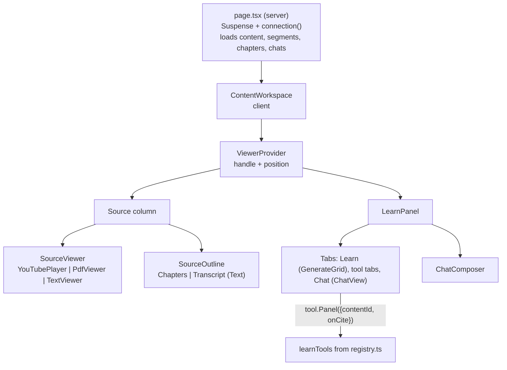
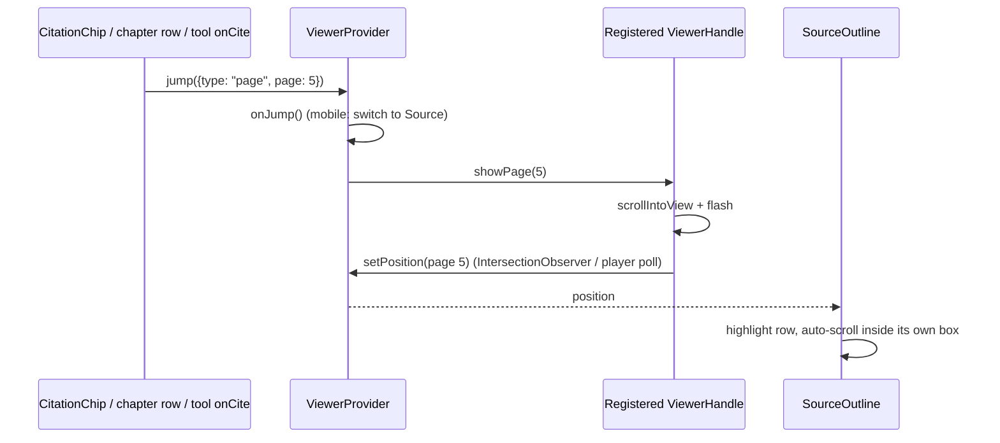
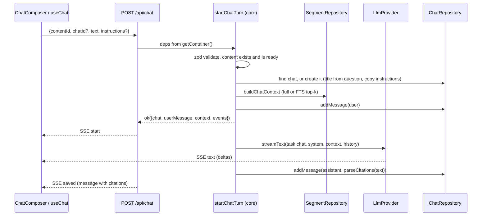
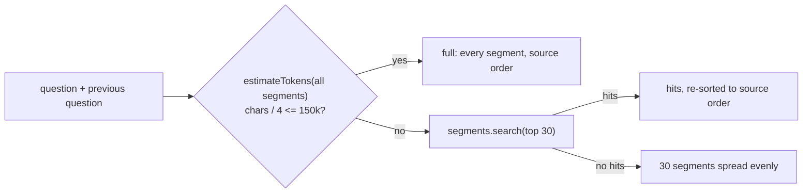

# 07. Content page and chat

Status: Current (Phase 3, Lane B). Decisions: ADR-0004, ADR-0005, ADR-0011, ADR-0013, ADR-0015 (chat context).

The content page mirrors YouLearn's layout in Hearth style: the app sidebar, the source in the middle, and a Learn panel with tools and chat on the right.

## Files

| Area               | Where                                                               |
| ------------------ | ------------------------------------------------------------------- |
| Route              | `apps/web/src/app/content/[id]/page.tsx`                            |
| Layout and viewers | `apps/web/src/features/content-viewer/`                             |
| Learn panel        | `apps/web/src/features/learn-panel/{learn-panel,generate-grid}.tsx` |
| Chat UI            | `apps/web/src/features/chat/`                                       |
| Chat use cases     | `packages/core/src/usecases/chat/{chat,context,prompts}.ts`         |
| Chat stream        | `apps/web/src/app/api/chat/route.ts` (`POST`, SSE)                  |
| Stored file        | `apps/web/src/app/api/content/[id]/file/route.ts` (`GET`)           |

## Page structure

- **Server read.** The page wraps everything, `AppShell` included, in one `<Suspense>`. `AppShell`'s `NavLink` calls `usePathname()`, which is runtime data on a dynamic route.
- **Full height.** The page cancels `AppShell`'s padding with negative margins and fills `h-dvh`. Each column scrolls on its own. `contain-inline-size` on that wrapper stops long nowrap text (the title) from widening `AppShell`'s flex `main` past a phone screen.
- **Responsive.** From `lg` (1024px) the source column and the Learn panel (`w-96`, `xl:w-md`, `2xl:w-lg`) sit side by side. Below `lg` a Hearth `Source | Learn` tab switch shows one at a time. Every viewer jump calls `onJump`, which switches back to Source, so a citation clicked in chat always shows its target.

## Viewer and jumps

`ViewerProvider` (`viewer-context.tsx`) keeps two contexts:

- **actions** (stable): `register(handle)`, `jump(ref)`, `jumpToToken("[p.5]")`, `setPosition`.
- **position** (changes often): where the reader is now, as a `CitationRef`. Only the Chapters and Transcript lists read it, so chat does not re-render while a video plays.

| Kind                | Viewer                                                                                     | Handle                    | Position source                 | Token     |
| ------------------- | ------------------------------------------------------------------------------------------ | ------------------------- | ------------------------------- | --------- |
| youtube             | `YouTubePlayer`: IFrame Player API, loaded once from `youtube.com/iframe_api`              | `seek(sec)` + `playVideo` | `getCurrentTime()` every 500 ms | `[mm:ss]` |
| pdf with `filePath` | `PdfViewer`: `pdfjs-dist` 6.5, one canvas per page, drawn when within a screen of the view | `showPage(n)`             | page ≥ 50% visible              | `[p.N]`   |
| pdf without file    | `TextViewer` in `pages` mode (the seed)                                                    | `showPage(n)`             | top-most visible page           | `[p.N]`   |
| webpage, text       | `TextViewer` in `paragraphs` mode; anchor `§n` = segment `idx + 1`                         | `showParagraph(n)`        | top-most visible paragraph      | `[§n]`    |

- A seek requested before the YouTube player is ready is kept and applied on ready.
- `youtubeVideoId` accepts `watch?v=`, `youtu.be/`, `/embed/`, `/shorts/` and `/live/` URLs. Anything else shows a warning callout, and chat still works.
- Unsupported jumps (a page citation on a video) are ignored.
- **pdf.js worker.** `new URL("pdfjs-dist/build/pdf.worker.min.mjs", import.meta.url)` is bundled by Turbopack as a static asset. pdf.js is imported dynamically, so it never runs on the server.

### `GET /api/content/[id]/file`

- `content.filePath` is resolved against `THOTH_DATA_DIR` (it may be relative, like `uploads/x.pdf`, or absolute).
- A path that resolves outside the data folder is refused with `403`. A missing row, a content with no file, or a missing file is `404`.
- The response streams the file with `Content-Type: application/pdf` for PDFs and `Cache-Control: private, max-age=3600`.

## Learn panel

- **Tabs** are browser-like: each closes with its own button, `+` opens a new Learn tab, arrow keys move between them and Delete closes one. A tool or the Chat tab opens once and is re-selected after that. Panels stay mounted while hidden, so a tool keeps its state.
- **The Learn tab** shows the Generate grid, one card per entry in `learnTools` (label and description), in registry order. It also lists the content's recent chats.
- **Tools** get `contentId` and `onCite = jumpToToken`, per the frozen contract in `learn-panel/types.ts`.
- **The composer** sits at the bottom of the panel. Sending opens the Chat tab, then streams the answer into it.

## Chat

### Turn

- **Errors before streaming** (validation, missing content or chat, content not ready, no text) come back as `Result` errors. The route returns JSON `{error}` with status 400 or 404, and nothing is saved.
- **Errors while streaming** become an `error` event. The question stays saved; the answer is not. The UI shows a danger callout with **Try again**.
- **Stop** aborts the fetch. The route passes `req.signal` to the provider, and the client keeps the partial text.
- If the client disconnects, the route keeps consuming events, so a finished answer is still saved.

### SSE events (`features/chat/stream-events.ts`)

| Event   | Payload                                                          |
| ------- | ---------------------------------------------------------------- |
| `start` | `chat`, `userMessage`, `context: {mode, included, total}`        |
| `text`  | `delta`                                                          |
| `saved` | `message` (the assistant message with parsed `citations`). Last. |
| `error` | `message`, in Hearth voice                                       |

### Prompt (`prompts.ts`)

- **System:** Thoth's role, then rules: answer from the source; put a token after every sentence that uses it; the citation format for this content kind; only use tokens that appear in the source; say so when the source does not cover the question; a small Markdown subset; answer in the question's language. In search mode it adds that only the best-matching passages are included. The owner's chat instructions come last, in `<chat_instructions>`, and must not override the citation rules.
- **Context** (`LlmRequest.context`, cached by the API adapter): `<source title kind>` with one passage per line, each starting with its token from `segmentToken` (built on `citationToken`).
- **History:** the last 20 messages. Consecutive messages of one role (after a failed reply) are merged.

### Context selection (`context.ts`)

The previous question joins the search query so a short follow-up ("and the second one?") still finds its passages. The UI shows a caption when an answer used search mode.

### Rendering answers (`markdown-lite.ts`, `rich-text.tsx`)

- Answers are parsed into a small Markdown subset: paragraphs, `-` and `1.` lists, headings (shown as bold lines), `**bold**`, `` `code` ``, and citation tokens. Nothing is rendered as HTML, so model output cannot inject markup.
- Tokens become **citation chips**: `p. 5`, `03:21` or `§4` on `neutral-tint`, turning `accent-tint` on hover, with an accessible name such as "Play from 03:21". A click calls `jump`.
- Layout follows Hearth Conversation: the reader's message in an `accent-tint` bubble, the reply on the page in `body-lg`.

### History and instructions

- **History** menu (Hearth Menu) lists the content's chats, newest first. **New chat** clears the thread; the chat row is created only when the first question is sent.
- **Instructions** opens a Hearth Modal (`<dialog>`) with up to 2,000 characters. On a saved chat it calls `saveChatInstructionsAction`. On a new chat it is kept as a draft and sent with the first question. New chats start with the latest chat's instructions.
- Reads and instruction saves are thin Server Actions in `features/chat/actions.ts`.

## Tests

| Test                                      | Covers                                                                                                                       |
| ----------------------------------------- | ---------------------------------------------------------------------------------------------------------------------------- |
| `core/usecases/chat/chat.test.ts` (14)    | tokens in the context per kind, FTS switch and fallback, saved citations, history, instructions, stream errors, input errors |
| `web/features/chat/markdown-lite.test.ts` | inline and block parsing, citations inside bold, no HTML                                                                     |
| `web/features/content-viewer/*.test.ts`   | YouTube ID parsing, locator labels and the active row                                                                        |

## Known limits and follow-ups

- The PDF viewer draws canvases only, with no text layer, so PDF text cannot be selected yet.
- `AppShell` should wrap `NavLink` in `<Suspense>` and offer a full-bleed option; this page works around both.
- On phones the sidebar is hidden and `AppShell` has no mobile navigation yet.
- `ChatRepository` has no delete or rename, so chats cannot be removed from History yet.
