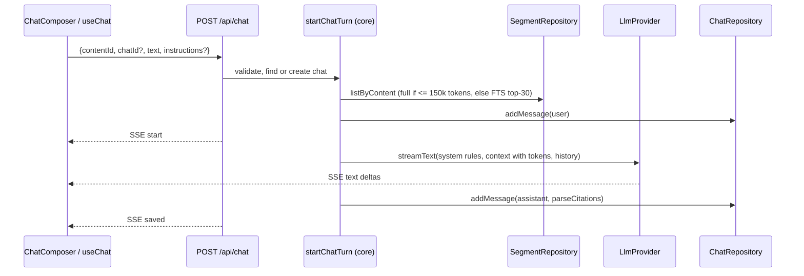

# 07. Content page and chat

Status: Current (Phase 3, Lane B). Draft; to be extended before merge.

## Layout

`/content/[id]` (`app/content/[id]/page.tsx`) loads the content, segments, chapters and chats, then renders `ContentWorkspace` (`features/content-viewer`): AppShell sidebar, source column (viewer + Chapters/Transcript tabs), Learn panel. Below `lg` a Source | Learn tab switch shows one column; a citation click switches to Source.

## Viewer and citations

`ViewerProvider` holds one `ViewerHandle` (`seek`, `showPage`, `showParagraph`) registered by the active viewer, plus the current position (time, page or paragraph) used to highlight and auto-scroll chapters and transcript.

| Kind                | Viewer                                            | Token     |
| ------------------- | ------------------------------------------------- | --------- |
| youtube             | IFrame Player API, polls time every 500 ms        | `[mm:ss]` |
| pdf with `filePath` | pdf.js canvases from `GET /api/content/[id]/file` | `[p.N]`   |
| pdf without file    | segments as text pages                            | `[p.N]`   |
| webpage, text       | paragraphs, `§n` = segment idx + 1                | `[§n]`    |

## Chat turn

- Prompts: `packages/core/src/usecases/chat/prompts.ts`. Context: `context.ts`. Errors before streaming are JSON 4xx; errors while streaming are an `error` event, and no assistant message is saved.
- History: last 20 messages; consecutive same-role messages merge.
- Chat instructions are per chat; a new chat copies the latest chat's.
