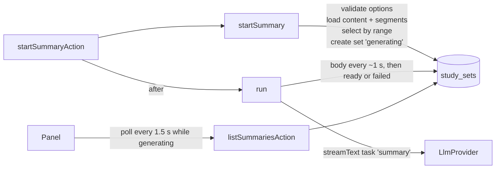

# 08. Summary and notes

Status: Current (Phase 4, Lane C; notes editor rebuilt in Phase 8, Lane 2). Decisions: ADR-0016, ADR-0022.

The notes editor has its own doc: [12-notes-editor.md](12-notes-editor.md). This doc keeps the summary and the shared prompt rules.

## What it does

| Tool        | Entry point                 | What the owner gets                                                                                                                       |
| ----------- | --------------------------- | ----------------------------------------------------------------------------------------------------------------------------------------- |
| **Summary** | `features/summary/tool.tsx` | A Generate dialog (template, range, language, custom prompt), a list of this content's summaries, the open summary as Markdown with chips |
| **Notes**   | `features/notes/tool.tsx`   | One Markdown document per content in a live-preview editor (doc 12), debounced autosave, and "Draft notes with Claude" streamed live      |

Both plug into the Learn panel through the `LearnTool` contract (`features/learn-panel/types.ts`). They are client components that load data through their own Server Actions.

## Core use cases (`packages/core/src/usecases/{summary,notes}`)

| Function                                 | File         | Notes                                                                                                                     |
| ---------------------------------------- | ------------ | ------------------------------------------------------------------------------------------------------------------------- |
| `startSummary(deps, contentId, options)` | `summary.ts` | Returns `Result<{ set, run }>`. The set exists (status `generating`) before the model is called                           |
| `generateSummary`                        | `summary.ts` | `startSummary` + `run()`; used by tests and scripts                                                                       |
| `listSummaries`                          | `summary.ts` | Newest first. A set `generating` for more than 15 minutes is marked `failed` ("interrupted", e.g. after a server restart) |
| `deleteSummary`                          | `summary.ts` | Only a `summary` set of that content                                                                                      |
| `getSourceBounds`                        | `summary.ts` | `{ locatorType, durationSec, pageCount }` so the dialog shows time or page inputs                                         |
| `selectSegments(segments, ranges)`       | `ranges.ts`  | See below                                                                                                                 |
| `getNote`, `saveNote`, `draftNotes`, `streamNotesDraft` | `notes/notes.ts` | The drafts return Markdown and do **not** save it; the editor decides to replace or append. See doc 12 |

### Options

`SummaryOptions` (zod, stored as the set's `options` JSON):

| Field          | Values                                                                                                            |
| -------------- | ----------------------------------------------------------------------------------------------------------------- |
| `template`     | `detailed` (comprehensive), `cheat_sheet` (concise bullets), `short` (essentials)                                 |
| `language`     | Free text up to 40 characters, default `English`. The dialog offers a list                                        |
| `customPrompt` | Optional, up to 1000 characters. Added to the system prompt                                                       |
| `ranges`       | 0 to 10 of `{type:"time", startSec, endSec}` or `{type:"page", startPage, endPage}`. Empty means the whole source |

The title is `"<Template> summary"` plus the ranges, e.g. `Short summary · 01:46–28:22` or `Detailed summary · pages 3–5`.

### Range rules (`selectSegments`)

- **Time range:** a segment is kept when it **overlaps** the range (`start < rangeEnd && end > rangeStart`), so a cue group that straddles a boundary is not lost.
- **Page range:** inclusive on both ends.
- Several ranges are a union, returned in reading order.
- A range never matches a locator of another type (a page range on a video selects nothing).
- If nothing is selected the use case returns `validation` ("Nothing in this source falls inside the range you chose") and creates no set.
- The selected text must be at most 600,000 characters (`MAX_SOURCE_CHARS`, about 150k tokens). Beyond that the owner is asked to choose a range. Map-reduce summarising for very long sources is **not** built.

### Prompts (`prompts.ts`)

- `buildSourceContext` prefixes every segment with `citationToken(locator, idx)`: `[p.3]`, `[01:46]`, `[§4]`. It is sent as `LlmRequest.context`, so the API adapter can cache it.
- The system prompt holds the template instructions, the language, the custom prompt, and the citation rules: cite inline with tokens exactly as they appear, never invent one, none inside headings.
- Notes use the same context and their own system prompt (`notes/prompts.ts`). Both use `task: "summary"`.

### Status transitions

`generating` → `ready` (body saved, trimmed) or `failed` (`error` set). A stream `error` event, an empty reply, or a thrown error all end in `failed`; a partial body is kept. `run()` never throws.

## Web (`apps/web/src/features/{summary,notes}`)

| File                          | Role                                                                                                                                                                                                   |
| ----------------------------- | ------------------------------------------------------------------------------------------------------------------------------------------------------------------------------------------------------ |
| `summary/actions.ts`          | Thin Server Actions. `startSummaryAction` calls `after(run)` so the action returns at once                                                                                                             |
| `summary/generate-dialog.tsx` | The Hearth modal. The form is mounted only while open, so every open starts fresh. Time inputs accept `01:46` or `1:02:03`                                                                             |
| `summary/dialog.tsx`          | Hearth modal on a native `<dialog>` (focus trap, Escape, focus return). Used by the delete confirm                                                                                                     |
| `summary/markdown.tsx`        | `react-markdown` + `remark-gfm` in Hearth styles. `linkCitations` rewrites tokens to `#cite:` links; the `a` renderer shows them as chips that call `onCite("[p.3]")`. Default URL sanitising stays on |
| `summary/callout.tsx`         | Hearth Callout (danger, info)                                                                                                                                                                          |
| `notes/**`                    | The live-preview Tiptap editor, autosave and the streamed draft. Described in doc 12                                                                                                                   |

`notes` no longer imports from `summary`: it uses `Dialog` from `@thoth/ui` and its own copy of `callout.tsx`. Chips in notes are editor nodes, not `linkCitations` links.

### Why polling, not SSE

The Learn panel contract gives us Server Actions, and a Server Action cannot stream to the client. `app/api/**` belongs to Lane B. So generation runs in `after()` and writes the growing text into `study_sets.body` about once a second; the panel polls while any set is `generating` and re-renders the Markdown, which looks like streaming. It also survives closing the tab. Trade-off: up to 1.5 s of latency, and a server restart during generation leaves a set that is marked `failed` by `listSummaries` after 15 minutes.

### Notes autosave and drafts

Moved to [12-notes-editor.md](12-notes-editor.md): 800 ms debounced autosave through `saveNote` (records `note_edit`), and a Claude draft that streams into the editor through polled Server Actions, with Stop and one undo step.

## Tests

- `summary/summary.test.ts` (18): range filtering for time and page, prompt tokens and templates, status transitions, failure paths, partial saves, list and delete.
- `notes/notes.test.ts` (4) and `notes/draft-runs.test.ts` (8): notes use cases and the streamed draft. Editor tests are listed in doc 12.
- Fakes live in `summary/fakes.ts` (test-only, not exported from the package).
- No live call in CI. Live smoke runs go through the dev harness `/dev/tools/<contentId>`.

## Known limits

- Very long sources are refused, not chunked.
- Notes are one document; no versions, no merge if two tabs edit.
- Citation chips depend on Lane B's `onCite` to move the viewer. In the harness it only records the token.
