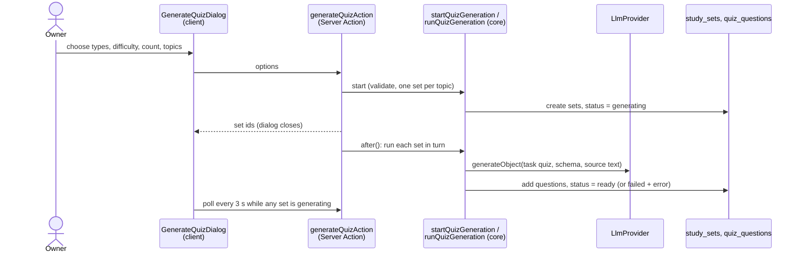

# 09. Quiz and flashcards

Status: Current (Phases 5 and 6, Lane D). Decision draft: ADR-0016 and ADR-0017.

## Flow

Flashcards follow the same two steps (`startFlashcardGeneration` / `runFlashcardGeneration`), with one set per request.

## Where things live

| What                                             | Where                                                                                  |
| ------------------------------------------------ | -------------------------------------------------------------------------------------- |
| Quiz use cases, schemas, prompts, grading, stats | `packages/core/src/usecases/quiz/`                                                     |
| Flashcard use cases, schemas, prompts, FSRS      | `packages/core/src/usecases/flashcards/`                                               |
| Test fakes (in-memory repos, scripted model)     | `packages/core/src/usecases/quiz/fakes.ts`                                             |
| Server Actions                                   | `apps/web/src/features/{quiz,flashcards}/actions.ts`                                   |
| Learn panels                                     | `features/quiz/tool.tsx`, `features/flashcards/tool.tsx` (registered in `learn-panel`) |
| Review UI shared by decks and `/review`          | `features/flashcards/review-session.tsx`                                               |
| "Due today" page                                 | `apps/web/src/app/review/page.tsx`, `features/flashcards/due-today.tsx`                |

## Quiz

- **Options** (`quizOptionsSchema`): question types (one or more of five), difficulty, questions per topic (1 to 30), topics (chapter ids, empty means all), focus, language. They are stored on the set (`StudySet.options`) with `topic` and `chapterId`, so "Generate more" repeats them.
- **Topics.** One set per chapter, titled "Quiz N: {chapter title}". A content with no chapters gets one set for the whole text. The chapter's text is every segment from its start to the next chapter's start (`segmentsForChapter`), rendered as `[p.3] text` or `[03:21] text` lines (capped at 60,000 characters).
- **Generation.** `generateObject` with task `quiz` and `generatedQuizSchema`, a discriminated union on `type`, one schema per question type. The prompt asks for understanding and application, an explanation, and a `source` citation token. Questions of types that were not requested are dropped, and the list is capped at the count. An empty result fails the set.
- **Locators.** The model copies a citation token such as `[p.3]`. `resolveCitation` turns it into the `Locator` of a real segment, or `null` if it names nothing real. The player shows the chip and calls `onCite(citationToken(locator))`. For paragraph (`offset`) locators the token is `[§0]`, because a locator alone does not carry the paragraph index. Lane B can improve this when it wires `onCite`.
- **Grading** (`grading.ts`, `submit-answer.ts`):

  | Type                        | Rule                                                                                         |
  | --------------------------- | -------------------------------------------------------------------------------------------- |
  | multiple choice, true/false | 1 or 0                                                                                       |
  | fill in the blank           | 1 if the normalised answer equals a normalised accepted answer, else 0                       |
  | multi select                | `max(0, (right picks − wrong picks) / right answers)`. Correct only for the exact set        |
  | free response               | model score 0..1 against the rubric (task `grading`). 0.7 or more is correct. Feedback shown |

  Every attempt is stored through `QuizRepository.addAttempt`. A blank free response returns a validation error without a model call.
- **Weak topics** (`stats.ts`): for each topic, the mean of the latest score of each answered question. The panel lists topics under 80%, weakest first, at most 3.
- **Player.** One question at a time. "Check answer" grades through the Server Action. Feedback shows the result, the explanation, the key points (free response) and the citation chip. The completion screen shows the score with Restart, Generate more (same options, same topic), and "Next: {following quiz}".

## Flashcards

- **Options:** count (1 to 60), topics, focus, language. One request covers all chosen topics. The prompt labels each topic, and each card carries one of those titles as `topic` (anything else falls back to the first).
- **Cards** are stored due now (`newFsrsState`). Editing changes `front` and `back` only. Deleting a card removes its reviews (cascade).
- **FSRS** (`fsrs.ts`): `ts-fsrs` with fuzz off and short-term steps on.
  - `toCard` and `fromCard` map `FsrsState` to and from the library's card. `learning_steps` is recovered from the last interval (see the ADR draft).
  - `scheduleReview(state, rating, now)` is pure. `previewReview` gives the four next due dates, shown on the buttons ("Again 1m, Hard 6m, Good 10m, Easy 8d" for a new card).
  - `reviewCard` saves the new state and a review row in one transaction (`FlashcardRepository.recordReview`).
  - A card due again within 20 minutes stays in the session.
- **Review UI** (`ReviewSession`): front, "Show answer", then Again/Hard/Good/Easy. The same component serves a deck's own review (cards due in that set) and `/review`.
- **`/review`** ("Due today"): `listDueCards` across all sets, oldest first, up to 100. An empty state links back to the library. The orchestrator adds the sidebar link to `/review`.

## Tests

`pnpm --filter @thoth/core test`: schema good and bad replies for every question type; grading rules including multi select partial credit and fill-in-the-blank normalising; weak-topic calculation; chapter source extraction and citation resolving; generation with fakes (start, run, failed, wrong types); FSRS mapping and scheduling with a fixed clock; card review, edit and delete. A live run through the Claude subscription was done by hand (see the lane report).

## Known limits

- Offline review is deferred. Do not edit `public/sw.js` in this lane.
- A set stuck on "Generating" after a server restart is deleted by the owner and generated again.
- Quiz attempts are not grouped into rounds. The score screen shows only the current play-through. Topic strength uses the latest attempt per question.
