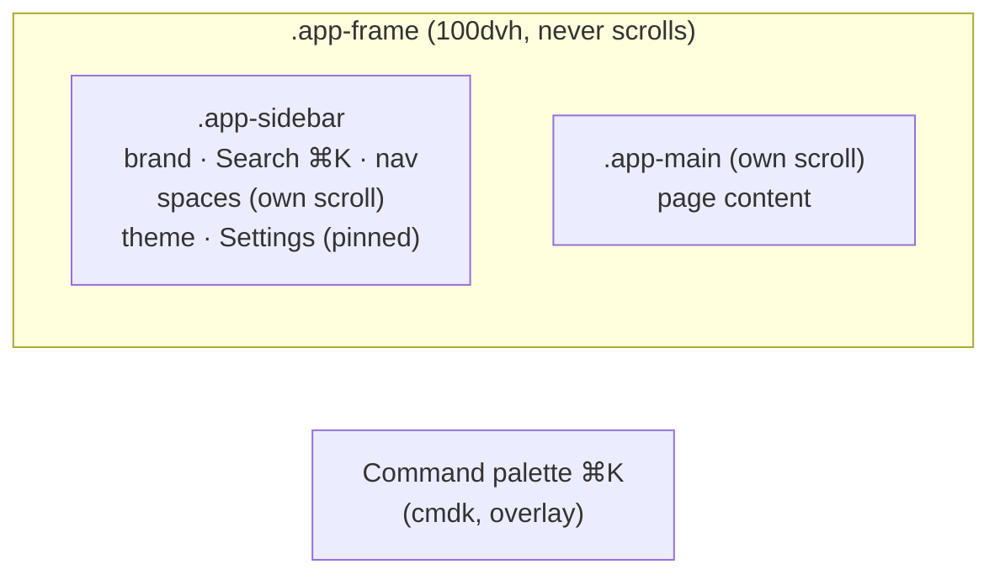

# 11. App shell and the native feel

Status: Current (Phase 8, Step 0). Decision: ADR-0020.

Thoth should feel like a desktop app (Notion, Claude Code), not a website. **Every page and panel follows these rules.** Reviewers check them.

## The frame

| Piece                                                        | File                                               |
| ------------------------------------------------------------ | -------------------------------------------------- |
| Frame, `bleed` option for full-screen pages                  | `apps/web/src/app/_components/app-shell.tsx`       |
| Sidebar (collapse, drawer, theme)                            | `apps/web/src/app/_components/sidebar.tsx`         |
| Commands, shortcuts, search providers                        | `apps/web/src/app/_components/commands.tsx`        |
| Palette                                                      | `apps/web/src/app/_components/command-palette.tsx` |
| Per-viewer prefs (theme, sidebar) and the first-paint script | `apps/web/src/app/_components/prefs.ts`            |
| Styles                                                       | `apps/web/src/app/shell.css`                       |

## Rules

1. **Never scroll the page.** Pages render inside `.app-main`, which scrolls. Full-screen tools (the content workspace) use `<AppShell bleed>` and manage their own panel scrolling.
2. **Keyboard first.**
   - Every app-level action is a `Command` in the registry, registered with `useCommands`. That puts it in the palette with its shortcut.
   - Never add your own `window` keydown listener for global shortcuts.
   - Shortcuts use `mod` (Cmd on Mac, Ctrl elsewhere).
   - Reserved: `mod+k` palette, `mod+\` sidebar, `mod+,` settings.
3. **Search plugs into the palette** with `useSearchProvider(provider)`. Results are `{ id, label, detail, group, href }`.
4. **No full-page spinners.**
   - Use skeleton blocks shaped like the content (`bg-surface-300`, `animate-pulse`).
   - Use in-place pending labels on buttons ("Saving", "Grading").
   - Keep the previous content visible while refreshing.
5. **Instant feedback.** Update the UI optimistically for local, safe actions (toggles, reorder, rename) and roll back on error with a Hearth callout.
6. **Chrome is not text.**
   - Buttons, tabs, nav items and panel headers use `cursor: default` and `user-select: none`; `shell.css` sets this.
   - Content stays selectable.
7. **Motion** (Hearth motion guide):
   - Durations: 150 ms for hover and press, 200 ms for menus and drawers, 300 ms for modals.
   - Easing: `cubic-bezier(0.2, 0, 0, 1)` for elements entering.
   - Animate only color, opacity and transform.
   - Respect `prefers-reduced-motion`.
8. **Density.**
   - Interactive rows are 32–36 px in chrome, and at least 40 px for primary buttons.
   - Lists use hairline dividers (`border-subtle`), not cards, when there are many rows.
9. **Modals** use `Dialog` from `@thoth/ui` (a native `<dialog>`). Render it only while open.
10. **Empty states:** a serif `type-heading-3`, one sentence in `text-ink-muted`, and one primary action.
11. **Theme:** use tokens only. Test every new screen in light and dark themes. The palette has "Use light theme" and "Use dark theme" commands.
12. **Phone** (under 768 px):
    - The sidebar becomes a drawer opened from the top bar.
    - Tap targets are at least 44 px.
    - Nothing may need hover to work.
