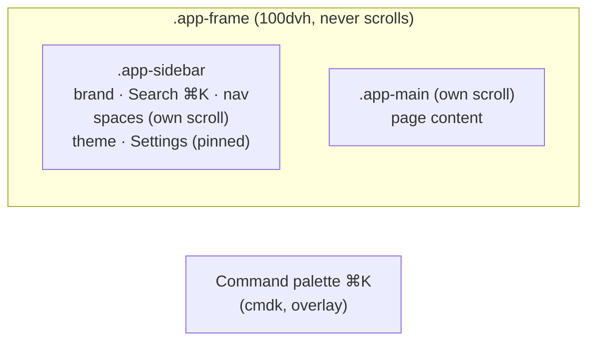

# 11. App shell and the native feel

Status: Current (Phase 8, Step 0). Decision: ADR-0020.

Thoth should feel like a desktop app (Notion, Claude Code), not a website. **Every page and panel follows these rules.** Reviewers check them.

## The frame

| Piece                                                       | File                                               |
| ----------------------------------------------------------- | -------------------------------------------------- |
| Frame (`AppFrame`), rendered once by the `(shell)` layout   | `apps/web/src/app/(shell)/layout.tsx`              |
| Page body (`AppPage`, `bleed` for full-screen pages)        | `apps/web/src/app/_components/app-shell.tsx`       |
| Page title with the page's tone (`PageHeader`)              | `apps/web/src/app/_components/page-header.tsx`     |
| Sidebar (collapse, drawer, theme)                           | `apps/web/src/app/_components/sidebar.tsx`         |
| Commands, shortcuts, search providers                       | `apps/web/src/app/_components/commands.tsx`        |
| Palette                                                     | `apps/web/src/app/_components/command-palette.tsx` |
| Per-viewer prefs (mode, look, accent, sidebar), first paint | `apps/web/src/app/_components/prefs.ts`            |
| The look in JavaScript, for layouts that differ (`useSkin`) | `apps/web/src/app/_components/use-skin.ts`         |
| Settings › Appearance                                       | `apps/web/src/features/settings/appearance.tsx`    |
| The Modern look's frame                                     | `apps/web/src/app/modern.css`                      |
| Styles                                                      | `apps/web/src/app/shell.css`                       |

## Rules

1. **Never scroll the page.** Pages render inside `.app-main`, which scrolls. Full-screen tools (the content workspace, a space) use `<AppPage bleed>` and manage their own panel scrolling.
   - Pages with the sidebar live in the `app/(shell)/` route group (ADR-0048). Its layout renders the frame once, so the sidebar stays mounted between pages and its current-page pill slides. A new page goes in `(shell)/` and wraps its body in `AppPage`.
2. **Keyboard first.**
   - Every app-level action is a `Command` in the registry, registered with `useCommands`. That puts it in the palette with its shortcut.
   - Never add your own `window` keydown listener for global shortcuts.
   - Shortcuts use `mod` (Cmd on Mac, Ctrl elsewhere).
   - Reserved: `mod+k` palette, `mod+\` sidebar, `mod+,` settings.
3. **Search plugs into the palette** with `useSearchProvider(provider)`. Results are `{ id, label, detail, group, href }`.
4. **No full-page spinners.**
   - Use skeleton blocks shaped like the content (`bg-surface-300`, `animate-pulse`).
   - Use in-place pending labels on buttons ("Saving", "Grading").
   - Keep the previous content visible while refreshing.
5. **Instant feedback.** Update the UI optimistically for local, safe actions (toggles, reorder, rename) and roll back on error with a Hearth callout.
6. **Chrome is not text.**
   - Buttons, tabs, nav items and panel headers use `cursor: default` and `user-select: none`; `shell.css` sets this.
   - Content stays selectable.
7. **Motion** (ADR-0047): springs, like iOS and Material You.
   - Use the springs from `@thoth/ui` (`spring.snappy` for presses, toggles and pills; `smooth` for cards and panels; `gentle` for large reveals; `bouncy` for playful moments) with `motion` components. Shared pieces are in `apps/web/src/app/_components/motion/`: `Reveal`, `Lift`, `CountUp`, `Ring`, `NavPill`, `PageEnter`.
   - CSS transitions and keyframes are fine for small things (the composer focus glow, the palette opening). Use `cubic-bezier(0.2, 0, 0, 1)` there.
   - Animate only color, opacity and transform.
   - `MotionProvider` (`reducedMotion="user"`) and the global reduced-motion rule turn movement off. Every interaction must still work then; the e2e suite runs that way.
8. **Colour and glass** (ADR-0047): bold chrome, calm reading.
   - Tones from `@thoth/ui` (`tone-peach`, `tone-sage`, `tone-sky`, `tone-butter`, `tone-lilac`) fill tiles, cards, chips and sidebar icon tiles. Content kinds use `kindTone`, and spaces use their own accent (`data-accent`, `accent-tile`).
   - `glass` (translucent and blurred) is for floating chrome only: the sidebar, palette, dialogs and the home composer card.
   - Never put a tone or glass behind reading text: the PDF, transcript, notes, chat answers or whiteboard content.
   - `prefers-reduced-transparency` makes the glass opaque.
9. **Density.**
   - Interactive rows are 32–36 px in chrome, and at least 40 px for primary buttons.
   - Lists use hairline dividers (`border-subtle`), not cards, when there are many rows.
10. **Modals** use `Dialog` from `@thoth/ui` (a native `<dialog>`). Render it only while open.
11. **Empty states:** a serif `type-heading-3`, one sentence in `text-ink-muted`, and one primary action.
12. **Theme:** use tokens only. Test every new screen in light and dark, in both looks (rule 14). The palette has "Use light theme" and "Use dark theme" commands.
13. **Phone** (under 768 px):
    - The sidebar becomes a drawer opened from the top bar.
    - Tap targets are at least 44 px.
    - Nothing may need hover to work.
14. **Two looks** (ADR-0050): Hearth and Modern, picked in Settings › Appearance or from ⌘K.
    - Style the look with CSS on `:root[data-skin="modern"]`. Read it in JavaScript (`useSkin`) only when the layout itself differs, as the content page's split does.
    - Every screen must look right in both. `hearth-only` hides a part in Modern, and `modern-only` adds one.
    - In Modern, the sidebar floats as glass and lists recent sources, the page sits on a solid rounded sheet, and home leads with the composer.
