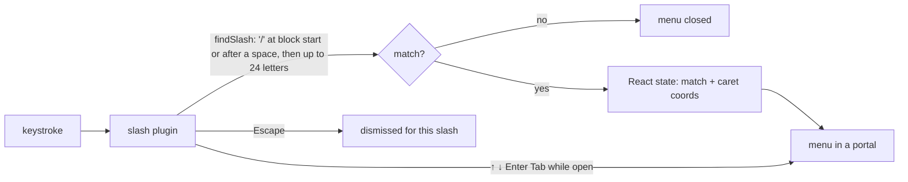

# 12. Notes editor

Status: Current (Phase 8, Lane 2). Decisions: ADR-0022, draft ADR-0025 (`docs/decision/0025-notes-draft-streaming-and-storage.md`).

## What it does

The Notes panel is one live-preview editor, similar to Notion. There is no separate Write pane and Preview pane.

- Formatting appears as you type: `#` and a space makes a heading, `-` a bullet, `1.` a numbered list, `>` a quote, `**bold**`, `` `code` ``, three backticks make a code block, and `---` a divider.
- Type `/` to open a menu of blocks.
- `[p.3]`, `[03:21]` and `[§2]` become citation chips. Clicking a chip calls `onCite(token)`, which moves the source viewer.
- The note saves itself 800 ms after the last edit. A quiet status shows "Saving…" or "Saved".
- "Draft notes with Claude" streams Claude's draft into the editor as it is written. Stop cancels it.

Storage does not change: the note is still Markdown in `notes.markdown` (one note per content, `NoteRepository`).

## Files

| File                                             | Role                                                                                                    |
| ------------------------------------------------ | ------------------------------------------------------------------------------------------------------- |
| `apps/web/src/features/notes/tool.tsx`           | `notesTool` and its Panel: header, status, toolbar, editor, the draft dialog                            |
| `features/notes/editor/extensions.ts`            | The single list of Tiptap extensions. Anything offered here must round-trip through Markdown            |
| `features/notes/editor/citation.ts`              | The `citation` inline node: Markdown tokenizer, input rule, paste rule, the chip node view and `onCite` |
| `features/notes/editor/callout.ts`               | Decorates a quote that starts with `**Note:**` (or Tip, Important, Warning) as a Hearth callout         |
| `features/notes/editor/slash.ts`                 | The `/` plugin (`findSlash`, Escape to dismiss) and the menu items                                      |
| `features/notes/editor/slash-menu.tsx`           | The menu: Hearth `menu` styles, a portal at the caret, arrow keys, Enter or Tab                         |
| `features/notes/editor/toolbar.tsx`              | Formatting buttons. They wrap, and they hide below a 20rem panel                                        |
| `features/notes/editor/prose.ts`                 | Hearth styles for the editable content, as Tailwind variants on the editor root                         |
| `features/notes/editor/markdown.ts`              | `parseNote` (Markdown to editor JSON) and `serializeNote` (editor to Markdown)                          |
| `features/notes/use-autosave.ts`                 | Debounced save through `saveNoteAction`                                                                 |
| `features/notes/use-draft.ts`                    | Starts a draft, polls it, shows it live, stop, one undo step                                            |
| `features/notes/actions.ts`                      | Thin Server Actions: load, save, start, read and cancel a draft                                         |
| `features/notes/draft-runs.ts`                   | The process-wide `NotesDraftRuns` instance (server only, kept on `globalThis`)                          |
| `packages/core/src/usecases/notes/notes.ts`      | `getNote`, `saveNote`, `draftNotes`, `streamNotesDraft`                                                 |
| `packages/core/src/usecases/notes/draft-runs.ts` | `NotesDraftRuns`: the in-memory registry of running drafts                                              |

The packages are `@tiptap/react`, `@tiptap/starter-kit`, `@tiptap/pm`, `@tiptap/markdown` and `@tiptap/extension-placeholder`, all pinned at 3.32.2.

## Blocks and how they are stored

| Block                    | Shortcut or slash item          | Markdown                                |
| ------------------------ | ------------------------------- | --------------------------------------- |
| Heading 1, 2, 3          | `#`, `##`, `###` and a space    | `# Title`                               |
| Bulleted list (nestable) | `-` and a space                 | `- point`                               |
| Numbered list            | `1.` and a space                | `1. step`                               |
| Quote                    | `>` and a space                 | `> text`                                |
| Callout                  | slash menu "Callout"            | `> **Note:** text`                      |
| Code block               | three backticks and a space     | a fenced block, with a language         |
| Divider                  | `---`                           | `---`                                   |
| Bold, italic, strike     | `**b**`, `*i*`, `~~s~~`, ⌘B, ⌘I | the same                                |
| Inline code              | `` `x` ``, ⌘E                   | the same                                |
| Link                     | paste a URL                     | `[text](url)`                           |
| Citation chip            | type or paste `[p.3]`           | `[p.3]`, `[03:21]`, `[1:02:03]`, `[§2]` |

Not offered, because Markdown cannot hold it: underline, colour and alignment. StarterKit's underline is turned off.

**The callout is a plain quote.** Markdown has no callout block, so we keep a quote that starts with a bold label and only _decorate_ it while editing (`bg-info-tint`, `text-info`). The note stays portable, and other Markdown renderers show a quote.

**Round-trip rule.** `features/notes/editor/markdown.test.ts` proves that Markdown in equals Markdown out for every block above, for each citation form, and for a whole note that holds them all. `slash.test.ts` proves each slash item produces the Markdown in the table. Known normalisations, each stable after one save:

- A citation inside bold, such as `**Main idea [p.2]**`, saves as `**Main idea** [p.2]`. `@tiptap/markdown` cannot put a mark on an inline atom, so the chip carries no marks (`marks: ""`).
- Brackets in plain text are escaped: `[0]` saves as `\[0\]`. They still render as `[0]`.
- The trailing empty paragraph (where the caret lands after a list) is not saved: `serializeNote` trims the end.
- Two lists in a row separated only by a blank line are one list in Markdown, so they load as one.

## Citation chips

```mermaid
flowchart LR
  T["typed '[p.3' then ']'"] -->|input rule| N[citation node<br/>attrs.token = '[p.3]']
  P[pasted text] -->|paste rule| N
  M["Markdown '[p.3]'"] -->|inline tokenizer| N
  N -->|renderMarkdown| M
  N -->|node view: button| C["onCite('[p.3]')"]
```

- The token pattern is the one in `@thoth/core` `parseCitations`. Paragraph numbers are 1-based (ADR-0019).
- The tokenizer runs only at a `[`, after Markdown's own code rules, so a token inside inline code or a code block stays text.
- The chip is a `<button>` (`badge badge--accent`) with `aria-label="Go to p.3 in the source"`. Mousedown does not move the caret.
- `onCite` is read through a ref, so a new `onCite` from the host applies without rebuilding the editor.

## Slash menu



- Items: Text, Heading 1–3, Bulleted list, Numbered list, Quote, Callout, Code block, Divider. Each shows its Markdown shortcut on the right, so the menu also teaches the shortcuts.
- The query filters by label and keywords ("hr" finds Divider). With no match the menu hides and Enter works as usual.
- The menu is portalled to `body` with `position: fixed`, so it is never clipped by a panel. It opens above the caret when there is no room below.
- It never opens inside a code block, inside a word (`and/or`), or while the editor is read-only.

## Autosave

- Every edit calls `schedule()`: the status becomes "Saving…" and a timer starts. 800 ms after the last edit, `flush()` serialises the editor and calls `saveNoteAction`.
- Blur saves at once. Unmounting the panel saves anything still pending (the editor is destroyed after this cleanup runs).
- One save runs at a time. Text equal to the last saved text is not sent again.
- Loading the note is not an edit. It replaces the document with `addToHistory: false` and `preventUpdate`, so it creates no undo step and no save.
- A failed save keeps the text, shows a danger callout, and retries on the next edit.
- `saveNote` in core is still the only way a note is written, so every save records the `note_edit` activity (ADR-0023).

## "Draft notes with Claude"

Server Actions are dispatched **one at a time per client** (`next/dist/docs/01-app/02-guides/server-actions.md`). A single long streaming action would block autosave and every other action on the page for the whole draft. So the draft runs in the background, and the editor polls for new text.

```mermaid
sequenceDiagram
  participant E as Editor (use-draft)
  participant A as Server Actions
  participant R as NotesDraftRuns (memory)
  participant C as core streamNotesDraft
  participant L as LlmProvider

  E->>A: startDraftAction(contentId)
  A->>C: validate content, build prompt
  C-->>A: Result<events>
  A->>R: start(events, abortController)
  A-->>E: draftId (returns at once; after() keeps the run alive)
  R->>L: streamText (task "summary", signal)
  loop every 250 ms
    E->>A: readDraftAction(draftId, from)
    A->>R: read(id, from)
    R-->>E: { text since from, status }
    E->>E: render "your notes + draft so far"
  end
  E->>A: cancelDraftAction(draftId) (Stop)
  A->>R: cancel: status cancelled, abort the model
```

- **Validation first.** `streamNotesDraft` checks the content (exists, `ready`, has segments, under `MAX_SOURCE_CHARS`) and returns a `Result` before any token. It then yields `text` events and ends with exactly one `done` or `error`. An empty reply is an `error`.
- **Live rendering.** Each tick parses the whole draft so far with the editor's own Markdown parser and replaces the document with "your notes + the draft". A half-written line looks like Markdown for a moment and becomes formatted on the next tick. The editor is read-only while Claude writes, and the end of the draft is kept in view.
- **Append or replace.** With an empty note the draft starts at once. Otherwise the shared `Dialog` asks: Cancel, Replace notes, or Add below (primary).
- **One undo step.** Ticks skip history and autosave (`addToHistory: false`, `preventUpdate`). At the end the document is reset to its old content and the final draft is applied as one change. So ⌘Z removes the whole draft, or restores the replaced notes, and the final change starts autosave.
- **Stop.** Stop calls `cancelDraftAction`. The registry marks the run `cancelled` and aborts the model through the request's `AbortSignal`. The last poll collects what was written. A "Draft stopped" callout says the text is kept and how to undo it; it clears on the next edit.
- **Closing the panel** cancels a running draft. If the tab is closed, nobody polls; the registry cancels a running draft that has not been read for 30 seconds.
- **Memory.** Finished runs are forgotten 10 minutes after they end. Nothing in the registry is saved. The note is saved by the editor's autosave, so a server restart during a draft loses only the unsaved draft.
- The prompt is unchanged (`notes/prompts.ts`, task `summary`, so it uses the Summary model from Settings).

`draftNotes` (one `generateText` call, no streaming) is kept for scripts and tests.

## Layout and feel

- The panel fills its box: `h-full min-h-0 flex-col`. The header and toolbar stay put and the text scrolls in its own area. There is no fixed width.
- Header, toolbar and text share one centred reading column (`max-w-2xl`), so a wide panel adds whitespace, not longer lines.
- The toolbar wraps on narrow panels. Below a 20rem container it hides; Markdown shortcuts and the slash menu still do everything. On touch screens its buttons are 44 px.
- Clicking the empty space below the text puts the caret at the end.
- Chrome (header, toolbar, menu) uses `cursor: default` and `select-none`. The text stays selectable.
- Loading shows skeleton lines, never a spinner.
- All colours are Hearth tokens. Checked in light and dark themes, at 360 px and desktop widths.

## Tests

- `packages/core/src/usecases/notes/notes.test.ts` (4): get, save limits, the non-streaming draft and its failures.
- `packages/core/src/usecases/notes/draft-runs.test.ts` (8): `streamNotesDraft` validation, signal and events; `NotesDraftRuns` reading from an offset, mid-stream reads, cancel with abort, model errors, abandoned drafts, expiry, a provider that throws.
- `apps/web/src/features/notes/editor/markdown.test.ts` (29): round-trip of every block and citation form, chips on load, tokens in code, look-alikes, `insertCitation`, a Claude-style draft.
- `apps/web/src/features/notes/editor/slash.test.ts` (15): `findSlash`, filtering, each slash item's Markdown, trailing paragraph.

The tests use a headless Tiptap editor in Node (no DOM), so they exercise the real schema, parser and serializer. Input rules need a view and are checked in the browser walkthrough.

## Known limits

- One note per content, no versions, no merge across two tabs (unchanged).
- No tables, task lists or images in notes yet.
- The draft re-parses the whole draft on every tick. That is fine at note sizes (a few thousand words), not for very long documents.
- A draft runs in the server's memory. With more than one server process, the poll could reach a process that does not know the draft. Thoth runs one process (ADR-0002).
