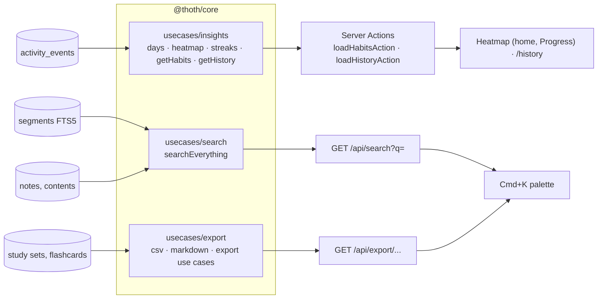

# 13. Habits, history, search and export

Status: Current (Phase 8, Lane 3). Decisions: ADR-0023 (activity log) and the Lane 3 draft ADR `ADR-0026.md`.

Four small features that read what the owner already did and wrote. All rules live in `@thoth/core`; the web layer only fetches and draws.

## Habit tracker

- **Data:** `ActivityRepository.countByDay(from, to, tzOffsetMin)`. `getHabits` reads the whole history in one grouped query, so the longest streak is all-time.
- **Days are the browser's local days.** The server cannot know the timezone, so the client passes `new Date().getTimezoneOffset()` to a Server Action (`features/habits/actions.ts`) after mount and shows a skeleton until it answers. `localDay(at, tz)` in `insights/days.ts` is the only place that converts an instant to a day.
- **Heatmap:** 53 columns of 7 days, Sunday first, the last column holds today; days after today are drawn empty. Levels 0–4 are relative to the busiest day in view (`levelFor`). Colours are Hearth tokens: `surface-300`, `accent-tint`, `accent-muted`, `accent`, `accent-pressed`.
- **Streak rules** (`computeStats`): a streak is consecutive local days with at least one event. Today with no activity yet does not break it; it stays alive until the day ends. If yesterday and today are both empty the current streak is 0. This week starts on Sunday, like the grid.
- **UI:** `features/habits/heatmap.tsx`. `compact` is the one-line summary plus grid on the home page; the full variant adds four stat cards on Progress. Each cell has a `title` and `aria-label` ("3 actions on Mon, 16 Nov 2026"); tapping a cell shows the same text under the grid (phones have no hover). On a phone the grid scrolls sideways inside its own box, starting at today.

## History

`/history` lists the newest 300 events grouped by local day ("Today", "Yesterday", then a date). `getHistory` links each event to the page it came from by resolving its `ref` (memoised, one read per distinct id):

| Kind                         | `ref`                                              | Links to                           |
| ---------------------------- | -------------------------------------------------- | ---------------------------------- |
| `content_added`, `note_edit` | content id                                         | `/content/{id}`                    |
| `summary_generated`          | study set id                                       | the set's content (or space)       |
| `quiz_answer`                | question id                                        | question → set → content           |
| `card_review`                | card id                                            | card → set → content               |
| `exam_submitted`             | exam session id                                    | session → set → space              |
| `chat_question`              | chat id (backfilled rows) or message id (new rows) | content, only when it is a chat id |

An event whose target was deleted still shows, without a link.

## Search

`GET /api/search?q=` (query capped at 200 characters) returns `{ hits }` from `searchEverything`:

1. **Titles:** every query word must appear in the title (case-insensitive); a title that starts with the word or contains it as a whole word scores higher.
2. **Notes:** every query word must appear in the note; the hit carries a snippet around the first match.
3. **Source text:** `SegmentRepository.search` (FTS5 BM25) across all contents, limit 2 × the result limit. FTS matches **whole words** with OR semantics; it does not match word prefixes.
4. **Merge** (`mergeHits`): titles, then notes, then source hits; within a kind by score. Scores are not comparable across kinds, so kind decides the order.

A source hit links to `/content/{id}?at=[p.3]` (also `[03:21]`, `[§4]`), the same citation tokens the viewer already opens. The palette (`features/search/search-provider.tsx`) debounces at 150 ms and aborts the previous request through the `AbortSignal`.

## Export

| Route                                     | File                                                               |
| ----------------------------------------- | ------------------------------------------------------------------ |
| `GET /api/export/content/{id}/markdown`   | `<title>.md`: title, source link, notes, ready summaries           |
| `GET /api/export/content/{id}/flashcards` | `<title>-flashcards.csv`: every ready flashcard set of the content |
| `GET /api/export/flashcards/{setId}`      | `<set title>.csv`: one set                                         |

Responses carry `Content-Disposition: attachment` and `Cache-Control: no-store`. File names are ASCII slugs. Failures return JSON `{ error }` with 404 (missing) or 400 (nothing to export).

**Anki CSV** (`flashcardsToAnkiCsv`): UTF-8, `Front,Back,Tags`, comma separated, fields quoted when they contain a comma, quote or line break and quotes doubled (RFC 4180). Header lines `#separator:Comma`, `#html:false`, `#tags column:3` tell Anki 2.1.54+ how to read the file and keep `<` and `&` as text; older versions skip `#` lines. A topic becomes one tag (`Cell biology` → `Cell_biology`) because Anki tags are space-separated. Import with File → Import in Anki and pick the Basic note type.

**Triggers:** palette commands "Export notes and summaries as Markdown" and "Export flashcards as Anki CSV", available while the URL is `/content/{id}`. They fetch the file, save it through a temporary link and show failures in a small status callout (bottom right, dismissible). `features/export/export-commands.tsx` is mounted through `<SearchProvider />` in the app shell.

## Files

| Area                            | Files                                                                                                                                                             |
| ------------------------------- | ----------------------------------------------------------------------------------------------------------------------------------------------------------------- |
| Core                            | `packages/core/src/usecases/{insights,search,export}/` (tests beside them)                                                                                        |
| Web                             | `apps/web/src/features/{habits,history,search,export}/`, `app/history/page.tsx`, `app/api/{search,export}/`                                                       |
| Shared edits (one section each) | `app/page.tsx` (heatmap), `app/progress/page.tsx` (heatmap), `app/_components/app-shell.tsx` (`<SearchProvider />`), `app/_components/sidebar.tsx` (History item) |

## Known limits

- `chat_question` events recorded after ADR-0023 hold a message id, so History cannot link them. Fix: record the chat id (a contract change for the chat use case).
- Search matches whole words only (the FTS query has no prefix terms).
- The palette re-sorts items inside a group with its own fuzzy matcher, so the order within a group can differ from the ranking above.
- There is no Export button in the content workspace yet (that folder belongs to Lane 1); the palette commands cover it.
