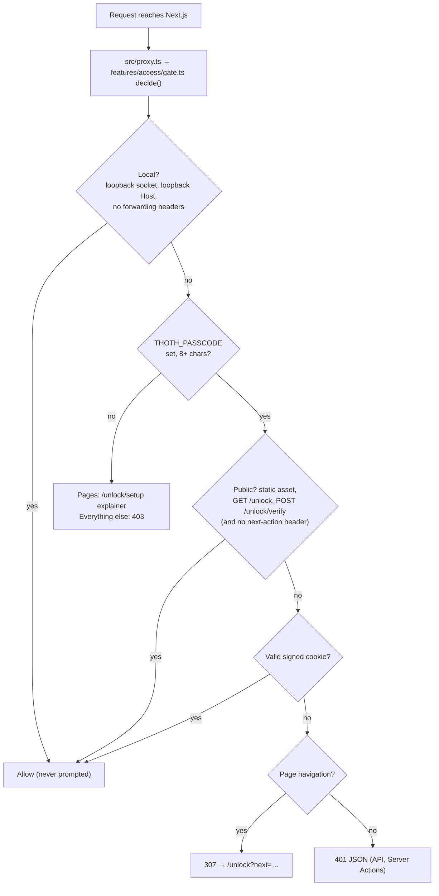

# 14. Phone, LAN and the passcode gate

Status: Current (Phase 8, Lane 4). Decision: draft ADR `docs/decision/0027-passcode-gate-and-lan-server.md` (ADR-0002 still holds: single user, local first).

Thoth runs on the owner's Mac. To use it from a phone, the Mac listens on the network, and **every request that does not come from the Mac itself must carry a signed session cookie**. With no passcode configured, other devices get a "set a passcode" page and **no data**.

## The gate



`POST /unlock/verify` checks the origin, the rate limit, then the passcode (constant time), and answers `303` with `Set-Cookie`.

## Who is "local"? (the hard part)

Next.js gives the proxy no socket. It fills `x-forwarded-for` from the socket **only when the client did not send one** (`base-server.js`: `??=`), so a remote device can forge `X-Forwarded-For: 127.0.0.1` and `Host: localhost`. Therefore:

| Mode                                 | How you start it         | Source of truth                                                                                                                                          | Safe on a LAN?                    |
| ------------------------------------ | ------------------------ | -------------------------------------------------------------------------------------------------------------------------------------------------------- | --------------------------------- |
| **Trusted** (`THOTH_TRUSTED_PEER=1`) | `pnpm start:lan`         | `scripts/lan-server.mjs` overwrites `x-thoth-peer` (real socket address) and `x-thoth-proxied` (did the client send forwarding headers) on every request | **Yes**                           |
| Untrusted                            | `pnpm dev`, `next start` | `x-forwarded-for` and `Host`, forgeable from the LAN                                                                                                     | **No.** Do not expose these ports |

Local means: the peer is loopback **and** the `Host` is loopback **and** no forwarding header was present. That last rule keeps `tailscale serve` (or any local reverse proxy) from making remote traffic look local. Opening `http://my-mac.local:3214` on the Mac itself is not loopback, so it asks for the passcode once.

## Session cookie

- Name `thoth_session`, value `v1.<expiry ms>.<HMAC-SHA256 base64url>`. It carries no user data.
- The MAC covers the expiry and a hash of the passcode, so changing `THOTH_PASSCODE` signs every device out.
- `HttpOnly`, `SameSite=Lax`, `Path=/`, 30 days, `Secure` when the request came over https (`x-forwarded-proto`).
- Secret: `THOTH_SECRET`, or 32 random bytes created once at `<THOTH_DATA_DIR>/.session-secret` (mode `0600`).
- Verification is constant time (`timingSafeEqual`).

## Rate limiting

Failed tries are counted in memory (`features/access/rate-limit.ts`): **5 per peer and 30 in total per 15 minutes**. The message says how long to wait. A restart clears the counters. The global cap exists because in untrusted mode the peer address can be forged.

## What is covered

The proxy matcher is everything except `/_next/static`. A browser needs no cookie only for: `/_next/static/*`, `/manifest.webmanifest`, `/pwa-icon/*`, `/favicon.ico`, `/sw.js`, `/offline`, `/unlock/setup`, `GET /unlock`, `POST /unlock/verify`. A Server Action can be called on any URL with a `next-action` header, so that header **disqualifies** a request from every public rule.

## Running on the LAN

```bash
echo 'THOTH_PASSCODE=pick-a-long-passcode' >> apps/web/.env.local
pnpm start:lan          # builds if needed, serves 0.0.0.0:3214, prints your addresses
```

On the phone, join the same Wi-Fi and open the printed `http://192.168.x.x:3214`. Choose "Add to Home Screen" for the PWA.

### Tailscale (works away from home)

1. Install Tailscale on the Mac and the phone, signed in to the same tailnet.
2. Run `pnpm start:lan`; the script prints the Mac's `100.x.y.z` address.
3. Open `http://100.x.y.z:3214` on the phone. Tailscale encrypts the link, so plain http is fine there.
4. Do not use `tailscale serve` or `funnel` in front of Thoth unless you also set `THOTH_PASSCODE`: they connect from loopback, and Thoth treats a loopback peer that carries forwarding headers as remote, but a proxy that adds none cannot be told apart from you. Never use `funnel` (public internet).

Plain http on a shared Wi-Fi sends the passcode unencrypted. At home that is acceptable; elsewhere use Tailscale.

## Phone polish

- CSS lives in the `/* Lane 4: phone */` block at the end of `apps/web/src/app/shell.css`: safe-area insets, 44 px drawer targets, inputs at 16 px (stops iOS focus zoom), no horizontal overflow in `.app-main`.
- Safe-area insets only apply when the viewport has `viewport-fit=cover` (set in `app/layout.tsx`, outside this lane).
- Checked at 375 px with no horizontal scroll: `/`, `/review`, `/progress`, `/settings`, `/content/[id]`, and the unlock page. `/spaces/[id]` and `/exams/[id]` had no seed data to render.

## PWA

- Manifest: `id`, `scope`, `display_override: ["window-controls-overlay", "standalone"]`, shortcuts (Review, Progress, Add content → `/`), `any` and `maskable` icons.
- `public/sw.js` is `v2`: it never intercepts `/unlock*` or `/api/*`, and caches only successful `/_next/static/*` responses. Bump `VERSION` when the strategy changes.

## Tests

`features/access/*.test.ts`: signing and verification (tampering, expiry, passcode change), the loopback check (forged headers, proxies, IPv6), the rate limiter, and the gate decisions (API, Server Actions on public paths, open redirects).
