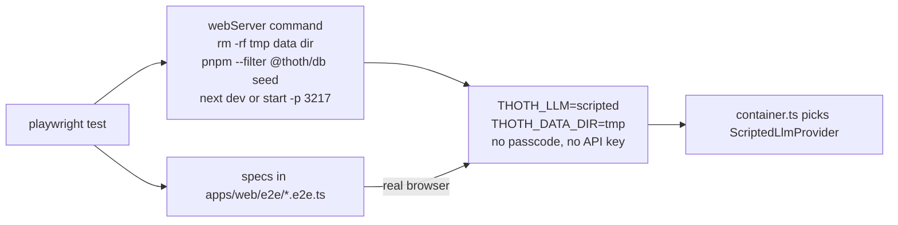

# 15. End-to-end browser tests

Status: Current (Phase 9, Lane 1). Decision: ADR-0028.

Playwright drives a real Chromium against the real app, with the language model replaced by a scripted one. It catches what unit tests cannot: a Learn tool inside the dock, a citation that has to move the viewer, a layout saved across a reload.

## Run it

```bash
pnpm test:e2e                       # starts a dev server on 127.0.0.1:3217, runs every spec
E2E_SERVER=start pnpm test:e2e      # same, against `next start` (run `pnpm build` first; CI does this)
pnpm --filter @thoth/web exec playwright test search   # one spec, by file name
pnpm --filter @thoth/web exec playwright show-report e2e/.report
```

Debug helpers (environment variables):

| Variable            | Effect                                                                                                                       |
| ------------------- | ---------------------------------------------------------------------------------------------------------------------------- |
| `E2E_PORT`          | Port of the test server (default `3217`, so it never clashes with `pnpm dev` on 3000).                                       |
| `E2E_REUSE=1`       | Attach to a server you already started (with `THOTH_LLM=scripted`) instead of starting one. Fastest loop for writing a spec. |
| `E2E_SERVER_LOGS=1` | Show the server's stderr. It is hidden by default because `next dev` prints harmless pdfjs warnings.                         |

A full run takes about 35 s with the dev server and 40 s with `next start` (17 tests, 2 skipped).

## How a run is built



- **Fresh data.** The data folder is `<tmpdir>/thoth-e2e-<port>`, deleted and re-seeded before the server starts (the two sample contents `sample-lecture` and `sample-pdf`). Nothing touches the owner's `data/`.
- **One worker.** All specs share one server and one database, and they add data, so they run one after another. Each spec makes its own data with a unique name (`unique()` in `support.ts`) and never depends on another spec or on an earlier run. That also makes a retry safe.
- **Each test has a fresh browser context**, so `localStorage` (theme, dock layout, sidebar) starts empty.
- **File names are `*.e2e.ts`**, not `*.spec.ts`, so Vitest in `apps/web` does not pick them up.

## The scripted LLM (`packages/llm/src/scripted-provider.ts`)

`ScriptedLlmProvider` answers every task the app uses today, with output built from the request itself, so the same input always gives the same output and citations point at real segments:

| Task and prompt            | Reply                                                                                                          |
| -------------------------- | -------------------------------------------------------------------------------------------------------------- |
| `chapters`                 | The wanted number of chapters, each starting at a real segment number from the context.                        |
| `summary` (summary system) | Streamed Markdown, `# Scripted summary`, with a citation after every point.                                    |
| `summary` (notes system)   | `# Scripted notes` with citations, as text or streamed.                                                        |
| `quiz` (also exams)        | Exactly the requested count, cycling through the requested types. Citations cycle through the source's tokens. |
| `flashcards`               | The requested count, cycling through the topics in the prompt.                                                 |
| `grading`                  | Score 0.9 for an answer of five words or more, 0.2 for less.                                                   |
| `chat` (streamed)          | `You asked: "…". Based on the source, <first passage>. <token>`, then a second passage and token.              |

Fixed answers the specs rely on: the correct multiple-choice option is **"The claim the source supports"**; the true/false statement is **true**; the fill-in-the-blank answer is **scripted**.

Rules it follows:

- It copies citation tokens from the context (`[p.3]`, `[03:21]`, `[§1]`). The first token in the context is the first citation in a chat answer.
- It validates its reply with the caller's real zod schema, so a prompt change that breaks the schema fails in its unit test.
- **An unknown task or prompt returns an `llm_unavailable` error** (or a stream `error` event) that names the gap, instead of a quiet fake. It recognises a prompt by its opening words, so if a use case's system prompt changes, the unit tests in `scripted-provider.test.ts` (which build prompts with the real prompt functions) fail first.
- Source lines may end with `\r\n`: a browser textarea sends them.

To add a feature that calls the model: add the task to `llmTasks`, teach `ScriptedLlmProvider` a reply and a unit test, then add the journey.

## Journeys

| Spec                    | Covers                                                                                                                                                                                                                                                          |
| ----------------------- | --------------------------------------------------------------------------------------------------------------------------------------------------------------------------------------------------------------------------------------------------------------- |
| `add-content`           | Paste text, the new row appears in Recents and becomes Ready, the content opens with its text.                                                                                                                                                                  |
| `workspace`             | Open `sample-lecture`; Cmd+K "Quiz layout" shows Notes and Quiz; type in Notes with real key events and reload (autosaved); ask Chat, get a streamed answer with a citation chip, close the Source panel first and click the chip: the Source panel comes back. |
| `learn-tools`           | Summary with citations; a quiz answered right, wrong and as free response (graded); flashcards generated and one reviewed.                                                                                                                                      |
| `exam`                  | Create a space, add a content, create an exam, start, answer, submit, see the score and "By topic".                                                                                                                                                             |
| `review`                | `/review` serves a due card, "Show answer", rate it, the reviewed count goes up.                                                                                                                                                                                |
| `progress`              | The heatmap is visible and has a count for today.                                                                                                                                                                                                               |
| `history`               | Today's entries list the content just added, newest first, and link back to it.                                                                                                                                                                                 |
| `search`                | Cmd+K for "cristae" (a word only in the PDF text) opens `sample-pdf` at page 3.                                                                                                                                                                                 |
| `theme`                 | The sidebar button cycles system, light, dark; the dark theme changes the page colour and survives a reload.                                                                                                                                                    |
| `phone`                 | At 375 px the sidebar is a drawer behind "Open menu", and the content page is one panel at a time with a bottom tab bar, no sideways scroll.                                                                                                                    |
| `gate`                  | Smoke test of the passcode gate on the dev server (below).                                                                                                                                                                                                      |
| `planner`, `whiteboard` | `test.fixme` skeletons for Phase 9 lanes 3 and 4. The comments list the steps. The orchestrator enables them at merge.                                                                                                                                          |

### What the gate test checks, and what it cannot

`next dev` and `next start` are the untrusted mode of doc 14: Next.js copies the socket address into `x-forwarded-for` only when the client sent none, so the gate cannot tell a forged `127.0.0.1` from the real one. The test therefore asserts only what must hold in every mode: a plain loopback request gets the page, and a request forwarded for a **remote** address (page, API route or Server Action) gets 403 and no data while no passcode is set. The trusted mode (`pnpm start:lan`, which overwrites the peer headers) is covered by the unit tests in `src/features/access/`.

## Writing a spec

- Select by role, label and visible text, like Testing Library. Never use CSS classes. A `data-testid` is a last resort (none are used today).
- Scope to the panel: a dock group and its content can both be `region`s with the same name, so use `getByRole("tabpanel", { name: "Quiz" })`, and `getByRole("main")` (a soft navigation can leave a hidden second `<main>`).
- Always `goto()` from `support.ts`: it waits until React has hydrated, so the first click is not lost.
- Open the palette with `openPalette()` or `runCommand()`: they press `ControlOrMeta+K` and retry until the listener exists.
- Wait with web-first assertions (`expect(locator).toBeVisible()`), never `waitForTimeout`.
- Type with `page.keyboard.type` where the app handles input events itself (the Notes editor); `fill` is fine for plain inputs.

## Known limits

- The "processing" state of a new content lasts a few milliseconds with the scripted LLM and a local ingest job, so `add-content` asserts the row and its final Ready state, not the transient one.
- The YouTube player needs the network (the IFrame API), so no spec depends on playback. The citation jump on a video is observed through the Source panel reopening, not through the player's position. Page and paragraph jumps (`search`) are observed in the DOM.
- Provider quality is not tested here: `packages/llm/src/live.test.ts` does that (doc 06).

## CI

The `e2e` job in `.github/workflows/ci.yml` runs beside `check`: install, restore the cached Chromium (`~/.cache/ms-playwright`, keyed on `pnpm-lock.yaml`), `pnpm build`, then `E2E_SERVER=start pnpm test:e2e`. CI retries a failed test once and records a trace on that retry. On failure the job uploads `apps/web/e2e/.report` (the HTML report) and `apps/web/e2e/.results` (traces and screenshots) as the `playwright-report` artifact. Open a trace with `pnpm --filter @thoth/web exec playwright show-trace <trace.zip>`.
