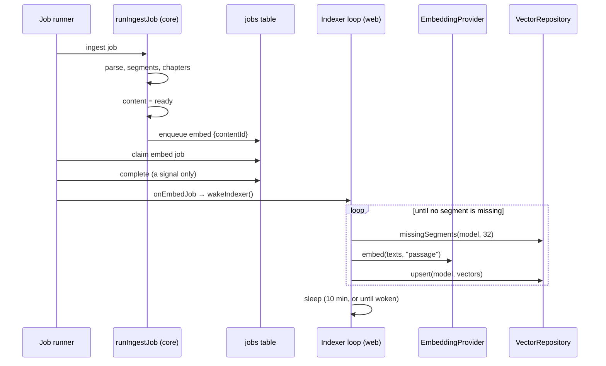
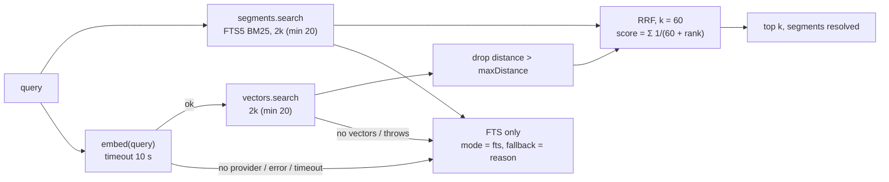

# 16. Embeddings and hybrid retrieval

Status: Current (Phase 9, Lane 2). Decisions: ADR-0029 (local embeddings, libSQL vectors, hybrid retrieval) and draft `docs/decision/NNNN-draft-p9-lane2.md` (the orchestrator numbers it) (background indexer, cut-off, fallbacks).

Keyword search (FTS5) misses questions worded differently from the source. Thoth now also embeds every segment with a small local model and searches by meaning. Both lists are merged by **reciprocal rank fusion (RRF)**. Nothing leaves the Mac, and nothing waits for the model: a content is `ready` before its vectors exist, and every caller falls back to keywords.

## Where things live

| Part                   | Path                                                                                      |
| ---------------------- | ----------------------------------------------------------------------------------------- |
| Ports                  | `packages/core/src/ports/embeddings.ts` (`EmbeddingProvider`, `VectorRepository`)         |
| Model adapter          | `packages/embeddings/src/transformers-provider.ts` (`TransformersEmbeddingProvider`)      |
| Test fake              | `packages/embeddings/src/fake-provider.ts` (`FakeEmbeddingProvider`, word hashing)        |
| Vector store           | `packages/db/src/repositories/vector-repository.ts` (`segment_vectors`, migration `0007`) |
| Retrieval and indexing | `packages/core/src/usecases/retrieval/` (`retrieve.ts`, `rrf.ts`, `indexing.ts`)          |
| Background indexer     | `apps/web/src/server/jobs/indexer.ts`, started by `runner.ts`                             |
| Settings status line   | `apps/web/src/features/search-index/` (`SearchIndexStatus`, actions)                      |
| Wiring                 | `apps/web/src/server/container.ts` (`embeddings` slot)                                    |

## The model

- `Xenova/multilingual-e5-small` through Transformers.js (`@huggingface/transformers` 4.3.2), quantized `q8` ONNX on the CPU. 384 dimensions, mean pooling, L2-normalized, so cosine distance is `1 - dot`.
- e5 needs prefixes: `query: ` for questions and `passage: ` for segments. The adapter adds them; callers pass plain text.
- Inputs longer than the model's 512-token window are truncated by the tokenizer. A PDF page usually fits.
- **Download:** about 135 MB once (118 MB `model_quantized.onnx` + 17 MB `tokenizer.json`), 144 MB on disk, cached in `<THOTH_DATA_DIR>/models`. It took about 45 s on the owner's connection.
- **Loading:** lazy, on the first `embed` call, shared afterwards. A failed load (offline on first use) is not cached: the call returns `Result` error `llm_unavailable` with a message that says to check the connection, and the next call tries again.
- **Throughput** (M-series Mac, warm, batch 16): about 200–245 short passages per second (≈230 characters) and about 22 full pages per second (≈1,800 characters). A 300-page PDF indexes in about 15 s.
- Browser tests (`THOTH_LLM=scripted`) get `FakeEmbeddingProvider` instead: no download, same code path.

## Indexing

- **Why a separate loop.** The job runner runs one job at a time. The first embed waits for the 135 MB download, and a big library takes minutes. Inside the runner that would hold up the next ingest. The indexer runs beside it instead, a batch of 32 segments at a time, yielding between batches.
- **Backfill.** The indexer starts with the runner (`instrumentation.ts` → `startJobRunner` → `startIndexer`). Its first pass embeds every segment without a vector, oldest content first, so contents from before Phase 9 are covered.
- **Failures.** A model error pauses the indexer 5 minutes and is shown on the settings status line. A DB error is logged and retried after 5 minutes.
- **Model changes.** Vectors store their model id. `missingSegments(model)` treats vectors of another model as missing, so switching models re-embeds everything.
- **Re-ingest** replaces a content's segments; their vectors go with them (`ON DELETE CASCADE`), and the next `embed` signal fills them again.
- **Rebuild** (settings) deletes every content's vectors and wakes the indexer.

## Retrieval

`retrieveSegments(deps, { contentIds, query, k, maxDistance?, known?, embedTimeoutMs? })`:

- **RRF** (`rrf.ts`): each list contributes `1 / (60 + rank)` for a 1-based rank. A segment found by both lists adds both, so it is listed once and usually ranks first. An id repeated inside one list counts once. Ties keep first-seen order (FTS first).
- **Result:** `hits` (segment, RRF score, `ftsRank`, `vectorRank`, `distance`), `mode` (`hybrid` or `fts`), `fallback` and a `note` when it is `fts`.
- **Fallback reasons:** `no_provider` (no embeddings configured), `no_vectors` (the contents are not indexed yet), `embed_failed`, `embed_timeout` (the model is still loading; default 10 s, Cmd+K 3 s), `vector_error` (the vector index threw). In all of them the caller gets plain FTS results, never an error.
- **Resolving segments:** vector hits carry only ids. The caller can pass the segments it already loaded (`known`); otherwise each content with a vector hit is read once. A vector whose segment is gone is skipped.

### Callers

| Caller                                          | How it uses retrieval                                                                                                                                                                                                                            |
| ----------------------------------------------- | ------------------------------------------------------------------------------------------------------------------------------------------------------------------------------------------------------------------------------------------------ |
| Chat context, large sources (ADR-0015)          | `buildChatContext` search mode: top 30 for the question plus the previous question; `ChatContext.retrieval` records the mode. Small sources still go in whole.                                                                                   |
| Cmd+K (`searchEverything`)                      | Source hits come from retrieval with `maxDistance = SEMANTIC_MAX_DISTANCE` (0.205) and a 3 s embed timeout. Title and note hits are unchanged.                                                                                                   |
| Exams (`sampleForQuery` in `exams/sampling.ts`) | With a focus query: the best-matching passages within the character budget, back in source order. With no query, `sampleAcrossChapters` as before. Exam options have no focus field yet, so the exam flow still samples by chapter (see Limits). |

### The Cmd+K distance cut-off

Vector search always returns the nearest passages, even for "qwzx". Cmd+K hides vector hits farther than 0.205. e5 packs similarities into a narrow band, so the margin is thin. Measured on the sample contents (nearest passage per query):

| Query                                            | Nearest distance | Relevant? |
| ------------------------------------------------ | ---------------- | --------- |
| how do cells get energy without oxygen?          | 0.087            | yes       |
| brain scans                                      | 0.123            | yes       |
| power plant of the cell                          | 0.148            | yes       |
| tế bào lấy năng lượng khi không có oxy           | 0.158            | yes       |
| ty thể là nhà máy năng lượng của tế bào          | 0.196            | yes       |
| não bộ và trí tuệ nhân tạo                       | 0.202            | yes       |
| tax law                                          | 0.207            | no        |
| asdf                                             | 0.214            | no        |
| qwzx plorb                                       | 0.226            | no        |
| recipe for pancakes, bóng đá, football world cup | 0.245–0.250      | no        |

Chat does not use a cut-off: it wants the best passages whatever their distance.

## Settings

`SearchIndexStatus` shows "Search index: 1,240 of 1,300 passages ready" (passages of `ready` contents that have a vector for the current model), a **Rebuild** button and the model's last error. It polls every 3 s while the index is behind. It is not yet mounted on `/settings` (another lane's file); the mount is two lines.

## Tests

| File                                                              | What it covers                                                                                                                                                                                                                                      |
| ----------------------------------------------------------------- | --------------------------------------------------------------------------------------------------------------------------------------------------------------------------------------------------------------------------------------------------- |
| `core/usecases/retrieval/retrieval.test.ts` (19)                  | RRF maths, ties, duplicates; fusion and dedupe; `known`; cut-off; every fallback; indexing batches, failure, status, clear                                                                                                                          |
| `core/usecases/retrieval/callers.test.ts` (8)                     | chat context, Cmd+K and exam sampling through retrieval, with scripted vectors                                                                                                                                                                      |
| `core/usecases/ingest/run-ingest-job.test.ts`                     | `ready` enqueues `embed`; the `embed` job wakes the indexer                                                                                                                                                                                         |
| `embeddings/src/transformers-provider.test.ts` (6)                | prefixes, batching, one load, download failure and retry, wrong shape; the fake                                                                                                                                                                     |
| `embeddings/src/live.test.ts` (3, `THOTH_LIVE_EMBED=1`)           | real model: 384-d unit vectors; "mitochondria make ATP" nearer "cell energy" than "tax law"; Vietnamese ↔ English                                                                                                                                   |
| `embeddings/src/live-retrieval.test.ts` (6, `THOTH_LIVE_EMBED=1`) | real model + libSQL + seeded samples: the fermentation page for "how do cells get energy without oxygen?", a paraphrase with no shared content word, "power plant of the cell" → p.3, a Vietnamese query → the English p.6, the cut-off, throughput |

Run the live ones with `THOTH_LIVE_EMBED=1 pnpm --filter @thoth/embeddings test`.

## Limits and next steps

- **FTS noise.** `toFtsQuery` ORs every word, so "of", "the", "in" or a Vietnamese syllable without its accents ("máy" → "may") match. In fusion those hits can outrank a better vector-only hit. Dropping stop words or trying AND first in `SegmentRepository.search` would help.
- **Short queries.** One or two words ("ty thể", "lên men") embed poorly; their hits rely on FTS.
- **Status counts** read through the existing ports (one segment read per content, plus every missing segment). Fine for one owner; a `VectorRepository.count(model)` would make it one query.
- **Exam focus.** `ExamOptions` has no focus field, so `sampleForQuery` is not reachable from the UI yet.
- **CPU.** Indexing a large library keeps a few cores busy for a while; queries during it are slower but still work.
