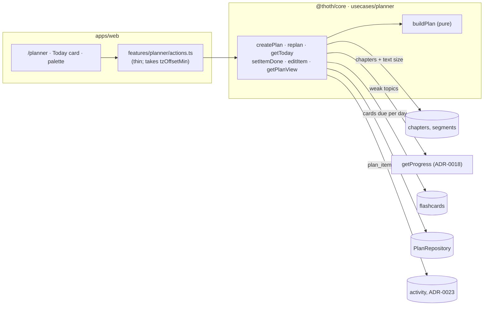
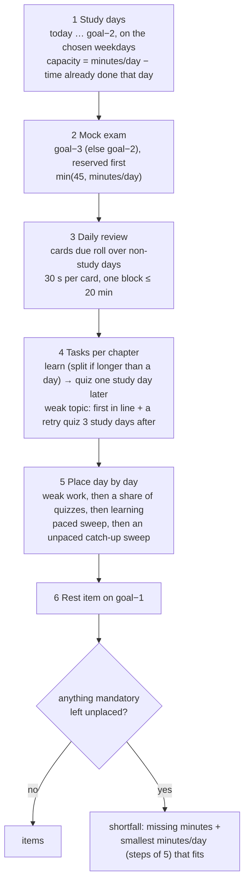

# 17. Study planner

Status: Current (Phase 9, Lane 3). Decisions: ADR-0030 and the Lane 3 draft ADR `NNNN-draft-p9-lane3.md`.

The planner turns "my exam is on 9 December" into dated tasks: learn each chapter, quiz it, review due flashcards, sit a mock exam, rest. The schedule is a **pure function** (`buildPlan`), so it is explainable, unit-tested with fixed dates and costs no tokens.

## Scheduling steps

`buildPlan(input)` never reads a clock: the caller says which local day "today" is and which items are already done.

| Rule            | Value                                                                                                                |
| --------------- | -------------------------------------------------------------------------------------------------------------------- |
| Learn minutes   | `ceil(chars / 800)`, at least 5 and at most 40; a chapter longer than a day is split into parts on separate days     |
| Quiz            | 8 minutes, one study day after the chapter's last learn part; the retry quiz for a weak topic is 6 minutes, optional |
| Review          | `ceil(cards × 30 s)`, 5 to 20 minutes; due cards roll to the next study day                                          |
| Mock exam       | 45 minutes (less if the day is shorter), three days before the goal, else two                                        |
| Weak topics     | Topics under 80% (`getProgress`) are learned first, weakest first, and get a retry quiz when time allows             |
| Pacing          | Daily target = mandatory minutes ÷ days before the exam × 1.3, so a 3-week plan is not done in 3 days                |
| Budget          | Never above minutes per day, in either sweep                                                                         |
| Not enough time | Items that do not fit are left out (never crammed). The result carries a `Shortfall` with a suggested daily budget   |

Days are the owner's **local calendar days** ("YYYY-MM-DD", ADR-0023). The browser sends `Date#getTimezoneOffset()` with every action; `localDay` turns the server's `now` into the browser's day.

## Use cases (`usecases/planner/planner.ts`)

| Use case                    | Does                                                                                                                                                                                                                                |
| --------------------------- | ----------------------------------------------------------------------------------------------------------------------------------------------------------------------------------------------------------------------------------- |
| `createPlan`                | Validates with `planInputSchema` (goal after today, within a year, contents exist), builds from today and saves                                                                                                                     |
| `replan`                    | Optionally changes minutes per day, then rebuilds from today. `replaceOpenItems` keeps finished items; they count against their day and are not scheduled again. Missed days roll forward because nothing is scheduled before today |
| `getToday`                  | Today's items across plans, plus the number of unfinished tasks from earlier days                                                                                                                                                   |
| `setItemDone`               | Ticks or unticks. The first tick records `plan_item_done` (History: "Finished a planned task")                                                                                                                                      |
| `editItem`                  | Changes title, minutes or day with validation                                                                                                                                                                                       |
| `getPlanView` / `listPlans` | Items, progress and days left. The view dry-runs `buildPlan` so it can warn when the remaining work no longer fits                                                                                                                  |

Chapter size comes from the segments between a chapter's start and the next chapter's start (same locator type), or an even split when locators do not line up. A content without chapters counts as one chapter named after it.

## UI (`features/planner`, `app/planner`)

- `/planner`: plans on the left, the chosen plan on the right; on a phone one at a time. State lives in the URL (`?plan=ID`, `?new=1`), so the palette and the Today card link straight in.
- Plan view: progress bar, days left, a Monday-to-Sunday week strip (tap a day), the day's task list, Re-plan, Delete. A warning callout offers "Re-plan at N min a day" when the work does not fit; an info callout offers a re-plan after missed days.
- Ticking is **optimistic** and rolls back with a callout on error. Each item links to the work: learn and quiz → `/content/{id}`, review → `/review`, exam → the plan's space (no link for a plan without a space).
- Home: `TodayCard` (client; "today" is the browser's day) shows today's tasks with checkboxes, and renders nothing when there are no plans.
- Palette (registered by `PlannerCommands`, mounted in the sidebar): "New study plan", "Open planner", "Re-plan" (every plan whose goal is ahead).

## Tests

`build-plan.test.ts` (budget, coverage, exam placement, weak topics first, no cramming, shortfall and its suggestion, rest day, non-study days, review roll-over, splitting, re-plan keeping done items, determinism) and `planner.test.ts` (use cases with an in-memory `PlanRepository`: timezone day edges, overdue cards, activity recorded once, re-plan, validation).
