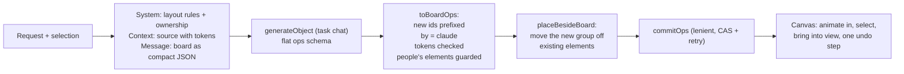
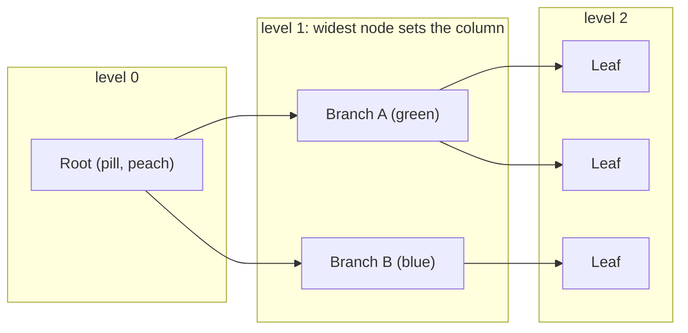

# 18. Whiteboard and mind maps

Status: Current (Phase 9). Decisions: ADR-0031, ADR-0035.

The Whiteboard is a Learn tool, so it is a dock panel beside the source (ADR-0021). Claude lays out an explanation on a canvas, you edit it, and you ask Claude to extend it. Mind maps are drawn on the same canvas. Any element can link to a page, time or paragraph of the source.

## Where the code is

| Piece                                                      | File                                                                |
| ---------------------------------------------------------- | ------------------------------------------------------------------- |
| Element and operation model (zod), the contract            | `packages/core/src/domain/whiteboard.ts`                            |
| Apply and diff operations (pure)                           | `packages/core/src/usecases/whiteboard/ops.ts`                      |
| `createBoard`, `listBoards`, `applyOps`, compare-and-swap  | `packages/core/src/usecases/whiteboard/boards.ts`                   |
| `askClaude`: prompt, conversion, guards, placement         | `packages/core/src/usecases/whiteboard/ask-claude.ts`, `prompts.ts` |
| `generateMindMap`: tree checks                             | `packages/core/src/usecases/whiteboard/mind-map.ts`                 |
| Tidy-tree layout, mind-map elements                        | `packages/core/src/usecases/whiteboard/layout.ts`                   |
| Text size estimates, boxes                                 | `packages/core/src/usecases/whiteboard/geometry.ts`                 |
| Source links and the "Link to source…" list                | `packages/core/src/usecases/whiteboard/source.ts`                   |
| Server Actions (thin) and the background run registry      | `apps/web/src/features/whiteboard/actions.ts`, `runs.ts`            |
| The panel: board menu, mind-map dialog, composer           | `apps/web/src/features/whiteboard/tool.tsx`, `composer.tsx`         |
| The canvas: gestures, keys, rendering                      | `apps/web/src/features/whiteboard/canvas.tsx`, `element-view.tsx`   |
| Board state: undo, autosave, merge, Claude runs            | `apps/web/src/features/whiteboard/use-board.ts`                     |
| Arrow routing, viewport maths, new elements (pure, tested) | `apps/web/src/features/whiteboard/model.ts`                         |
| Colours (from Hearth tokens) and motion                    | `apps/web/src/features/whiteboard/whiteboard.css`                   |

## Elements and operations

A board holds a list of elements (`shape`, `sticky`, `text`, `section`, `arrow`, `table`, `image`) and a `version`. Coordinates are board units: pixels at 100% zoom, origin top left. Every element has `by` (`claude` or `person`) and an optional `source` (`{ contentId, token }`, like `[p.3]`).

Every change, from a person or from Claude, is a list of operations: `add`, `update` (a patch) and `remove`. `applyOpsToElements` checks each one against `boardOpSchema` and against the board as it stands after the operations before it:

- `add` needs a new id. An arrow's ends must be other, non-arrow elements on the board.
- `update` needs an existing id and cannot change `id` or `type`. The patched element must still be valid. A `null` clears a field (for example `source`).
- `remove` needs an existing id and also removes the arrows attached to it.
- A locked element can only be unlocked.

`applyOps` (the canvas) is all or nothing. Claude's operations are applied leniently: a refused operation is skipped and reported.

## The operation flow

```mermaid
sequenceDiagram
  participant C as Canvas (use-board)
  participant A as Server Action
  participant U as core applyOps / commitOps
  participant R as WhiteboardRepository
  C->>C: edit (one undo step)
  C->>C: 500 ms later: ops = diffElements(saved, onScreen)
  C->>A: applyOpsAction(boardId, ops)
  A->>U: applyOps
  loop at most twice
    U->>R: get(board)
    U->>U: applyOpsToElements(latest, ops)
    U->>R: save(elements, version)  (compare-and-swap)
    alt saved
      R-->>U: new board
    else stale (someone saved in between)
      R-->>U: null, so reload and re-apply
    end
  end
  U-->>C: newest board
  C->>C: saved = server board; replay edits made during the save
```

Autosave sends only what changed since the last confirmed version. Because operations target ids, a save made while Claude was drawing lands on top of Claude's change and never undoes it. If the server refuses the operations (for example an element was removed elsewhere), the canvas reloads the board, re-applies what still fits and saves once more. The edit is recorded as `whiteboard_edit` activity, at most once per board per hour.

## Ask Claude



- The prompt carries the board as compact JSON (one element per line, numbers rounded, defaults kept), the source text with citation tokens, the chapter list, and the rules below.
- **Layout rules** (`LAYOUT_RULES`): one idea per element in a few words; left to right, then top to bottom; no overlaps with 24-unit gaps; sections for groups; arrows only where meaning flows; at most four colours; a title and a one-line takeaway for a new board; a `source` token on every element taken from the material; new content in free space beside the old.
- Claude answers with a flat, JSON-schema-friendly operation list (`claudeOpsSchema`: no unions, no regex, no number limits, so both adapters accept it). Core turns it into `boardOpSchema` operations and validates them. Words a model puts in `label` or `title` of a shape still become its text.
- **People's elements are never changed unless asked:** the request "asks" by selection. Ids you select before asking go to Claude as `<may_change>`; operations on any other `by: "person"` element are dropped and reported ("Left your element … as it is"). Rewording one of Claude's elements makes it yours.
- A citation token becomes a link only when it points at a real page, time or paragraph of the content; otherwise the element is kept without a link.
- If any new element would overlap an existing one, the whole new group moves, as one, to the right of the board. Core does no other layout fix-ups.

## Mind maps

Claude returns a concept tree as a flat node list (id, parent, label, source). `buildTree` keeps one root (several roots get a root made from the title), drops nodes in cycles or with missing parents, caps 60 nodes and 4 levels, trims labels and checks every token. Then core lays the tree out, so the layout never depends on the model.



The tidy-tree layout (`layoutTree`):

1. Each node gets a size from an estimate of its text (core cannot measure fonts) and its level.
2. Every level is a column as wide as its widest node; columns are 96 units apart.
3. Each subtree owns a horizontal band as tall as the larger of its node and its children's bands. Sibling bands are stacked with an even 24-unit gap (plus 24 between the big branches).
4. A parent is centred on its first and last child. A leaf is centred in its band.

Bands never overlap, and nodes of one column never overlap the next column, so no two nodes can overlap. The layout is deterministic. Colours: the root is peach and the branches cycle green, blue, purple, so a map uses at most four colours. Each child is linked to its parent by an arrow. A title and a one-line takeaway sit above the tree, and a map added to a board that already has content goes below it.

## The canvas

- **Rendering:** one transformed layer (`translate` + `scale`). Sections first, then all arrows in one SVG, then the other elements. Shapes are SVG; text is DOM, so it wraps and is selectable when edited. A dot grid in `surface-100` pans and zooms with the board.
- **Arrows** are right-angle connectors between facing sides, with rounded corners (`routeArrow`). Boxes clearly apart sideways (48 units) connect right to left, others bottom to top, with one jog halfway. Connectors do not route around other elements.
- **Pan:** two-finger scroll, Space + drag, the Pan tool, the middle button, or one finger on touch. **Zoom:** Cmd/Ctrl + wheel, trackpad pinch, two-finger pinch on touch, the zoom buttons, "Zoom to fit". A board opens fitted.
- **Select:** click, Shift + click, or a marquee on empty canvas (a section is picked only when fully covered). **Move:** drag, snapped to 8 units; moving a section carries what is inside it. **Resize:** corner handles (text: its wrap width). **Delete:** Delete or Backspace.
- **Connect:** drag from one of the four dots on an element's sides onto another element, or use the Arrow tool and drag from one element to another.
- **Edit text:** double-click or Enter. Escape or Cmd/Ctrl + Enter commits. Double-click empty canvas to add a text.
- **Context menu** (right-click): Edit text, Link to source…, Remove source link, colour, Duplicate, Delete; on empty canvas, add a shape, sticky or text, or paste.
- **Keys.** App-level shortcuts are `Command`s registered with `useCommands`, only while the canvas has focus and no text is being edited, so they never steal keys from chat or notes: Undo `mod+z`, Redo `mod+shift+z`, Copy, Cut, Paste, Duplicate `mod+d`, Select all, Zoom to fit `mod+0`, Zoom in `mod+=`, Zoom out `mod+-`. Single keys are handled by the focused canvas only: V select, H pan, A arrow, R shape, S sticky, T text, G section, arrows nudge (Shift for 24), Escape. "New whiteboard", "Make a mind map" and "Ask Claude on the whiteboard" are in the palette while the panel is open.
- **Undo and redo:** up to 100 steps per board, one per gesture. Claude's change is one step too.
- **Copy and paste:** within the tab, across boards. Arrows come along when both ends do.
- **Drop a citation:** dropping text that contains a token (for example a selection from Notes that holds a citation chip) makes a sticky linked to that place.
- **Theme and motion:** every colour is a Hearth token or a `color-mix` of two tokens (`whiteboard.css`); light and dark follow. Claude's new elements fade and rise in one after another and arrows draw in; zoom to fit glides. `prefers-reduced-motion` turns all of it off.
- **Phone** (under 768 px): view, pan, pinch-zoom, tap a badge to jump, and Ask Claude. Editing tools are hidden.

## Source links

An element with a `source` shows a small accent badge ("p.3") at its top right. Clicking it calls the Learn tool's `onCite(token)`, which reveals and jumps the Source panel. "Link to source…" opens a dialog with the chapters first, then every page, time or paragraph with its first words, filterable by typing.

## Claude runs in the background

"Ask Claude…" and "Mind map" follow ADR-0016's pattern. The action starts a run in a process-wide registry (`runs.ts`) and returns its id at once; `after()` keeps it going; the panel polls `readRunAction` every 800 ms. Server Actions run one at a time per client, so awaiting Claude in an action would hold up autosave. The run saves into the board itself, so closing the panel loses nothing, and a reopened panel picks up a run that is still going. "Stop" aborts the model call. A mind map that fails leaves no empty board behind. While a run is going the composer says "Claude is drawing…" (or "mapping the source…") and an empty board shows a skeleton shaped like a tree.

## Known limits

- Text sizes in core are estimates (0.56 × font size per character), so a box can be a little wider or narrower than its words.
- Connectors do not avoid other elements in their way.
- Claude does not draw `image` (SVG) elements yet; the model schema leaves them out.
- Dragging a chat citation chip needs the chat chip to be draggable (owned by the chat feature); text with a token can be dropped today.
