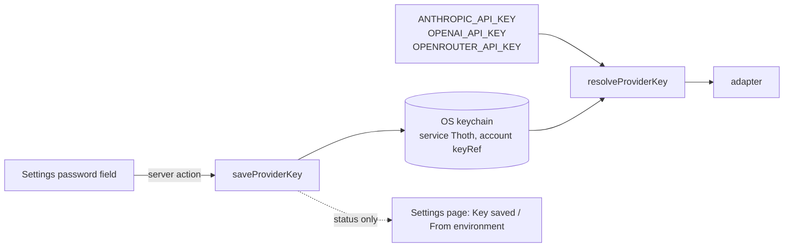

# 20. OpenAI-compatible providers and per-task routing

Status: Current (Phase 10). Decisions: ADR-0037, ADR-0040. Amends doc 02.

Thoth can send each task to its own provider and model: for example chat on Claude and flashcards on a local Ollama model. Providers are saved as **profiles**. API keys live in the OS keychain.

## Settings v2

`packages/core/src/domain/llm-profiles.ts`

| Piece             | What it is                                                                                                                                                                  |
| ----------------- | --------------------------------------------------------------------------------------------------------------------------------------------------------------------------- |
| `LlmProfile`      | `id`, `kind` (`claude-subscription`, `anthropic-api`, `openai-compatible`), `name`, `baseUrl`, `keyRef`, `models[]`, `caps { jsonSchema, tools }`                           |
| `LlmSettingsV2`   | `{ version: 2, profiles, tasks: Record<LlmTask, { profileId, model }> }`. The schema rejects a route to a missing profile.                                                  |
| `builtInProfiles` | The two Claude profiles. Always present, never editable: `readLlmSettings` replaces whatever was stored for them.                                                           |
| `readLlmSettings` | Reads v2, or upgrades a v1 value (`{ provider, models }`): every task keeps its model on the old provider. The v1 schema is private to this file and exists for that alone. |
| `llmPresets`      | Ollama `http://localhost:11434/v1`, LM Studio `http://localhost:1234/v1`, OpenRouter `https://openrouter.ai/api/v1`, OpenAI `https://api.openai.com/v1`, Custom.            |
| `envKeyVarFor`    | The env var that overrides a profile's key (see Keys).                                                                                                                      |

The settings row (`settings.key = "llm"`) is read through `readLlmSettings` by `DrizzleSettingsRepository`. A v1 row upgrades in memory and is written back as v2 on the next save.

### Use cases (`packages/core/src/usecases/llm-settings.ts`)

| Use case                                | Rule                                                                                                                                                         |
| --------------------------------------- | ------------------------------------------------------------------------------------------------------------------------------------------------------------ |
| `getLlmSettings`                        | Saved value or `defaultLlmSettingsV2` (subscription, Opus 5.5 everywhere).                                                                                   |
| `updateLlmSettings`                     | Whole value. Every route's model must be one of its profile's `models`.                                                                                      |
| `updateLlmRoutes`                       | The routing table only.                                                                                                                                      |
| `saveLlmProfile`                        | Adds or edits an `openai-compatible` profile. The id is a slug of the name (`ollama`, `ollama-2`). A route whose model was removed moves to the first model. |
| `deleteLlmProfile`                      | Refuses (`conflict`) while a task uses the profile. Deletes the keychain entry too.                                                                          |
| `saveProviderKey` / `deleteProviderKey` | Writes the key to `SecretStore` under `keyRef` (`profile-<id>`, or `anthropic-api`). The key never enters the settings row.                                  |
| `getProviderKeyStatus`                  | `env`, `saved`, `none` or `not-needed`. This is all the UI ever learns about a key.                                                                          |
| `resolveProviderKey`                    | Env var first, then the keychain. Undefined for none (local servers).                                                                                        |

## Keys

- **`apps/web/src/server/secrets.ts`:** `KeychainSecretStore` on `@napi-rs/keyring` (`AsyncEntry`), service `"Thoth"`. `create()` probes with one read; if the addon fails to load or the keychain throws (headless Linux without Secret Service), `available` is false, reads return null and Settings shows the env var fallback. The package is in `serverExternalPackages` (native addon).
- **Env always wins:** `ANTHROPIC_API_KEY` for `anthropic-api`; `OPENAI_API_KEY` only for a base URL on `api.openai.com`; `OPENROUTER_API_KEY` only for `openrouter.ai`. A key is never sent to a host it was not issued for.
- **The OpenAI SDK never reads env itself:** the adapter always passes `apiKey` (a placeholder for local servers) and `organization: null`, `project: null`, so `OPENAI_API_KEY` cannot leak to an Ollama or custom host.
- **The subscription adapter still strips `ANTHROPIC_API_KEY`** from the CLI's env (ADR-0013).

## `OpenAiCompatibleProvider` (`packages/llm/src/openai-compatible.ts`)

`openai` SDK 7.53, `chat.completions` with the profile's `baseURL`.

| Concern           | Behaviour                                                                                                                                                                                                                            |
| ----------------- | ------------------------------------------------------------------------------------------------------------------------------------------------------------------------------------------------------------------------------------ |
| Messages          | `system`, then `context` as a second system message `<source>…</source>`, then the turns. No prompt caching outside the Anthropic profiles.                                                                                          |
| Text              | Non-streaming create. A leading `<think>…</think>` block (Qwen, DeepSeek) is removed.                                                                                                                                                |
| Streaming         | `stream: true`, `stream_options.include_usage`; `delta.content` → `text`, usage → `done`. A `<think>` block is held back while streaming.                                                                                            |
| Structured output | `caps.jsonSchema` true: `response_format: json_schema` with `z.toJSONSchema` minus `$schema`, `strict: true` when every property is required (otherwise `strict: false`). False: `json_object` with the schema in the system prompt. |
| Degrading         | A 400 on the format steps down: json_schema → json_object → prompt only.                                                                                                                                                             |
| Validation        | `parseJsonLoose` (`json-repair.ts`: strips `<think>`, code fences, prose around the value, trailing commas), then zod. One retry that shows the model its reply and the zod issues. Then `llm_bad_output`.                           |
| Effort            | `reasoning_effort` only for `o*`, `gpt-5*` and `gpt-oss*` ids (also behind an OpenRouter `vendor/` prefix): low, medium, else high. Omitted for every other model.                                                                   |
| Max tokens        | Sent only when the request sets `maxTokens`: `max_completion_tokens` on api.openai.com, `max_tokens` elsewhere.                                                                                                                      |
| Refusals          | `message.refusal` or `finish_reason: content_filter` → `llm_refused`.                                                                                                                                                                |
| Retries           | SDK `maxRetries: 1` (429, 5xx, dropped connections).                                                                                                                                                                                 |

### Errors (all `llm_unavailable` unless noted)

| Cause                      | Message                                                                            |
| -------------------------- | ---------------------------------------------------------------------------------- |
| Connection refused, :11434 | `Ollama is not running at … Open the Ollama app or run ollama serve.`              |
| Connection refused, :1234  | `LM Studio's server is not running at … Start it in LM Studio's Developer tab.`    |
| Other connection failure   | `Could not reach <name> at <url>…`                                                 |
| 401                        | `<name> rejected the API key. Save a new key in Settings (or check <ENV>).`        |
| 403                        | `<name> does not allow this key to use "<model>".`                                 |
| 404                        | Ollama: `Ollama has no model "x". Run ollama pull x…`; others: check the model id. |
| 429                        | Rate limit or quota.                                                               |
| 400                        | `<name> rejected the request: …`                                                   |

## Routing (`packages/llm/src/router.ts`)

`createLlmProvider(settings, { resolveKey })` returns a `RoutedLlmProvider` (`id: "routed"`). Each call reads `request.task`, looks up the route, and dispatches to the adapter for that profile and model. Adapters are built lazily and once per profile and model within one router.

This was the least invasive shape: every use case already puts `task` on each request and calls `deps.llm()`, so no call site changed.

`container.llm(task?)`:

- without a task (all use cases, the chat and stream routes): the router;
- with a task: that task's concrete adapter (`router.forTask(task)`). Settings' "Check connection" uses `llm("chat")` so it names the real provider.

It is rebuilt from saved settings on every call, so a change applies on the next request. `THOTH_LLM=scripted` still returns `ScriptedLlmProvider` for every task.

## Settings UI (`apps/web/src/features/settings/`)

- **`providers.tsx`:** the saved profiles as a hairline list with a key badge (Key saved, From environment, Local, No key) and JSON schema / JSON mode. "Add provider" and Edit open a `Dialog` with preset chips that pre-fill name and base URL, a password key field, "Test connection", and a model checklist. The Anthropic API profile has an "Add key" dialog. Delete asks first and is refused while a task uses the provider.
- **Test connection** (`testProfileAction` → `container.probeLlm`): `GET /models`, then a tiny `json_schema` request to the first selected (or first listed) model. Success sets `caps.jsonSchema`; a 400 or an ignored schema leaves it false with a note. It uses the typed key, else the saved key, else the matching env var.
- **`task-routing.tsx`:** one row per task with a provider and a model select, and "Save routing". A note under it says small local models write weaker quizzes, flashcards and grading; an info callout appears when one of those tasks routes to an OpenAI-compatible profile.
- **No action returns a key.** Keys only go client → server → keychain.

The probe and every adapter call fetch whatever base URL the owner typed. That is intended for a single-user app; over the LAN the passcode gate (ADR-0027) protects the actions.

## Tests

| Test                                                       | Covers                                                                                                                                                         |
| ---------------------------------------------------------- | -------------------------------------------------------------------------------------------------------------------------------------------------------------- |
| `packages/llm/src/openai-compatible.test.ts`               | Request shape, both structured-output paths, repair, retry, format fallback, refusal, error mapping, streaming, probe. A fetch stub runs through the real SDK. |
| `packages/llm/src/router.test.ts`                          | Dispatch per task, one adapter per profile and model, adapter kinds.                                                                                           |
| `packages/core/src/usecases/llm-settings.test.ts`          | Routes, profile add/edit/delete, keys and status, env precedence, no keychain.                                                                                 |
| `packages/db/src/repositories/settings-repository.test.ts` | v1 → v2 upgrade through the repository.                                                                                                                        |
| `apps/web/src/server/secrets.test.ts`                      | Keychain store, and `available: false` when the keychain throws.                                                                                               |
| `packages/llm/src/live-ollama.test.ts`                     | Opt-in: `THOTH_LIVE_OLLAMA=1 [THOTH_OLLAMA_MODEL=llama3.2] pnpm --filter @thoth/llm test live-ollama`.                                                         |
