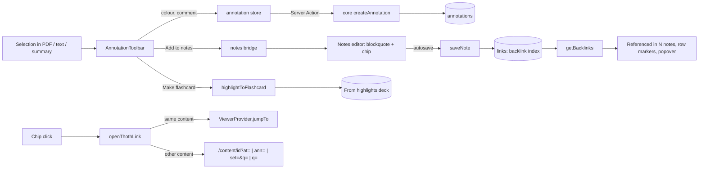

# 21. Annotations, links and backlinks

Status: Current (Phase 10). Decisions: ADR-0038, ADR-0041.

The owner can mark up a source, send a passage to notes as a quote that jumps back, link notes to any place in Thoth, see which notes quote a source, and turn a highlight into a flashcard.

## What it does

| Where                         | Select text                                                            | Draw                           | Shows                                                   |
| ----------------------------- | ---------------------------------------------------------------------- | ------------------------------ | ------------------------------------------------------- |
| PDF (stored file)             | colours, Comment, Add to notes, Make flashcard                         | pen, rectangle, ellipse, arrow | highlights, ink, shapes, comment pins; Annotations list |
| Text viewer (web, text, seed) | the same                                                               | no                             | highlights re-found by quote                            |
| Transcript / Text panel       | the same                                                               | no                             | highlights; a "quoted in notes" marker on quoted rows   |
| Chapters (summaries)          | the same                                                               | no                             | -                                                       |
| Summary panel                 | Add to notes (`thoth:s/` link), Make flashcard. No colours: see Limits | no                             | a flashed passage after a summary link jump             |

Every source also shows **Referenced in N notes** (PDF toolbar, text viewer, Transcript header). It opens a menu of the notes that link in; picking one opens that note scrolled to the link.

## Files

| Piece                                           | File                                                                                    |
| ----------------------------------------------- | --------------------------------------------------------------------------------------- |
| Link format, anchors, `findQuote` (Step 0)      | `packages/core/src/domain/link.ts`                                                      |
| Annotation model (Step 0)                       | `packages/core/src/domain/annotation.ts`                                                |
| Create, list, update, delete                    | `packages/core/src/usecases/annotations/annotations.ts`                                 |
| Backlinks, grouped                              | `packages/core/src/usecases/annotations/backlinks.ts`                                   |
| Highlight to flashcard                          | `packages/core/src/usecases/annotations/highlight-flashcard.ts`                         |
| Link picker targets, `resolveLink`              | `packages/core/src/usecases/annotations/link-targets.ts`                                |
| Chip labels ("Lecture 2 · p.3")                 | `packages/core/src/usecases/annotations/labels.ts`                                      |
| Server Actions (thin)                           | `apps/web/src/features/annotations/actions.ts`                                          |
| Client store per content (optimistic)           | `apps/web/src/features/annotations/store.ts`                                            |
| Selection and annotation toolbar                | `apps/web/src/features/annotations/annotation-toolbar.tsx`                              |
| Text views: marks, selection                    | `apps/web/src/features/annotations/{text-passages.tsx,text-ranges.ts}`                  |
| Summary mount                                   | `apps/web/src/features/annotations/summary-passages.tsx`                                |
| Add to notes, flashcards, open a backlink       | `apps/web/src/features/annotations/use-passage.ts`                                      |
| Opening a link chip                             | `apps/web/src/features/annotations/open-link.ts`                                        |
| Backlinks button and marker, Annotations list   | `apps/web/src/features/annotations/{backlinks,annotations-list}.tsx`                    |
| Colours (names to Hearth tokens)                | `apps/web/src/features/annotations/colors.ts`                                           |
| Page geometry, `perfect-freehand` strokes       | `apps/web/src/features/annotations/geometry.ts`                                         |
| PDF export (`pdf-lib`)                          | `apps/web/src/features/annotations/pdf-export.ts`, `app/api/content/[id]/annotated.pdf` |
| PDF viewer, overlay, text layer CSS             | `apps/web/src/features/content-viewer/{pdf-viewer,pdf-overlay}.tsx`, `pdf.css`          |
| Link chip node, `[[` / `@` picker, notes bridge | `apps/web/src/features/notes/editor/{thoth-link,link-trigger,link-picker,bridge,quote}` |

## Link format

| URI                      | Target                                                |
| ------------------------ | ----------------------------------------------------- |
| `thoth:c/<id>`           | a content                                             |
| `thoth:c/<id>?at=p.3`    | a page; `t.201` a time (seconds); `par.4` a paragraph |
| `thoth:c/<id>?at=…&q=…`  | a passage of the source text, found again by text     |
| `thoth:a/<id>`           | one annotation                                        |
| `thoth:s/<id>?q=<quote>` | a passage in a study set (a summary)                  |
| `thoth:space/<id>`       | a space                                               |

In notes a link is ordinary Markdown: `[Lecture 2 · p.3](thoth:a/<id>)`. The label is `linkLabel(title, place)`: the title cut at a word to 28 characters, then the page, time, paragraph or "Summary". A `?q=` quote is cut at a word to 100 characters (`linkQuote`); that is enough to find the passage.

## Data flow

### Annotations

- Stored by `createAnnotation`, validated with `newAnnotationInput`. The anchor is always a `content` anchor into the same content. Ink and shapes need their payload, a highlight needs a quote or rects, a comment pin needs text.
- The web store (`useAnnotations(contentId)`) is one module-level store per content, shared by every panel without a provider. Changes are optimistic and roll back with a callout (doc 11, rule 5).
- PDF highlights keep `rects` in 0..1 page space, one per line (`toPageRects` merges the selection's client rects). Text highlights keep only the locator and the quote; text views find them again with `findQuote` (`marksIn`). A highlight whose passage is gone is not drawn.

### PDF viewer

Each page is a `<section data-pdf-page>` with three layers:

1. the canvas (pdf.js, drawn when within a screen of the view, as before);
2. the SVG overlay (`PdfOverlay`), viewBox `1000 × 1000/ratio`, so strokes keep their width at any zoom. Highlights use `fill-<token>` at 35% opacity with `mix-blend-mode: multiply`; ink is a `perfect-freehand` outline; shapes are stroked rect, ellipse or line with an arrow head;
3. the pdf.js 6 `TextLayer`, sized by one CSS variable (`--total-scale-factor`), which a `ResizeObserver` updates. A resized panel needs no new text layer.

The overlay sits under the text, so highlighted text stays selectable. In a drawing tool it moves on top and takes pointer events (`touch-action: none`). Pen pressure comes from `PointerEvent.pressure`; mouse and trackpad strokes use simulated pressure. Once a pen was seen, touch input does not draw (palm rejection). Coalesced events give smooth strokes.

Clicking a mark (hit test in page space) opens its toolbar: colour, comment (shown in the popover), Add to notes, Make flashcard, Delete, and the notes that quote it. The comment pin tool places a `comment` annotation.

**Undo and redo** cover every create and delete in the viewer: toolbar buttons, ⌘Z / ⇧⌘Z while focus is in the PDF (a local key handler, never a window one), and palette commands. Re-creating gives a new id, which the stack follows.

**Palette commands:** Download annotated PDF, PDF: Undo annotation, PDF: Redo annotation, PDF: Pen / Rectangle / Ellipse / Arrow / Comment pin / Select text.

The **Annotations** list (toolbar button) groups annotations by page, time or paragraph. Clicking one jumps there and flashes it. `AnnotationsList` takes only `contentId`, so it can also be registered as a dock panel.

### Jumps

`ViewerProvider` gained `jumpTo(target)` and `showPanel(id)`:

| Target                  | What happens                                                                                                                     |
| ----------------------- | -------------------------------------------------------------------------------------------------------------------------------- |
| `cite`                  | as before (`seek`, `showPage`, `showParagraph`)                                                                                  |
| `annotation` (+ `near`) | the viewer's `showAnnotation(id)` scrolls to the mark and pulses it; text views also flash it through the flash bus; else `near` |
| `quote` (+ `near`)      | `showQuote(text)`: the PDF finds the page whose text holds it; text views paint the range with the CSS highlight API             |
| `set` (+ quote)         | opens the Summary panel (`showPanel("summary")`), which opens that set and flashes the passage (`set-quote.ts`)                  |

`showPanel` runs the workspace's own palette command (`workspace.show.<id>`), so this lane does not edit the workspace. A jump into a content that is not on screen navigates to `/content/<id>` with `?at=p.3`, `?ann=<id>`, `?q=…` or `?set=<id>&q=…`; `InitialJump` turns those into a `jumpTo`. `?reveal=<href>` opens the Notes panel scrolled to that link.

### Add to notes

`sendToNotes("content:<id>", {kind: "quote", text, href, label})` appends a blockquote that ends in the chip, then the workspace shows the Notes panel. If the editor is not mounted, the request waits in the bridge and runs when the note has loaded. The change goes through the editor, so autosave stores it and `saveNote` writes the backlink row. The store refreshes backlinks a moment after the save.

- From a PDF the passage first becomes a yellow highlight, and the chip links to it (`thoth:a/<id>`).
- From text the chip links to the place and quote (`thoth:c/<id>?at=t.201&q=…`). No highlight is made.
- From a summary the chip links to the set (`thoth:s/<id>?q=…`).

ProseMirror owns the note's DOM and undoes class changes on it, so "flash the quote" paints the passage with the CSS highlight API and puts a ring on the chip only (a node view, which ignores DOM changes).

### Backlinks

`getBacklinks(contentId)` reads `LinkRepository.backlinksTo` and groups rows by what they point at: `a:<annotationId>`, `s:<setId>`, `at:<p.3>` or `content`. Each source names the note's owner (a content with its title, or a space). `noteCount` counts distinct notes documents. A transcript row is "quoted" when a link points at its position or at a highlight inside it.

### Highlight to flashcard

`highlightToFlashcard` (or `passageToFlashcard` for a passage that is not stored) adds a card to the content's **From highlights** deck, a `study_sets` row of kind `flashcards` with `options.source = "highlights"`, created on first use. Front: a cloze of the quote (its longest uncommon word blanked, `clozeOf`), or Claude's question (task `flashcards`) when asked; if Claude fails, the cloze is used and the toolbar says so. Back: the quote, then the comment. The card keeps the locator, so review jumps back like any card.

### Link chips and the picker in notes

`ThothLink` is an inline atom like the citation chip. Its Markdown tokenizer reads `[label](thoth:…)` before StarterKit's Link mark, and the citation tokenizer no longer matches `[p.3]` when `(` follows. Labels lose brackets and newlines (`cleanLabel`). The round trip is tested like citations (`thoth-link.test.ts`).

Clicking a chip calls `openThothLink`: same content, a viewer jump; another content, a page change; a deleted target, the chip turns into a struck-through broken chip with the reason as its title.

Typing `[[` anywhere or `@` after a space opens the picker (`link-trigger.ts`, `link-picker.tsx`). `searchLinkTargets` lists, for the current content: a typed position (`p.4`, `12:30`, `§2`), chapters, annotations and summaries; then, for a query, other contents and passages from the Cmd+K hybrid search (`searchEverything`), and spaces.

**For Lane 4 (space notes):** `useNotesLinks(ownerKey)` + `<NotesLinksLayer>` give a `NotesEditor` everything; `ThothLink`, `LINK_CHIP_CLASS` and `openThothLink` render and open chips elsewhere (space chat).

### Export

`GET /api/content/[id]/annotated.pdf` loads the stored file with `pdf-lib`, writes standard annotations into a copy, and returns it as a download. The stored file is untouched. The PDF toolbar's download button and the "Download annotated PDF" command use it.

| Thoth         | PDF annotation                                       |
| ------------- | ---------------------------------------------------- |
| highlight     | `Highlight` with `QuadPoints`, comment in `Contents` |
| ink           | `Ink` (`InkList`, width from the page width)         |
| rect, ellipse | `Square`, `Circle`                                   |
| arrow         | `Line` with `LE [/None /OpenArrow]`                  |
| comment pin   | `Text` (`/Comment` icon)                             |

Coordinates map 0..1 page space onto the crop box (PDF y grows upward). Colours come from `design/hearth/tokens.json`: strokes use the light-theme token, highlights the brighter dark-theme token. The file is saved without object streams, so simple readers see the annotations.

## Colours

Annotation colours are names (ADR-0038). Hearth has one brand hue and four status hues, so: yellow → `warning`, green → `success`, blue → `info`, pink → `danger`, purple → `accent`. Text highlights use the `-tint` ground; PDF marks use the solid token.

## Tests

| Test                                            | Covers                                                                                                                             |
| ----------------------------------------------- | ---------------------------------------------------------------------------------------------------------------------------------- |
| `core/usecases/annotations/annotations.test.ts` | create rules, update, delete, backlink grouping, cloze, From highlights deck, Claude fallback, picker targets, `resolveLink`       |
| `web/features/notes/editor/thoth-link.test.ts`  | Markdown round trips (10 shapes), chips vs citations vs web links, insert, the quote blocks, `[[` / `@` trigger                    |
| `web/features/annotations/geometry.test.ts`     | page rects, line merging, hit tests, ink thinning, `marksIn`, `locatorIn`                                                          |
| `web/features/annotations/pdf-export.test.ts`   | every PDF subtype written, quad points in PDF space, original unchanged                                                            |
| `web/e2e/annotations.e2e.ts`                    | a real PDF: highlight → Add to notes → chip jumps back; backlink marker opens the note; export downloads a PDF with a `/Highlight` |

## Limits and follow-ups

- **Summary highlights are not stored.** `Annotation.anchor` is a `content` anchor (Step 0 contract), so a summary passage can be sent to notes and turned into a card, but not coloured. Storing them needs a `set` anchor on annotations.
- **Annotations list** lives in the PDF toolbar. A dock panel needs one entry in `features/workspace/panels.ts` and `panel-ids.ts` (not this lane's files).
- **Rotated PDF pages** are drawn and exported as if unrotated.
- **Scanned PDFs** have no text layer: pen, shapes and pins only.
- **Backlinks refresh** on a timer after Add to notes, and when the page loads; an edit made in another tab shows after a reload.
- **Search** covers annotations of the current content only; a global annotation search needs a repository method.
