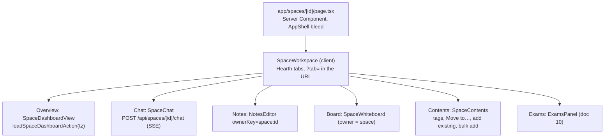
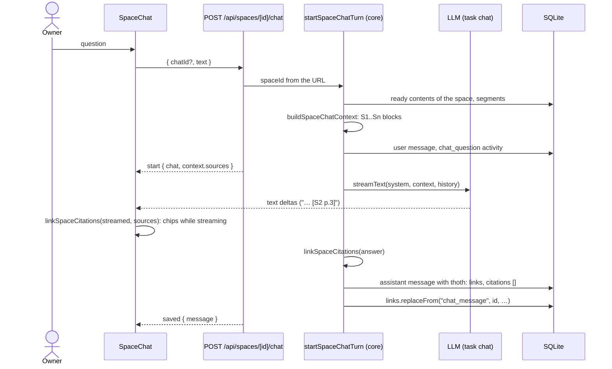

# 22. Spaces: chat, dashboard, notes, board, organising

Status: Current (Phase 10, Lane 4). Decisions: ADR-0039, ADR-0038, draft `docs/decision/NNNN-draft-p10-lane4.md`. Exams and progress inside a space: doc 10.

A space is a place to study, not just a folder. Its page is a workspace with six tabs: **Overview**, **Chat**, **Notes**, **Board**, **Contents** and **Exams**.

## The page

- **Tabs, not a dock** (draft ADR, point 4). `?tab=chat` opens a tab directly; History, search and the dashboard link to tabs this way. The palette has `Space: <tab>` commands, and arrow keys move between tabs.
- A panel mounts on first visit and stays mounted while hidden, so a streaming answer or an unsaved board edit survives a tab switch.
- Chat, Notes and Board fill the height and scroll inside themselves. Overview, Contents and Exams scroll as a page.
- The page refreshes every 2 s while a content in the space is still processing (`RefreshWhileBusy`).

| Piece                                                     | Path                                                                                        |
| --------------------------------------------------------- | ------------------------------------------------------------------------------------------- |
| Space use cases (create, overview, update, move, tags)    | `packages/core/src/usecases/spaces/{spaces,organise}.ts`                                    |
| Dashboard                                                 | `packages/core/src/usecases/spaces/dashboard.ts`                                            |
| Playlist import                                           | `packages/core/src/usecases/spaces/bulk-add.ts`, port `PlaylistLister` in `ports/ingest.ts` |
| Space chat (context, prompt, citations, turn)             | `packages/core/src/usecases/chat/space-chat*.ts`                                            |
| Space boards                                              | `createSpaceBoard`, `listSpaceBoards` in `packages/core/src/usecases/whiteboard/boards.ts`  |
| Playlist listing (ytInitialData, yt-dlp)                  | `packages/ingest/src/youtube-playlist.ts`                                                   |
| Workspace, header, dashboard, contents, icons, accents    | `apps/web/src/features/spaces/`                                                             |
| Space chat UI and its own link chip                       | `apps/web/src/features/chat/space-*`                                                        |
| Space chat route                                          | `apps/web/src/app/api/spaces/[id]/chat/route.ts`                                            |
| Tags UI (chips, filter, dialog), bulk add in the composer | `apps/web/src/features/library/{tags,add-content-composer}.tsx`                             |

## Space chat

- **Context** (`buildSpaceChatContext`). When all the space's ready contents together fit in 60k estimated tokens, they all go in whole ("Read N sources in full"). Otherwise the hybrid retrieval of doc 16 runs once over all of them with a deep pool, and keeps at most `perContentK` (8) passages per content and `totalK` (40) in all, so one long book cannot crowd out the rest. With no hits at all (keywords only, "summarise"), each content gets an even spread.
- **Sources.** Only contents that contributed passages are labelled, S1..Sn in content order. Each block is `<source id="S2" title="…" kind="pdf">` with the usual position tokens inside.
- **Citations.** The model cites `[S2 p.3]`, `[S1 03:21]`, `[S3 §2]`, a whole source as `[S2]`, or several as `[S1 p.2; S2 §4]`. Loose spellings (`[S2, p 7]`, `[S1 page 4]`) are understood. An unknown source (`[S9]`) is dropped, and a bracket that is not a citation (`[see below]`) is left alone.
- **Stored answers hold `thoth:` links** (ADR-0039): `[Genetics · p.2](thoth:c/<id>?at=p.2)`. `ChatMessage.citations` stays empty. Each answer's links are indexed as `chat_message` rows with `fromSpaceId`, so the cited content's backlinks include space chat answers.
- **Chips.** `SpaceRichText` renders the chat Markdown subset and turns each `thoth:` link into `SpaceLinkChip`, which looks and opens like the notes editor's `ThothLink` chip (doc 21): `openThothLink` resolves the target and opens the content at the cited page, time, paragraph, highlight or summary passage (`/content/<id>?at=par.2`). A gone target shows a struck-through chip.
- **Chats** belong to the space (`ChatRepository.createForSpace`, `listBySpace`). A new chat copies the latest chat's instructions, as content chat does. A chat id from another space is refused.

## Dashboard (Overview tab)

`getSpaceDashboard(deps, spaceId, { now, tzOffsetMin })` computes everything on read:

| Block                          | Source                                                                                                                     |
| ------------------------------ | -------------------------------------------------------------------------------------------------------------------------- |
| Continue where you left off    | The newest History event that lands in a content of this space; else the first ready content never studied ("Start here"). |
| Countdown                      | The nearest plan with `spaceId` = this space whose goal date has not passed (doc 17).                                      |
| Sources ready, accuracy, cards | `getProgress(deps, now, { spaceId })`: quizzes of the space's contents and the space's exams (doc 10).                     |
| Due for review                 | Flashcard sets of the space's contents with cards due now, most due first.                                                 |
| Today's plan                   | `getToday` filtered to plans that target this space.                                                                       |
| Weak topics                    | The five weakest topics of `getProgress` for the space.                                                                    |
| Recent activity                | `getHistory` filtered to events whose link lands in this space or one of its contents.                                     |

It loads through a Server Action, because "today" is the browser's day (ADR-0023).

## Notes and board

- **Notes** mount `NotesEditor` with `ownerKey="space:<id>"` and no Draft button. `saveNote` writes the backlink index (ADR-0038) and records `note_edit` with the space id as `ref`. History resolves such an event to the space's Notes tab. Cmd+K search finds space notes and opens `/spaces/<id>?tab=notes`.
- **Board.** The whiteboard tool takes an owner (`BoardOwner`): a content, or a space with its ready contents. A space board is stored with `space_id` and has no mind map (that needs one source). Ask Claude works without a source. "Link to source…" first asks which content, then which place; a citation badge opens that content at that place.

## Organising

- **Move a content** (`moveContent`): a content belongs to at most one space (ADR-0018). Three ways:
  - "Move to…" on each row of the Contents tab, with an Undo callout;
  - drag a row (Contents tab or home Recents) onto a space in the sidebar (`application/x-thoth-content` drag data, `SpaceNavItem` is the drop target);
  - on a content page, Cmd+K "Move to <space>" or "Remove from its space" (`MoveCommands`, mounted once in the sidebar).
- **Tags** (`createTag`, `updateTag`, `deleteTag`, `setContentTags`, `tagsByContent`):
  - a tag name is unique ignoring case; creating an existing name returns that tag;
  - the Tags dialog on a row ticks tags, creates one (name and colour), renames, recolours or deletes;
  - filter chips above the home Recents and the Contents tab keep the rows carrying every selected tag (`filterByTags`, AND).
- **Colour and icon.** "Customise" on the space header edits name, description, colour (`accentColors`) and icon (`spaceIcons`). The sidebar and header show the icon in the colour.
- **Accent swatches** come from `features/spaces/accents.css`: Hearth semantic tokens mixed with `color-mix`, never hex (draft ADR, point 2). Use `data-accent="<name>"` with `.accent-dot`, `.accent-tint`, `.accent-fg` or `.tag-chip`.

## Bulk add

The composer (`AddContentComposer`) is on the home page and, with `spaceId`, in the Contents tab, where everything it adds lands in that space.

- **PDFs.** "Choose PDFs" takes several files; "Choose folder" (`webkitdirectory`) and dropping a folder take every PDF inside, in path order. Each file is a normal `POST /api/upload` and a normal ingest, two at a time, with a progress list (Waiting, Uploading, Queued, or the error). Files that are not PDFs are skipped and counted.
- **YouTube playlists.** A link with `list=` is a playlist. A `/playlist` link always imports the list; a watch link with `list=` offers "Add every video in the playlist" (on by default). `addPlaylist` lists the videos through `PlaylistLister`, skips ones already in the library, queues one YouTube ingest per video (at most 200) and reports what it did.
- **Listing a playlist** (`YoutubePlaylistLister`): read `ytInitialData` from the playlist page; when the page fails, or says there are more videos (a continuation, past about 100), ask `yt-dlp --flat-playlist -J` if it is installed. Never downloads media.

## Tests

- Core: `usecases/spaces/{organise,dashboard,bulk-add,space-board}.test.ts`, `usecases/chat/space-chat.test.ts`.
- Ingest: `packages/ingest/src/youtube-playlist.test.ts` with page and yt-dlp fixtures in `__fixtures__/`.
- Scripted model: the space chat case cites the first passage of the first two sources (`packages/llm/src/scripted-provider.ts`, doc 15).
- Browser: `apps/web/e2e/spaces.e2e.ts` covers a cross-content chip that opens the right content, due cards on the dashboard, moving (menu, Undo, drag onto the sidebar), the tag filter and bulk adding two PDFs.

## Known limits and follow-ups

- A whiteboard edit's History event still holds the board id (`whiteboard_edit`, ADR-0031), so it does not appear in a space's recent activity.
- The dashboard's "Review" opens the global review queue; there is no per-space review session yet.
- A text dropped onto a space board with a citation token in it becomes a plain sticky: the board has no single content to link. Use "Link to source…" instead.
- New `chat_question` events hold the message id, which History cannot resolve, so space chat questions do not appear in a space's recent activity yet.
- The accent swatches for pink and orange are close in light theme; a Hearth category palette would separate them.
