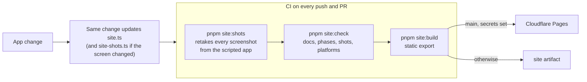

# 23. Website (landing page)

Status: Current (Phase 12). Decisions: ADR-0044, ADR-0045, ADR-0046.

The public page that introduces Thoth and offers the downloads. It is a static site in `apps/site`, built from one content file and real screenshots of the current app, and a CI gate fails when it falls behind the app.

## Where things are

| Piece                                                      | File                                                                |
| ---------------------------------------------------------- | ------------------------------------------------------------------- |
| Everything the page says: features, downloads, models, FAQ | `apps/site/content/site.ts`                                         |
| The page (sections in order)                               | `apps/site/src/app/page.tsx`                                        |
| Download button that picks the visitor's OS                | `apps/site/src/components/download.tsx`                             |
| Theme-aware screenshot, gallery                            | `apps/site/src/components/{shot,gallery}.tsx`                       |
| Version and "What's new", read at build time               | `apps/site/src/lib/build-data.ts`, `parse.ts`                       |
| Freshness gate (pure) and its CLI                          | `apps/site/src/lib/freshness.ts`, `apps/site/scripts/check.ts`      |
| Screenshot scenes                                          | `apps/web/e2e/site-shots.ts`, `apps/web/playwright.shots.config.ts` |
| Build, shots, gate, deploy                                 | `.github/workflows/site.yml`                                        |

## Pages

| Route        | What it is                                                                                           | Built from                                        |
| ------------ | ---------------------------------------------------------------------------------------------------- | ------------------------------------------------- |
| `/`          | The playful landing: hero demo, drop anything, the walkthrough story, try-it widgets, call to action | `content/landing.ts`, `src/components/landing/**` |
| `/features`  | The documented tour with real screenshots, gallery, models, privacy, keyboard, FAQ                   | `content/site.ts`, `src/components/sections.tsx`  |
| `/changelog` | What's new, from the roadmap                                                                         | `docs/plan/roadmap.md`                            |
| `/download`  | The installer for your system, every installer, FAQ                                                  | `content/site.ts`                                 |

## The landing page

- **Motion** (ADR-0046): `motion` with the springs in `src/motion/tokens.ts` (snappy, smooth, gentle, bouncy). Presses shrink, pills and tabs slide (`layoutId`), and the story follows the scroll. Under `prefers-reduced-motion` nothing moves, and every demo still works.
- **Colour and type** ("Hearth, turned up"): `src/app/landing.css` adds tinted card grounds (`tone-peach`, `tone-sage`, `tone-sky`, `tone-butter`, `tone-lilac`), glows, `type-hero`, `type-hero-sm` and `aspect-shot`, all from Hearth tokens.
- **Hero demo** (`hero-demo.tsx`): a recreation of the content workspace with the app's Hearth classes and icons (`app-icons.tsx` copies the app's icons). It has two examples:
  - **Lecture video**: Kleppmann's _Distributed Systems 6.1: Consensus_, embedded from `youtube-nocookie.com` only after a click (Play or a citation). Citations seek the real player through the IFrame API messages, and its playhead drives the chapter highlight. The chapter times come from the lecture's transcript; keep them in step if the example changes.
  - **Book chapter (PDF)**: a short chapter we wrote, not book text. `scripts/make-example-pdf.ts` turns the same text into `public/examples/consistency-and-consensus.pdf` before every build.
  - **Layouts**, as in the app: Study (chat), Watch + notes (the source with its transcript, Notes beside it at full height) and Quiz (Notes above a quiz). A picker over the window and the Layout menu both switch them. In Watch + notes and Quiz, each chapter has **+ Notes**.
  - "Add panel" opens Notes, Summary, Quiz or Flashcards beside the chat. Drag a group's tabs, or use Layout → Swap sides, to move it.
  - The window keeps one size (from `md` up), and its panels scroll inside it, so nothing on the page jumps. The sidebar matches the app (ADR-0047): glass, tinted icon tiles.
- **App tools** (`app-tools.tsx`): small, working copies of Notes, Quiz, Flashcards, the mind map and an exam result, drawn like the app's panels. The hero demo and "Drop anything" share them; their example content is `landing.tools`.
- **Drop anything** (`drop-anything.tsx`): pick PDF, YouTube or a web page, and the example is already there. The output tabs open the app tools; a citation lights up the spot in the source card. The panel keeps one height across tabs.
- **Headline**: the rotating word sits in a slot sized to the longest word, so the line never reflows.
- **Walkthrough story** (`scroll-story.tsx`): scrolling moves between five beats. Each beat plays steps over real screenshots: the cursor goes to a recorded hotspot, clicks, and shows a tip. The beats and steps are in `landing.story`.
- **Try-it widgets** (`bento.tsx`): flashcard, quiz, notes, whiteboard (mind map, stickies, drag), model switch and privacy counters.

## How the page stays current

- **Screenshots.** `site-shots.ts` drives the app against the scripted LLM (doc 15) at 1440×900. Each `shot(page, "<id>")` writes `apps/site/public/shots/<id>-light.png` and `<id>-dark.png`, and the page shows the one that matches the visitor's theme. CI retakes them on every run, so the deployed page always shows the current UI. The committed copies exist for local previews and the README.
- **Facts are read, not typed:**
  - the version, from `apps/desktop/src-tauri/tauri.conf.json`;
  - "What's new", from the `### Phase N: Title — DONE yyyy-mm-dd` headings in `docs/plan/roadmap.md`. A phase written as a plan (it has a "Done when" line) shows its title only; a phase written as a summary also shows its bullets.
- **`pnpm site:check` fails when:**
  - a `docs/technical_design/NN-*.md` doc is neither in some feature's `docs` nor in `notUserFacing`;
  - a DONE roadmap phase cannot be read for "What's new";
  - a feature uses a screenshot that `site-shots.ts` does not take, or whose files are missing;
  - the download targets and the `desktop.yml` build matrix disagree.

  It runs in the `check` job of CI and in the site workflow. Its logic is unit-tested in `freshness.test.ts`, including the case of a new doc 24 with no site entry.

## Hotspots

Before it takes a screenshot, `site-shots.ts` calls `hot("<shot>", "<name>", locator)`. That records the element's box, in 0..1 of the 1440×900 frame, into `apps/site/content/hotspots.json`. A walkthrough step `{ shot, at: name }` puts the cursor there. CI retakes shots and hotspots together, so the cursor always lands on the real button. `site:check` fails if a step names a shot the script does not take, or a hotspot it does not record.

## Adding or changing a feature

1. Add or edit its entry in `site.ts`: kicker, title, body, up to four points, a screenshot id, and the design docs it presents.
2. If it needs a new screenshot, add the id to `shotIds` and a scene in `site-shots.ts` that ends with `await shot(page, "<id>")`.
3. Run `pnpm site:shots`, `pnpm site:check` and `pnpm site:dev` (http://127.0.0.1:3300), and look at it in light and dark themes and at phone width.

## Deploy

- `site.yml` deploys `apps/site/out` with `wrangler pages deploy` to the Pages project `thoth` on pushes to `main`.
- It runs only when the repo has the `CLOUDFLARE_API_TOKEN` and `CLOUDFLARE_ACCOUNT_ID` secrets. Without them, the step prints a notice and the built site is uploaded as the `site` artifact.
- The live address is **https://thoth-5j7.pages.dev** (Cloudflare added the suffix because `thoth` was taken). The repo variable `SITE_URL` holds it and sets the canonical and social-preview URLs; change it there, and in `layout.tsx`'s default, if the project gets a custom domain.

## Downloads

Download links point to `https://github.com/<owner>/thoth/releases/latest/download/<asset>`. The `release` job in `desktop.yml` publishes the installers under the stable names in `site.ts` when a `v*` tag is pushed (ADR-0045). Until the first release exists, the links return 404.

The header's GitHub link shows the live star count (`github-stars.tsx`): one call to GitHub's public API per session, kept in `sessionStorage`; the plain link shows until it answers or if it fails.

On a Mac, the download section also shows the Homebrew command (`BREW_INSTALL` in `site.ts`, ADR-0049), copied in one click.

## Rules

- **Hearth only**, as in the app: tokens and `@thoth/ui` classes, no hex, no arbitrary sizes.
- **No trackers.** No analytics, cookies or third-party requests. Fonts are self-hosted by `next/font`.
- **Plain, accurate copy.** Every claim must be true of the current app. Fix the copy in the same change that changes the behaviour.
