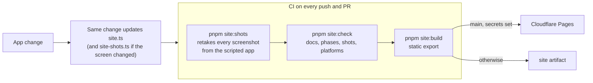

# 23. Website (landing page)

Status: Current (Phase 11). Decisions: ADR-0044, ADR-0045.

The public page that introduces Thoth and offers the downloads. It is a static site in `apps/site`, built from one content file and real screenshots of the current app, and a CI gate fails when it falls behind the app.

## Where things are

| Piece                                                      | File                                                                |
| ---------------------------------------------------------- | ------------------------------------------------------------------- |
| Everything the page says: features, downloads, models, FAQ | `apps/site/content/site.ts`                                         |
| The page (sections in order)                               | `apps/site/src/app/page.tsx`                                        |
| Download button that picks the visitor's OS                | `apps/site/src/components/download.tsx`                             |
| Theme-aware screenshot, gallery                            | `apps/site/src/components/{shot,gallery}.tsx`                       |
| Version and "What's new", read at build time               | `apps/site/src/lib/build-data.ts`, `parse.ts`                       |
| Freshness gate (pure) and its CLI                          | `apps/site/src/lib/freshness.ts`, `apps/site/scripts/check.ts`      |
| Screenshot scenes                                          | `apps/web/e2e/site-shots.ts`, `apps/web/playwright.shots.config.ts` |
| Build, shots, gate, deploy                                 | `.github/workflows/site.yml`                                        |

## How the page stays current

- **Screenshots.** `site-shots.ts` drives the app against the scripted LLM (doc 15) at 1440×900. Each `shot(page, "<id>")` writes `apps/site/public/shots/<id>-light.png` and `<id>-dark.png`, and the page shows the one that matches the visitor's theme. CI retakes them on every run, so the deployed page always shows the current UI. The committed copies exist for local previews and the README.
- **Facts are read, not typed:**
  - the version, from `apps/desktop/src-tauri/tauri.conf.json`;
  - "What's new", from the `### Phase N: Title — DONE yyyy-mm-dd` headings in `docs/plan/roadmap.md`. A phase written as a plan (it has a "Done when" line) shows its title only; a phase written as a summary also shows its bullets.
- **`pnpm site:check` fails when:**
  - a `docs/technical_design/NN-*.md` doc is neither in some feature's `docs` nor in `notUserFacing`;
  - a DONE roadmap phase cannot be read for "What's new";
  - a feature uses a screenshot that `site-shots.ts` does not take, or whose files are missing;
  - the download targets and the `desktop.yml` build matrix disagree.

  It runs in the `check` job of CI and in the site workflow. Its logic is unit-tested in `freshness.test.ts`, including the case of a new doc 24 with no site entry.

## Adding or changing a feature

1. Add or edit its entry in `site.ts`: kicker, title, body, up to four points, a screenshot id, and the design docs it presents.
2. If it needs a new screenshot, add the id to `shotIds` and a scene in `site-shots.ts` that ends with `await shot(page, "<id>")`.
3. Run `pnpm site:shots`, `pnpm site:check` and `pnpm site:dev` (http://127.0.0.1:3300), and look at it in light and dark themes and at phone width.

## Deploy

- `site.yml` deploys `apps/site/out` with `wrangler pages deploy` to the Pages project `thoth` on pushes to `main`.
- It runs only when the repo has the `CLOUDFLARE_API_TOKEN` and `CLOUDFLARE_ACCOUNT_ID` secrets. Without them, the step prints a notice and the built site is uploaded as the `site` artifact.
- Set the repo variable `SITE_URL` if the address is not `https://thoth.pages.dev` (another project name, or a custom domain). It sets the canonical and social-preview URLs.

## Downloads

Download links point to `https://github.com/<owner>/thoth/releases/latest/download/<asset>`. The `release` job in `desktop.yml` publishes the installers under the stable names in `site.ts` when a `v*` tag is pushed (ADR-0045). Until the first release exists, the links return 404.

## Rules

- **Hearth only**, as in the app: tokens and `@thoth/ui` classes, no hex, no arbitrary sizes.
- **No trackers.** No analytics, cookies or third-party requests. Fonts are self-hosted by `next/font`.
- **Plain, accurate copy.** Every claim must be true of the current app. Fix the copy in the same change that changes the behaviour.
